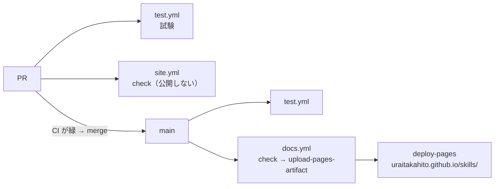

## 試験

```sh
pnpm install --frozen-lockfile
pnpm run typecheck   # 型の検査（tsc）
pnpm run lint        # ESLint
pnpm run build       # test/cli.test.ts は build 済みの dist/ を動かすので、試験の前に打つ
pnpm test            # Vitest
```

`pnpm test` は build をしない。`dist/` が無いと `test/cli.test.ts` が「先に pnpm run build を打ってください」で落ちる。GitHub Actions でも同じ順に流す（`.github/workflows/test.yml`）。

## 判定の道具

Dependabot の PR の判定の道具は `src/release-age.ts`（`node src/release-age.ts <owner>/<repo> <PR> [--hours <時間>] [--now <ISO 時刻>]`）。version は PR の差分（pnpm-lock・package-lock・yarn.lock・workflow の `uses:`）から読み、依存の依存も数える。終了コードは 0 対象・10 まだ・20 判定できない・1 道具の誤り。

## この docs

原稿は `docs-site/src/content/docs/` の Markdown（Astro + Starlight）。`docs-site/` は root と別の pnpm の project で、依存と lockfile を自分で持つ。

```sh
pnpm --dir docs-site install --frozen-lockfile
pnpm --dir docs-site run dev     # 手元で見る（http://localhost:4321/skills/）
pnpm --dir docs-site run check   # build と、原稿と repo の食い違いの検査
```

`astro build` は `.md` のページの中で何が落ちても exit 0 で終わるので、`check` は build の後に `docs-site/scripts/check-refs.mjs` を流す。見る物は、ページへのリンク・本文が名指した repo の path・README の URL・skill が名指す原稿の見出し・`config.json` の欄の揃い・skill の中の相対パス（`${CLAUDE_SKILL_DIR}/…` の先）・画面の絵（`docs-site/src/assets/screens/`）と本文の参照の揃い。Mermaid の図は書き間違えても検査を通るので、図を変えたら手元で見る。

skill は Pages ではなく原稿の Markdown を読む（`/dependabot-triage` と `/sustaining-engineer` が [設定](/configuration/) を読む）。原稿の見出しや表を変えたら、`check` が skill の読む先を確かめる。

### 公開の流れ

main への push のたびに https://uraitakahito.github.io/skills/ に出す（この repo にタグは無い）。


