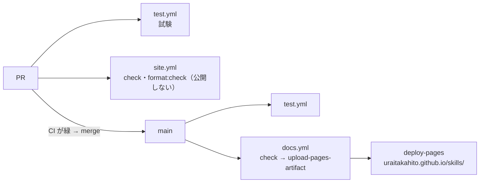

## 試験

TypeScript の道具（`tpm` と判定の道具）は `cli/` の pnpm の project にある。試験は `cli/` で打つ。Node と pnpm は [はじめる](/getting-started/#node-と-pnpm-を入れる) のとおりに入れる（version は `.node-version`）。

```sh
cd cli
pnpm install --frozen-lockfile
pnpm run typecheck   # 型の検査（tsc）
pnpm run lint        # ESLint（TSDoc の書き方も見る）
pnpm run doccheck    # コメントの抜け（TypeDoc。ページは作らない）
pnpm test            # Vitest
```

build は無い。`cli/bin/tpm` は `cli/src/cli.ts` を node で直に動かす（Node が型を消して動かす）ので、main を pull すれば次から新しいコードで動く。そのため `cli/src/` には消せる型だけを書き、import の先は `.ts` と書く（`cli/tsconfig.json` の `erasableSyntaxOnly`・`allowImportingTsExtensions`）。GitHub Actions でも上と同じ順に流す（`.github/workflows/test.yml`）。

`cli/src/` のコメントの決まり:

- export した関数・型・class・定数と method には、`/** */` で一言を書く（何か・何を返すか）。`pnpm run doccheck` が抜けを止める（設定は `cli/typedoc.json`）。interface の欄には、名前で分からない物にだけ書く。
- `@param`・`@returns` は書かない。引数は、要る時だけ文の中で名前を出して書く。
- `/** */` の中の `<…>` と `@` は `` `…` `` で囲む（TSDoc が HTML や tag と読む。`pnpm run lint` の `tsdoc/syntax` が止める）。
- file の頭の説明は `//` で書く。

## tpm のコード

`cli/src/` は層ごとにファイルを分けてある（層の説明は [担当のあいだの決まり](/protocol/#層)）。

| ファイル | 中身 |
|---|---|
| `cli/src/program.ts` | 命令の木（`tpm --help`）。`cli/src/cli.ts` が動かす |
| `cli/src/protocol.ts` | 担当の種類・見出しの表・状態の字の形・命令の一覧 |
| `cli/src/commands/` | 決まりの命令（`tpm-side.ts`・`role-side.ts`・`messages.ts`・`infra.ts`） |
| `cli/src/roster.ts`・`cli/src/state.ts` | 名簿と、状態の folder |
| `cli/src/transport/` | 連携の口（`types.ts`）と adapter（`cmux.ts`・`file.ts`） |
| `cli/src/tracker/` | 課題管理の口（`types.ts`）と adapter（`jira.ts`・`github.ts`・`none.ts`） |
| `cli/src/guard.ts` | 門 |
| `cli/src/run-role.ts` | 連携の道具が担当の居場所で動かす `tpm run-role`（名簿を読んで claude を起こす） |

- **見出しを足す・変える**: `cli/src/protocol.ts` の `HEADINGS` と、`skill-sets/core/.claude/skills/_shared/protocol.md` の表を合わせる（`check` が揃いを見る）。
- **命令を足す**: `cli/src/program.ts`（か `cli/src/commands/register.ts`）に足し、`cli/src/protocol.ts` の `COMMANDS` にも書く（試験が命令の木との揃いを、`check` が skill と docs の `tpm <命令>` が在るかを見る）。
- **道具を足す**: `transport/` か `tracker/` に口を満たす adapter を書き、`cli/src/config.ts` の選択肢と `cli/src/context.ts` に足す。上の層は変えない。
- **試し方**: 決まりの命令は、連携を `file`（知らせ・居場所・状態をファイルに書くだけ）にした project で cmux 無しに試せる（`cli/test/helpers.ts`）。実機で担当を起こして試すときは、`TPM_STATE` を一時の folder に向けて本物の名簿を汚さない。
- **道具を直に打つ**: `tpm` が起こした session では、門が `cmux` や `acli` の直打ちを止める。adapter の開発で直に打つときは、命令の頭に `TPM_RAW=1` を付ける。

## 判定の道具

Dependabot の PR の判定の道具は `cli/src/release-age.ts`（`node cli/src/release-age.ts <owner>/<repo> <PR> [--hours <時間>] [--now <ISO 時刻>]`）。version は PR の差分（pnpm-lock・package-lock・yarn.lock・workflow の `uses:`）から読み、依存の依存も数える。終了コードは 0 対象・10 まだ・20 判定できない・1 道具の誤り。skill は Dependabot の PR を見る repo の folder でこれを打つが、nodenv の `node` の shim は渡された script の folder から `.node-version` を探すので、この repo の version で動く。`cli/bin/tpm` も同じ訳で、`~/.local/bin/tpm` のような repo の外の symlink から呼ばれても、本当の在り処の path を `node` に渡す sh にしてある。

## この docs

原稿は `docs-site/src/content/docs/` の Markdown（Astro + Starlight）。`docs-site/` は `cli/` と別の pnpm の project で、依存と lockfile を自分で持つ。

```sh
pnpm --dir docs-site install --frozen-lockfile
pnpm --dir docs-site run dev            # 手元で見る（http://localhost:4321/skills/）
pnpm --dir docs-site run check          # build と、原稿と repo の食い違いの検査
pnpm --dir docs-site run format         # code（astro.config.ts・src/ の .ts・scripts/）を Prettier で整える
pnpm --dir docs-site run format:check   # 整っているかと、md の中の JSON の塊を見る（site.yml が流す）
```

Prettier は既定の設定のまま使い、設定のファイルは置かない。原稿の `.md` は Prettier に掛けない（表や日本語の折り返しを崩させないため）。その代わり、`format:check` は `docs-site/scripts/check-md-json.mjs` で repo の `.md`（skill・原稿・README など、git が追跡する物と add 前の新しい物）の中の ` ```json `・` ```jsonc ` の塊だけを取り出し、読めることと、Prettier（`--parser json`・`--parser jsonc`）で整えた形と同じことを見る。` ```jsonc ` の塊は、`tpm` が `config.jsonc` を読むのと同じ `cli/src/jsonc.ts` で読む。`<id>` などの置き字は、文字列の中に書けば読める。落ちたら、塊を `prettier --parser json`（`jsonc`）に通した形に書き換える。`cli/` の整形は Prettier でなく ESLint（`@stylistic`）が見る。

`astro build` は `.md` のページの中で何が落ちても exit 0 で終わるので、`check` は build の後に `docs-site/scripts/check-refs.mjs` を流す。見る物は、ページへのリンク・本文が名指した repo の path（git が追跡する物と、add 前の新しい物だけを数える。build の書き出しなど `.gitignore` にある物は、手元に在っても無いとみなす）・README の URL・skill が名指す原稿の見出し・`config.jsonc` の欄の揃い・skill の中の相対パス（`${CLAUDE_SKILL_DIR}/…` の先）・skill が名指す `_shared/` の決まりの見出し・画面の絵（`docs-site/src/assets/screens/`）と本文の参照の揃い・skill に連携と課題管理の道具の命令が直に書かれていないこと・skill と原稿が書いた `tpm` の命令が在ること・`protocol.md` の見出しと `cli/src/protocol.ts` の見出しの表の揃い。Mermaid の図は書き間違えても検査を通るので、図を変えたら手元で見る。

skill は Pages ではなく原稿の Markdown を読む（`/dependabot-triage` と `/sustaining-engineer` が [設定](/configuration/) を読む）。原稿の見出しや表を変えたら、`check` が skill の読む先を確かめる。

### 公開の流れ

main への push のたびに https://uraitakahito.github.io/skills/ に出す（この repo にタグは無い）。


