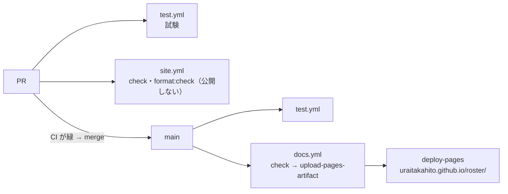

## 試験

TypeScript の道具（`roster` と判定の道具）は `cli/` の pnpm の project にある。試験は `cli/` で打つ。Node と pnpm は [はじめる](/getting-started/#node-と-pnpm-を入れる) のとおりに入れる（version は `.node-version`）。

```sh
cd cli
pnpm install --frozen-lockfile
pnpm run typecheck   # 型の検査（tsc）
pnpm run lint        # ESLint（TSDoc の書き方も見る）
pnpm run doccheck    # コメントの抜け（TypeDoc。ページは作らない）
pnpm test            # Vitest
```

build は無い。`cli/bin/roster` は `cli/src/cli.ts` を node で直に動かす（Node が型を消して動かす）ので、main を pull すれば次から新しいコードで動く。そのため `cli/src/` には消せる型だけを書き、import の先は `.ts` と書く（`cli/tsconfig.json` の `erasableSyntaxOnly`・`allowImportingTsExtensions`）。GitHub Actions でも上と同じ順に流す（`.github/workflows/test.yml`）。

`cli/src/` のコメントの決まり:

- export した関数・型・class・定数と method には、`/** */` で一言を書く（何か・何を返すか）。`pnpm run doccheck` が抜けを止める（設定は `cli/typedoc.json`）。interface の欄には、名前で分からない物にだけ書く。
- `@param`・`@returns` は書かない。引数は、要る時だけ文の中で名前を出して書く。
- `/** */` の中の `<…>` と `@` は `` `…` `` で囲む（TSDoc が HTML や tag と読む。`pnpm run lint` の `tsdoc/syntax` が止める）。
- file の頭の説明は `//` で書く。

## roster のコード

`cli/src/` は層ごとにファイルを分けてある（層の説明は [担当のあいだの決まり](/protocol/#層)）。

| ファイル | 中身 |
|---|---|
| `cli/src/program.ts` | 命令の木（`roster --help`）。`cli/src/cli.ts` が動かす |
| `cli/src/protocol.ts` | 担当の種類・見出しの表・状態の字の形・命令の一覧 |
| `cli/src/commands/` | 決まりの命令（`tpm-side.ts`・`role-side.ts`・`messages.ts`・`launch.ts`・`staff.ts`・`infra.ts`・`page.ts`・`issue.ts`・`review.ts`） |
| `cli/src/roster.ts`・`cli/src/state.ts`・`cli/src/reviews.ts` | 名簿と、状態の folder と、レビューの頼みの記録 |
| `cli/src/transport/` | 連携の口（`types.ts`。居場所の口 `SeatPort` だけ。メッセージは運ばない）と adapter（`cmux.ts`・`file.ts`） |
| `cli/src/mailroom/` | 配りの口（`types.ts`。預ける・数える・取り置く・渡せたと返す、など）と adapter（`nats.ts`。試験用は `memory.ts`）。担当どうしのメッセージは、いつもここを通る |
| `cli/src/mail.ts`・`cli/src/commands/mail.ts` | メッセージを NATS で配る道の、手元の物（受け手の名・名乗り・印・渡した記録）と、hook の命令（`roster mail …`）・TPM 担当の側の片付け |
| `cli/src/tracker/` | 課題管理の口（`types.ts`）と adapter（`jira.ts`・`github.ts`）、課題の Key の形で adapter を選ぶ `routed.ts` |
| `cli/src/guard.ts` | guard |
| `cli/src/run-role.ts` | 連携の道具が担当の居場所で動かす `roster run-role`（名簿を読んで claude を起こす） |

- **担当の種類を足す**: `cli/src/protocol.ts` の `ROLES` に足し、名の略（`cli/src/castlist.ts`）を書く。skill は `skill-sets/<名前>/.claude/skills/<役割>/SKILL.md`。合わせる物は、次の 3 つに分かれる。
  - **足さないと落ちる物**: 名の略（書き忘れは型の検査で落ちる）。居場所の色の試験（`cli/test/roster.test.ts` の「居場所の色」。色を並べた表に足す。色は、ほかの役割とも、選んだ居場所の地の青とも紛れない物）。docs に、役割の名と TPM 担当の役割の名（小文字）を並べた文を書くなら、古い名の検査の役割の一覧（`docs-site/scripts/check-old-name.mjs` の `PEERS`。並べた値の中の TPM 担当の名を、道具の古い名でなく内の名と見分けるのに使う）。
  - **要る時だけ足す物**: 設定で既定を替えられるようにするなら `cli/src/config.ts`、読むだけの担当なら `cli/src/guard.ts` の読むだけの担当の表。skill が在るかを見てから起こす役割（今は Staff Engineer 担当だけ。`cli/src/commands/staff.ts` の `staffSubject`）なら、試験が作る偽の skill の folder（`cli/test/helpers.ts` の `staffRoot`）。
  - **足すとよい物（足さなくても落ちない）**: 役割の名を並べた試験の表（`cli/test/castlist.test.ts` の名の接頭辞・`cli/test/config.test.ts` の担当ごとの既定）。docs の役割の表（[決まりの実装](/protocol/#居場所の色) の色・[設定](/configuration/) の担当の欄・[skill](/skill/) の一覧）。担当が読む skill の文で、役割を並べた所（`skill-sets/core/.claude/skills/tpm/SKILL.md` の担当の既定の表と設定の欄の並び・`_shared/protocol.md` の頭の役割の並び。docs と食い違わないように）。
- **見出しを足す・変える**: `cli/src/protocol.ts` の `HEADINGS` と、`skill-sets/core/.claude/skills/_shared/protocol.md` の表を合わせる（`check` が揃いを見る）。
- **命令を足す**: `cli/src/program.ts`（か `cli/src/commands/register.ts`）に足し、`cli/src/protocol.ts` の `COMMANDS` にも書く（試験が命令の木との揃いを、`check` が skill と docs の `roster <命令>` が在るかを見る）。
- **道具を足す**: `transport/` か `tracker/` に口を満たす adapter を書き、`cli/src/config.ts` の選択肢と `cli/src/context.ts`（課題管理は `cli/src/tracker/routed.ts`）に足す。上の層は変えない。連携の口は居場所の口だけで、命令は `ctx.seats`（居場所を作る・題と状態・閉じる）を呼ぶ。メッセージは、配りの口（`ctx.mailroom()`。下の「[NATS JetStream（メッセージキュー）とのつなぎ](#nats-jetstreamメッセージキューとのつなぎ)」）が運ぶ。
- **試し方**: 決まりの命令は、連携を `file`（居場所・状態をファイルに書くだけ）にし、配りの口を試験用の口（memory）に替えた project で、cmux も NATS も無しに試せる（`cli/test/helpers.ts`）。実機で担当を起こして試すときは、`ROSTER_STATE` を先に作った一時の folder（`mktemp -d` など）に向けて本物の名簿を汚さない（`ROSTER_STATE` の folder が無いと、`roster` は空の状態を作らずに止まる）。担当の居場所の中で試験を流しても、試験は roster の環境変数（`ROSTER_*`）を抜いてから `roster` を起こす（`cli/src/env.ts` の `withoutRosterEnv`）。
- **道具を直に打つ**: `roster` が起こした session では、guard が `cmux` のメッセージ・状態・居場所の命令と、`acli`・`gh issue` の記録と状態の命令の直打ちを止める（課題を読む命令は止めない。見るのは単純な命令の頭だけなので、commit の文や here-document に道具の名を書いても止まらない）。担当が置き場に消す要求（`curl -X DELETE …/api/pages…`・`…/api/files…`）を直に送るのも、置き場の CLI の消す命令（`pagetray page delete`・`pagetray file delete`・`pagetray api -X DELETE`）を打つのも止める（消してよいのは TPM 担当だけ。担当には環境変数 `PAGETRAY_NO_DELETE=1` も渡すので、guard をすり抜けても CLI が消さない）。adapter の開発で直に打つときは、命令の頭に `ROSTER_RAW=1` を付ける。

## pagetray（ページの置き場のサーバー）とのつなぎ

担当が置くページを DB に持つサーバー（Rust）は、別の repo [pagetray](https://github.com/uraitakahito/pagetray) にある（もとは、この repo の folder だった物を履歴ごと分けた）。作り・API の一覧・Rust の開発の手引きは、[pagetray の docs](https://uraitakahito.github.io/pagetray/)（[開発](https://uraitakahito.github.io/pagetray/development.html) の章）。この repo が持つのは、その API を定義から生成した client（下の「[生成した client](#生成した-clientcastlistpagetray-の定義から)」）で呼ぶ側（`roster page put`・`path`・`list`・`import`・`delete` は `cli/src/commands/page.ts`、`roster file put`・`path`・`list`・`delete` は `cli/src/commands/file.ts`、置き場に頼む足場と控えの folder は `cli/src/commands/store.ts`、送った記録の写しは `cli/src/commands/message-record.ts`）と、つなぎの試験。ページの本文と file の中身は URL の手の道なので、`store.ts` が curl で取る。

- **合わせる版**: `.pagetray-version` に、合わせる pagetray の版を `v<版>@<image の digest>` の形で書く（digest は pagetray の release にある。今は `v1.1.1`）。[運用](/operations/#ページの置き場pagetray)で起こす image も、この版。つなぎの試験（下の「[つなぎの試験](#つなぎの試験)」）が、この版の image に向けて流す。
- **送った記録の写し**: メッセージを送るたびに（`cli/src/commands/messages.ts` の `deliver`）、送った記録（`log.jsonl` の 1 行）を、置き場に `PutMessage`（`PUT /api/projects/<状態の folder の名>/messages/<メッセージの id>`。pagetray 1.1.0 から）で 1 件置く。Product Manager は、置き場の一覧の画面 `http://127.0.0.1:8801/messages` で、誰が誰に何を送ったかを見る。
  - 状態は、送った時は `waiting`（届くのを待っている）。受け手の hook が渡した時・届かないまま終わった時に、受け手の側と TPM 担当の側が書き足す（`delivered`・`undeliverable`・`expired`）。`carried`（ほかの道具で運んだ）は、前の版で cmux が運んだ行（`carrier` の無い行）の状態で、届いたかは置き場に書いていない。
  - 置き場の記録の `from`・`to` は、担当の Key（人が読む名。TPM 担当は `tpm`）。置き場は初めの値から替えないので、頼みのたびに替わる居場所の題では書かない。配りの受け手の名（Key と起こした回の組。`cli/src/mail.ts` の `recipientName`）とは別。送り手の組の無い前の版の行だけ居場所の題に、届く担当の分からない行は宛先の字に落とす。200 字を超える名は頭の 200 字に切り、空になる時は写さない。
  - **写せなくても、送りは止めない**。置き場が応えない・古い版（操作を持たない 404）・形の誤り（400）のどれでも、誤りを投げず、画面にも出さず、状態の folder の `message-records.jsonl` に 1 行（時刻・id・訳）だけ残す。写せた時は残さない。メッセージの id の形が置き場の決まり（英数字と `.`・`_`・`-` で 128 字まで）に合わない時は、字を替えずに、写さない（これも 1 行残す）。置き場が 2xx を返したのに答えを読めない時は、応えない時と分けて「答えを読めない（置けたかは分からない）」と残す。
  - 送り手の付随する id を付けた要求を、置き場が castlist に聞けない（503）・castlist に登録が無いと断った（400 の `/actorRef`）時は、付随する id を外して 1 度だけ置き直す（送り手が空の記録になる）。置けたら、`message-records.jsonl` の行に `"placed": "without-sender"` を付けて残す（この欄の無い行は、写せなかった回）。
  - `deliver` は、写しを待たずに始め（送りを止めない・遅らせないため）、命令の終わり（`cli/src/program.ts` の `runProgram`。どの誤りで終わる時も）で済むのを待つ。この要求だけは 1 回 2 秒で切る（ほかの置き場の要求は 10 秒）。置き場が答えない時は、送る命令の終わりが 2 秒、置き直しが入ると長くて 4 秒遅れる（「送った: …」の行は先に出る）。試験は、試験ごとに `messageRecordsSettled()` で待つ（`cli/test/setup.ts`）。
- **偽の置き場**: `cli/` のほかの試験は、偽の置き場（`cli/test/helpers.ts` の `FakeStore`）で流す。生成した client に差し込む、新しい API の偽物（状態と決まりは本物と同じ。curl の側は本文の GET だけに答える）。API の形（道・引数の名・JSON の欄）が変わったら、`FakeStore` と `store.ts` の `pagesRequest`・`page.ts`・`file.ts`・`reply.ts`（返事の状態）・`review-marks.ts`（レビューの印）・`message-record.ts`（送った記録の写し）を合わせて直す。`FakeStore` は、送った記録を置く要求を `requests` でなく `messagePuts` に入れる（送る命令のたびに出るので、ページと file の要求の並びを見る試験に混ぜない）。受ける file の種類（`file.ts` の `FILE_TYPES`）は、pagetray の定義（`cli/gen/model/pagetray/pagetray.smithy` の `CreateFile`）の一覧と揃える。
- **pagetray を上げる時**: pagetray で release を出す → この repo で `.pagetray-version` を新しい版と digest にする PR を出す（つなぎの試験が通る）。定義が替わった版なら、同じ PR で `cli/gen/gen.sh` の `DEFS` の pagetray の行（tag と SHA-256）を替えて client を作り直し、`FakeStore` と呼ぶ側を合わせる → [運用](/operations/#版を上げる)の「版を上げる」で container を作り直し、読むだけの試験で一覧の UI を見る。API を変える変更は、古い cli でも新しい cli でも通る順に分ける。
- **種類と役割の名**: 一覧は `cli/src/` だけが持つ。サーバーは字の形（英小文字で始まり、英小文字・数字・`-` で 32 字まで）だけを見るので、`cli` に種類や役割を足してもサーバーは変えない。
- **だれが消してよいか**: サーバーは人を見分けない。「消してよいのは TPM 担当だけ」という決まりは、`roster page delete`・`roster file delete` と guard（`cli/src/guard.ts`）が持つ。置き場の CLI（`pagetray`）の消す命令（ページも file も）も、guard と、担当に渡す `PAGETRAY_NO_DELETE=1` で止める。

## castlist（アクターの台帳）とのつなぎ

アクターの台帳のサーバー（Rust）は、別の repo [castlist](https://github.com/uraitakahito/castlist) にある（[castlist の docs](https://uraitakahito.github.io/castlist/)）。この repo が持つのは、その API を定義から作った client で呼ぶ側（`cli/src/castlist.ts`・`cli/src/castlist-query.ts`）と、新しい API を話す偽の castlist（`cli/test/fake-castlist.ts`。試験の process の中の HTTP の server）。

- **合わせる版**: 版は 3 か所にある。つなぎの試験が起こす image は `.castlist-version`（`.pagetray-version` と同じ `v<版>@<image の digest>` の形）、castlist が止まっていて container も無い時に Product Manager へ出す `container run` の 1 行は `cli/src/castlist.ts` の `CASTLIST_VERSION`（image の版）と `CASTLIST_VOLUME`（volume。今は `castlist-data-v1`）、client を作る定義は `cli/gen/gen.sh` の `DEFS` の castlist の行の tag（今はどれも `v1.1.0`）。`CASTLIST_VERSION` が古いままだと、古い image を起こす 1 行を出してしまう。
- **castlist を上げる時**: castlist で release を出す（castlist の docs の「[release を出す](https://uraitakahito.github.io/castlist/release.html)」）→ この repo で `.castlist-version`・`CASTLIST_VERSION` と、それを名指す試験（`cli/test/castlist.test.ts` の `expect(CASTLIST_VERSION).toBe(…)`）を新しい版にする PR を出す。定義が替わった版なら、同じ PR で `DEFS` の castlist の行（tag と SHA-256）を替えて client を作り直し、偽の castlist（`/healthz` の `version` も）と `cli/src/castlist.ts`・`cli/src/castlist-query.ts` を合わせる。

## callboard（画面のサーバー）とのつなぎ

castlist と pagetray の画面をまとめるサーバー（Rust）は、別の repo [callboard](https://github.com/uraitakahito/callboard) にある（[callboard の docs](https://uraitakahito.github.io/callboard/)）。この repo の cli は callboard を呼ばない（callboard は、人が browser で見る画面だけを持つ）。この repo が持つのは、起こす版と、[運用](/operations/#画面のサーバーcallboard)の手引きだけ。

- **合わせる版**: `.callboard-version` に、起こす callboard の版を `v<版>@<image の digest>` の形で書く（digest は callboard の release にある。今は `v0.2.0`）。DevOps Engineer 担当は、この版で起こす。この file を読む試験は無い（callboard を相手にしたつなぎの試験は、この repo に無い。callboard の側が、出した版の castlist と pagetray を相手に試験を流す）。
- **callboard を上げる時**: callboard で release を出す（callboard の docs の「[release を出す](https://uraitakahito.github.io/callboard/release.html)」）→ この repo で `.callboard-version` を新しい版と digest にする PR を出す → [運用](/operations/#画面のサーバーcallboard)の「版を上げる」で container を作り直す。castlist・pagetray の版も上がる時は、`.castlist-version`・`.pagetray-version` の PR と起こし直しを先に済ませる。
- **画面の URL**: 担当に渡す画面の URL（castlist のプロフィールの `http://127.0.0.1:8802/actors/<id>`・置き場の一覧の `http://127.0.0.1:8801/` など）は、まだ castlist と pagetray の画面を指す。callboard に画面を移し終え、castlist・pagetray の画面を外す時に、この repo の cli・docs・skill の URL を callboard の物に替える（AI-32 の後の段）。

## NATS JetStream（メッセージキュー）とのつなぎ

担当どうしのメッセージを預かって配る段取り（取り置き・渡せたの確かめ・渡し直し・上限・期限）は、自前で作らず、[NATS](https://nats.io/) の JetStream に任せる。roster が持つのは、それを包む「配りの口」（`cli/src/mailroom/types.ts` の `Mailroom`）と、NATS の言葉（stream・consumer）に写す adapter（`cli/src/mailroom/nats.ts`。公式の client `@nats-io/transport-node`・`@nats-io/jetstream` を使う）。担当どうしのメッセージは、いつもこの口を通る（連携の道具の cmux は運ばない。設定の `messages` は `nats` だけを受け、`cmux` は誤り。`cli/src/config.ts` の `messagesField`）。

- **命令からの使い方**（決まりは[担当のあいだの決まり](/protocol/#メッセージを-nats-で配る道)）:
  - 周り（`cli/src/context.ts` の `Context`）の `mailroom()` が、配りの口を要る時に 1 度だけ作る（NATS の client は、その時に初めて読む。使わない命令と guard の起動を遅くしない。client が `node_modules` に入っていないと、ここで読めず、送る命令は「メッセージキューが応えません」で止まる。[運用](/operations/#依存が増えた-pr-を-merge-した後)）。命令の終わり（`cli/src/program.ts` の `runProgram`）で閉じる。URL は `$ROSTER_NATS_URL`（既定 `nats://127.0.0.1:4222`）、箱を分ける名は状態の folder の名。
  - 送る所（`cli/src/commands/messages.ts` の `deliver`）は、受け手の名乗りを見ずに、受け手の名（`cli/src/mail.ts` の `recipientName`）の箱に置く。送る前の検査（`assertRead`）は、自分の名乗りが効いていれば `assertHandedOver`（配りの口の `lag`・`peek`・`counts` を聞く。本文は出さず、後の hook に渡させる）、効いていなければ `assertUnclaimed`（本文を命令の結果に出して 1 度止まり、見せた物を `shownLines` が覚える）。課題に記録を書く命令は、記録の前に置けるかを確かめる（`assertReachable`）。配りの口が応えない時は、どの送る命令も `queueDown` の誤りで止まる（`roster ask devops` も）。`roster report incident` だけは、その誤り（`QueueDownError`）を受けて台帳に書き、送っていない事を出して 0 で終わる（`reportIncident`）。名乗っている時の検査は、その頭で、hook が自分宛てを渡した直後（2 秒の内。`FRESH_MS`）の送りを 1 度止める（`assertNotFresh`。手元の渡した記録と `ctx.now()` で比べ、配りの口には聞かない）。1 度の返答で並べた送る命令を止めるための物で、会話の記録を見る guard の守り（`cli/src/commands/mail.ts` の `mailGuard`）は、Claude Code 2.1.332 では働かない（PreToolUse の時に、その返答の行がまだ書かれていない）。
  - hook の命令は `cli/src/commands/mail.ts`（`mailClaim`・`mailRelease`・`mailGate`・`mailWait`・`mailPrompt`）。席に付けるのは `cli/src/guard.ts` の `guardSettings`（どの席にも付ける。前の版が付けた `roster returned check` は付けない。その命令は、前の版が起こした席の hook のために、何もしない命令として残してある。`cli/src/program.ts`）。`roster mail gate` は、Bash を使い終えた後の hook（`PostToolUse` と `PostToolUseFailure` の両方）に付ける（結果を pipe で切ると、止まった命令も Claude Code には「成功」に見えるため。出力の JSON の event の名は、入力の `hook_event_name` に合わせる）。hook は、どの誤りでも exit 0 で終わる。exit 2 で終わるのは、待つ命令が本文を取り置いた時だけ。
  - 待つ命令（`roster mail wait`）は、`cli/bin/roster` が `cli/bin/roster-mail-wait`（sh）に回す。NATS の CLI（`nats`。`$ROSTER_NATS_CLI` に path を書けばそれ、`none` なら使わない）があれば、sh が段を 2 つ（`roster mail wait --arm`・`--check`。`cli/src/commands/mail.ts` の `mailArm`・`mailCheck`。exit code は `WAIT_STEP`）Node.js で短く動かし、その間を `nats sub <宛名> --count 1`（配りの口の `beacon`。聞くだけで、取り置かない。URL は環境変数 `NATS_URL` で渡す）で待つ。合図は新しく置かれた時だけ来るので、取りこぼしは 5 分ごとの見直しで、取れないまま箱に残っている物（`--check` が `soon` と返す）は 30 秒ほど後の見直しで拾う。待つ者の印が自分かは、印の pid が sh の pid かで見る。CLI が無い・配りの口が `beacon` を持たない（試験用の口）・合図の空振りや CLI の失敗が続く時は、sh が `exec` で `mailWait`（Node.js が待ち続ける）に替わる。sh の試験は `cli/test/mail-wait-sh.test.ts`（node と nats を偽物に替える）。
  - 担当が Bash を使う前の guard（`cli/src/commands/infra.ts` の `guard`）は、残っている待つ命令を止める（`settleWaiter`。手伝いの中では止めない）。
  - Claude Code の process の番号を知る道は `cli/src/mail.ts` の `claudePid` の 1 つ: 自分の親の process をたどり、環境変数（`CMUX_CLAUDE_PID`・`CLAUDE_PID`）の番号が親の列に居ればそれ、無ければ親の列で命令の名が `claude` の物。分からなければ名乗らない。process を見る・止めるのは `Context` の `procs`（試験は偽の表に替える）。
  - 届いた時刻は、`cli/src/seen.ts` が、運んだ道が `nats` の行について、手元の渡した記録（`delivered.jsonl`）から決める。前の版で cmux が運んだ古い行（`carrier` の無い行）は、もう増えない古い記録（`deliveries.jsonl`・`shown/`・`returned.jsonl`）から決める（読むだけ。連携の道具には聞かない）。置き場の記録への書き足しは `cli/src/commands/message-record.ts`（`copyMessageRecord` の 3 つ目の引数）。書き足す記録は、送り手の `log.jsonl` を読まず、配りの口の 1 通が運ぶ欄（`Letter` の `labels`。`deliver` が Key・見出し・送り手と受け手の Key・送った時刻を入れる）から作る（`cli/src/commands/mail.ts` の `sentFrom`）。
  - 試験は、`cli/test/helpers.ts` の `world()` が渡す試験用の口で流す（`world().office` が預かる側で、周りごとに別の口＝別の process。`world().procs` が偽の process、`world().pass(ms)` が時計。既定では、置かれた物を、受け手の席の hook がすぐ渡した事にする。`world().hold(<受け手>)` した受け手の分は、`release` まで箱に残る）。名乗った担当の居る世界は `cli/test/mail-helpers.ts`。本物の NATS と本物の Claude Code の hook での確かめは、ふだんの `pnpm test` には入っていない。

- **NATS の中の作り**: 箱（stream）が 3 つと、受け手ごとの取り口（consumer）。箱の名は `roster-<状態の folder の名>-log`・`-work`・`-adv`。
  - 記録の箱（`-log`）: 置かれた物をみな残す（30 日）。同じ id の置き直しを 1 通にする窓（2 分）を持つ。
  - 配る箱（`-work`）: 記録の箱から写しを受ける。渡せたと返った物は消える。届かないまま残った物は 72 時間で消える。**写しを受け始める位置を、箱を作った時刻からにしてある**（書かないと、配る箱を作り直した時に、記録の箱の中身をみな写し直し、届いた物まで渡り直す）。
  - 知らせの箱（`-adv`）: 渡し直しの上限を超えた時に NATS が出す知らせを溜める（30 日）。
  - 取り口: 自分の宛名だけを取る。取り置き 30 秒・渡すのは 5 度まで・1 度に取り置けるのは 20 通まで。
- **段取りの値**は `cli/src/mailroom/types.ts` の `MAILROOM_LIMITS` の 1 か所に書く。箱と取り口は、adapter が要る時に作る（あれば作らない）。値を変えても、もうある箱と取り口は変わらない（変える時は、箱を作り直す手順を足す）。
- **合わせる版**: `.nats-version` に、合わせる NATS の版を `v<版>@<image の digest>` の形で書く。[運用](/operations/#メッセージキューnats)で起こす image も、この版。設定は `nats/nats-server.conf`。
- **試験用の口**: `cli/src/mailroom/memory.ts`。NATS と同じ振る舞いを、memory の上で、渡された時計で動かす。
- **つなぎの試験**: 配りの口が守る振る舞いの試験は `cli/test/mailroom-contract.ts` に 1 つだけ書き、試験用の口（`cli/test/mailroom-memory.test.ts`。ふだんの `pnpm test`）と本物の NATS（`cli/test/mailroom-nats-e2e.test.ts`）の両方に流す。本物に向けた試験は、`$ROSTER_E2E_NATS_URL` に動いている NATS の URL がある時だけ流れる（CI の `nats-e2e.yml` が、`.nats-version` の image を起こして流す）。振る舞いを足す・変える時は、この試験に足して、両方が通ることを見る。
- **手元で流す**: NATS を手元で起こして（[運用](/operations/#メッセージキューnats)の起こし方か、release の binary を `-c nats/nats-server.conf` に倣った設定で）、`cd cli && ROSTER_E2E_NATS_URL=nats://127.0.0.1:<port> pnpm exec vitest run test/mailroom-nats-e2e.test.ts`。試験は、回ごとに違う名の箱を作る（消さない。試しの NATS は、済んだら data ごと消す）。

## 生成した client（castlist・pagetray の定義から）

castlist と pagetray の API は、それぞれの repo の Smithy の定義（`model/`）に書いてある。roster が呼ぶ TypeScript の client は、その定義から smithy-typescript で生成し、`cli/gen/<repo>-client/` に入れる（AI-36）。今は castlist の client（`cli/gen/castlist-client/`）と pagetray の client（`cli/gen/pagetray-client/`）で、castlist は `v1.1.0`、pagetray は `v1.1.0` の定義から作る。roster は、castlist と置き場に送る物をみな、これで送る（置き場の本文を取る curl だけが外）。

```sh
cd cli
pnpm install --frozen-lockfile   # tsc と、client が引く @smithy/* など
gen/gen.sh                       # 定義を tag から取り直し、client を作り直す
gen/gen.sh --check               # 取った定義の digest と、作り直した物が入れた物と同じかを見る（CI が流す）
```

- **入れる物**: 取った定義（`cli/gen/model/<repo>/`）と、client ごとに生成した TS（`src/`）・tsc で build した JS（`dist-cjs/`）と型（`dist-types/`）・生成した `package.json`。手で直さない。生成した TS は拡張子の無い import なので、Node が型を消して直に動かせない。そこで build した CJS を入れ、ESM の roster からは `createRequire` で読み、型は `dist-types/` から `import type` で取る（`cli/test/gen-clients.test.ts`）。roster は今までどおり build 無しで動く。`cli/gen/` は `pnpm run lint`・`typecheck`・`doccheck` の外に置く。
- **固める物**: 取る定義の repo・release の tag・SHA-256 は `cli/gen/gen.sh` の `DEFS` の 1 か所に書く。Smithy の CLI の版と digest も `gen.sh` に（pagetray の `ci/gen.sh` と同じ版）、生成器の版は `cli/gen/smithy-build.json` に書く。`smithy-build.json` に名指した Maven の物は、公開から 2 日たっていなければ `gen.sh` が止める（pnpm の `minimumReleaseAge` に合わせた物）。
- **定義を上げる・足す**: `DEFS` の行を替える・足す（1 行に 1 つの file。client を作る file の行には、5 つ目の欄に service の shape id（`ai.pagetray#Pagetray` など）を書く。pagetray の定義が使う `ai.common` は、castlist の `common.smithy` の行の物を使う）。`gen/gen.sh` を流し、取った定義と作り直した client を同じ commit に入れる。生成した `package.json` の依存が `cli/package.json` の `dependencies` に無ければ `gen.sh` が止めるので、`pnpm add` で足す。
- **使う所**: 読むのは `cli/src/clients.ts`（作る時に必ず書く設定・読み込み・server を問わずに 1 つ送る所 `sendOnce`（client を作る・送る 1 回を切る・誤りを読む）・答えの欄の名を `snake_case` に直す `toSnake`。呼ぶ側の code と `--json` に出す形を、前の API の形のまま使うため）。答えを Reply の形に直すのは server ごと（castlist は `viaNext`、pagetray は `viaPagetray`）。client を作るのは server ごとに 1 か所（castlist は `cli/src/castlist.ts` の `castlistClient`、pagetray は `cli/src/commands/store.ts` の `pagetrayClient`）。castlist を読む操作の、旗（前の API の引数の名）と新しい操作・引数の対応と、答えを前の API の形に直す所は `cli/src/castlist-query.ts`、置き場の API（ページ・file・返事の状態・レビューの印）の対応は `cli/src/commands/store.ts` の `pagesRequest`。作る時に `maxAttempts: 1` と `retryMode` などを書き、送り直さず、`AWS_*` の環境変数と `~/.aws/config` を読ませない（生成した `runtimeConfig` は、書かない欄をそこから読み、3 回まで送り直す）。生成した client は使う時だけ読む（送る物の無い guard の起動を遅くしない）。試験は `Context` の `clients` に、偽の HTTP の handler を持つ client を作る関数を入れる（`cli/test/castlist-next.test.ts`・`cli/test/page-next.test.ts`。偽の handler は `cli/test/next-fake.ts`）。
- **CI**: `.github/workflows/test.yml` の `gen` の job が `gen/gen.sh --check` を流し、続けて入れた物（client ごとの build した JS と取った定義）を 1 byte 替えると `--check` が落ちることを見る。

### つなぎの試験

`.github/workflows/pagetray-e2e.yml` の `e2e` の job が、castlist（`.castlist-version` の版）と pagetray（`.pagetray-version` の版）の image を digest で pull し、同じ docker の network で起こす（castlist は `127.0.0.1:8812`、pagetray は `127.0.0.1:8811`。volume は付けず、空の DB で起こす）。起きた物の `/healthz` の `version` が、書いた版と同じかを見る。pagetray は `PAGETRAY_CASTLIST_URL` で castlist に送り手を聞く。そこへ roster で、`cli/test/pagetray-e2e.test.ts`（`roster page put`・`path`・`list`・`import`・`delete` を `cli/src/` のすべての役割とページの種類で 1 枚ずつ置いて読む・file・返事の状態・レビューの印・送った記録を置いて `ListMessages` で読む）と `cli/test/castlist-e2e.test.ts`（登録・出来事・線・model と effort・find・show・events・settings、送り手の付いたページと file を置くと置き場が castlist に聞いてアクターを残すこと）を流す。

- 試験に向ける URL は `ROSTER_E2E_PAGES_URL`（置き場）と `ROSTER_E2E_CASTLIST_URL`（castlist）。無ければ、その試験は飛ばされる（ふだんの `pnpm test`）。
- 手元で流す: castlist と pagetray の、`.castlist-version`・`.pagetray-version` の tag の source から server を build し（castlist は `cargo build --release --bin castlist-server`、pagetray は `cargo build --release --bin pagetray-server`。その repo の checkout の外の `--target-dir` に）、動いている置き場と castlist と重ならない port で起こす。例 `CASTLIST_DB=<一時の folder>/castlist.db CASTLIST_LISTEN=127.0.0.1:8812 castlist-server` と `PAGETRAY_DB=<一時の folder>/pages.db PAGETRAY_LISTEN=127.0.0.1:8811 PAGETRAY_CASTLIST_URL=http://127.0.0.1:8812 pagetray-server` の後に、`cd cli && ROSTER_E2E_PAGES_URL=http://127.0.0.1:8811 ROSTER_E2E_CASTLIST_URL=http://127.0.0.1:8812 pnpm exec vitest run test/pagetray-e2e.test.ts test/castlist-e2e.test.ts`（roster の担当の居場所からは、`env -i` などで `ROSTER_*` を抜いて打つ）。
- 偽物: ほかの試験は、偽の castlist（`cli/test/fake-castlist.ts`）・偽の置き場（`cli/test/helpers.ts` の `FakeStore`）・偽の HTTP の handler（`cli/test/next-fake.ts`。答えを試験が要求ごとに決める）で流す。

## 判定の道具

Dependabot の PR の判定の道具は `cli/src/release-age.ts`（`node cli/src/release-age.ts <owner>/<repo> <PR> [--hours <時間>] [--now <ISO 時刻>]`）。version は PR の差分（pnpm-lock・package-lock・yarn.lock・workflow の `uses:`）から読み、依存の依存も数える。終了コードは 0 対象・10 まだ・20 判定できない・1 道具の誤り。skill は Dependabot の PR を見る repo の folder でこれを打つが、nodenv の `node` の shim は渡された script の folder から `.node-version` を探すので、この repo の version で動く。`cli/bin/roster` も同じ訳で、`~/.local/bin/roster` のような repo の外の symlink から呼ばれても、本当の在り処の path を `node` に渡す sh にしてある。`node_modules` が無い時は、`pnpm install --frozen-lockfile` を打つよう言って 2 で終わる（hook の guard は 2 の時だけ命令を止め、ほかの数では止めずに通すので、1 で終わると guard が走らないまま全担当の Bash が通る）。lock を替えた（pull した）後に install していない時は、`bin/roster` では止めない（exit 1 で止めると、hook は「止めない誤り」として道具を通すので、guard が走らずに全担当の Bash が守り無しで通る）。生成した client は使う時だけ読むので、読めない時は、その命令が「生成した … の client を読めません（…）。cli/ で pnpm install --frozen-lockfile を打ってください」と言って止まり、guard はこれを 2 で止める（守りを外さない向き）。install は guard の外（Product Manager の terminal か、`!` の命令）で打つ。また cmux の通知の hook のように PATH が既定だけで呼ばれたときは、`node`（nodenv の shim）と `cmux`（app の中）を自分で PATH に足す（`node` が見つからなければ、探した所を出して 2 で終わる）。

## skill の frontmatter

`skill-sets/` の `SKILL.md` の frontmatter は、Claude Code に渡す設定。担当の居場所には、どの skill セットも `--add-dir` で全部渡る（`cli/src/run-role.ts`）ので、model が呼べる skill は、どの担当の居場所の一覧にも載る。

- 担当の skill（`roster start` や `roster assign` が最初の入力で呼ぶ物・Product Manager が打つ物）は `disable-model-invocation: true` にする。一覧に載らず、model が自分で呼ばない。`when_to_use` は書かない（書いても効かない）。
- model に呼ばせる skill（今は `/dependabot-triage`・`dependabot-scan`・`audit-evidence`）は、`description` に何をするかを、`when_to_use` に呼ぶ場面（言い方の例）と呼ばない場面（どの担当の居場所で呼ばないか）を書く。2 つは一覧で続けて載り、合わせて 1,536 字で切られる。
- 引用符の無い値に「`: `」を書くと YAML として読めない。全角の「：」にするか、言い換える。
- 引数を取る skill（本文で `$ARGUMENTS` などを使う物。今は `/audit`・`/dependabot-triage`・`audit-evidence`）は、`argument-hint` に打てる物を書く（例 `"[dry-run] [max=<n>]"`）。/ を打つと、命令の名の後ろに出る。`[` で始まる値は `"…"` で囲む（囲まないと YAML の配列か誤りになる）。引数を取らない skill には書かない。
- `allowed-tools` は書かない。担当はどれも `bypassPermissions` で起きる（[設定](/configuration/)）ので、許可を渡す欄は効かない。bypass をやめても、skill の `allowed-tools` が効くのは skill を呼んだ turn の間だけで、【brief】や【answer】が届いた後の turn には効かない（Claude Code の skills の文書「Pre-approve tools for a skill」）。担当の許可を変えるなら、skill でなく担当を起こす旗（`--permission-mode` など。`cli/src/run-role.ts`）か settings の allow で渡す（2026-11-22 t-qnfh）。道具を絞る `disallowed-tools` は、この決まりの外。
- `model`・`effort` は、`context: fork` の skill にだけ書く。fork でない skill では、この 2 つは skill を呼んだ turn の残りだけ効き、次の入力で session の model・effort に戻る（Claude Code の skills の文書の frontmatter の表）。担当の skill に書くと、最初の依頼書の作業だけが別の model で動き、【brief】や【answer】が届いた後は黙って戻る。状態の model の字も替わらない。担当の model・effort は、`.claude/roles/config.jsonc` の担当の欄か `roster assign --model`・`--effort` で決める（[設定](/configuration/)）。fork の skill では、fork の中の subagent の model・effort になり、呼んだ担当の model は替わらない（2026-11-22 t-4zk5）。
- `context: fork` は、Claude が Skill tool で呼ぶ 1 回きりの仕事にだけ使う。skill を会話の外の subagent（`agent` の欄の種類。既定は `general-purpose`）に任せ、元の会話には結果の文だけが返る。担当の skill（`disable-model-invocation: true`）は fork にしない。手順が subagent の中に消え、【brief】や【answer】が届く 2 turn 目からの会話は手順を知らない。subagent に渡るのは SKILL.md の本文と引数だけで、会話の履歴も CLAUDE.md も見えない（Claude Code 2.1.330 で試した。公式の文書の比べの表は CLAUDE.md を読むように書くが、`general-purpose` の fork では見えなかった）。要る決まりは本文に書くか、`${CLAUDE_SKILL_DIR}` からの path で読ませる。`background: false` を書き、呼んだ turn で結果を受け取る（既定は裏で動き、結果は後の turn に届く）。subagent は担当の環境変数と guard の hook を受け継ぐので、fork の中の `roster` は呼んだ担当として動き、guard も効く。だから本文に書いてよい `roster` の命令は読む物（`roster page path`・`roster incident timeline` など。`check-skills.mjs` の `FORK_COMMANDS`）だけで、知らせ・状態・名簿の命令は呼んだ担当が打つ。`agent`・`background` は fork の skill にだけ書く（2026-11-22 t-hf43）。

`pnpm run check` の `docs-site/scripts/check-skills.mjs` が、欄の名・`name` と folder の揃い・`when_to_use` と `disable-model-invocation` の組・字数・`argument-hint` と本文の引数の組・`allowed-tools` が無いこと・`model` と `effort` が fork の skill にだけあること・fork の skill の組（`agent` と `background` は fork だけ・担当の skill を fork にしない・`background: false`・本文の `roster` の命令は読む物だけ）を見る。

## この docs

原稿は `docs-site/src/content/docs/` の Markdown（Astro + Starlight）。`docs-site/` は `cli/` と別の pnpm の project で、依存と lockfile を自分で持つ。

```sh
cd docs-site                  # docs-site/ で打つ（corepack は docs-site/package.json の packageManager で pnpm の版を決める）
pnpm install --frozen-lockfile
pnpm run dev                  # 手元で見る（http://localhost:4321/roster/）
pnpm run check                # build と、原稿と repo の食い違いの検査
pnpm run format               # code（astro.config.ts・src/ の .ts・scripts/）を Prettier で整える
pnpm run format:check         # 整っているかと、md の中の JSON の塊と *.jsonc を見る（site.yml が流す）
```

Prettier は既定の設定のまま使い、設定のファイルは置かない。原稿の `.md` は Prettier に掛けない（表や日本語の折り返しを崩させないため）。その代わり、`format:check` は `docs-site/scripts/check-md-json.mjs` で repo の `.md`（skill・原稿・README など、git が追跡する物と add 前の新しい物）の中の ` ```json `・` ```jsonc ` の塊だけを取り出し、読めることと、Prettier（`--parser json`・`--parser jsonc`）で整えた形と同じことを見る。repo の `*.jsonc` の file（`.claude/roles/config.jsonc` など）も、file 全体を ` ```jsonc ` の塊と同じに見る。` ```jsonc ` の塊と `*.jsonc` の file は、`roster` が `config.jsonc` を読むのと同じ `cli/src/jsonc.ts` で読む。`<id>` などの置き字は、文字列の中に書けば読める。落ちたら、塊を `prettier --parser json`（`jsonc`）に通した形に書き換える。`cli/` の整形は Prettier でなく ESLint（`@stylistic`）が見る。

Prettier の `--parser jsonc` は複数行の最後に末尾のカンマを付けるが、VS Code は知らない `.jsonc` の末尾のカンマに警告（`jsonc(519)`）を出す。そこで `.vscode/settings.json` が、repo の `*.jsonc` に `.vscode/jsonc.schema.json`（`allowComments`・`allowTrailingCommas` だけの schema）を当てて、警告を出させない。欄の名や型は見ない。

`astro build` は `.md` のページの中で何が落ちても exit 0 で終わるので、`check` は build の後に `docs-site/scripts/check-refs.mjs` を流す。見る物は、ページへのリンク・リンクの見出し（`#` の後ろ。見出しの id は Starlight が作るので、build の書き出しの id を読む）・本文が名指した repo の path（git が追跡する物と、add 前の新しい物だけを数える。build の書き出しなど `.gitignore` にある物は、手元に在っても無いとみなす）・README の URL・skill が名指す原稿の見出し・`config.jsonc` の欄の揃い・skill の中の相対パス（`${CLAUDE_SKILL_DIR}/…` の先）・skill が名指す `_shared/` の決まりの見出し・画面の絵（`docs-site/src/assets/screens/`）と本文の参照の揃い・skill に連携と課題管理の道具の命令が直に書かれていないこと・skill と原稿が書いた `roster` の命令が在ること・`protocol.md` の見出しと `cli/src/protocol.ts` の見出しの表の揃い。続けて `docs-site/scripts/check-skills.mjs` が skill の frontmatter を見る（[skill の frontmatter](#skill-の-frontmatter)）。続けて `docs-site/scripts/check-wording.mjs` が、repo の字（docs・skill・`roster` の code と試験・README・workflow）に、1 台の機械を指す語（`macOS` は当てない）と、ある人の home の path（`/Users/<名>`・`-Users-<名>`。見本の名 `me` は当てない）が無いかを見る。roster はだれの機械でも動かせる物として公開するので、機械は「roster を動かす機械」、cmux のバナーは「通知のバナー」と書く（2026-11-23 t-q5mh）。続けて `docs-site/scripts/check-old-name.mjs` が、git が追跡する物すべて（`cli/src`・`cli/test`・`.github` も。`cli/gen/` の取った定義と生成した client は、ほかの repo の tag の字なので除く）に、道具の古い名（命令の形・入口の path・道具を指す字）が残っていないかを見る。道具の名は 2026-11-23 に替えた（t-v28j）。替えなかった内の名（状態と控えと設定の folder・環境変数・castlist の鍵とラベル・TPM 担当を指す値・skill の名）は当てず、当てない型は file の頭に並べてある。Mermaid の図は書き間違えても検査を通るので、図を変えたら手元で見る。

skill は Pages ではなく原稿の Markdown を読む（`/dependabot-triage` と `/sustaining-engineer` が [設定](/configuration/) を読む）。原稿の見出しや表を変えたら、`check` が skill の読む先を確かめる。

### 公開の流れ

main への push のたびに https://uraitakahito.github.io/roster/ に出す（この repo にタグは無い）。



`deploy-pages` は、上げた直後の artifact を「0 個」と見て落ちることがある（上げた物が一覧に出るまでの遅れ）。`docs.yml` は落ちても job を止めず、30 秒おいて同じ回の中で 1 度だけやり直す。それでも落ちたら job は赤になる。そのときは `gh workflow run docs.yml --ref main` で新しい回を流す。落ちた回の `gh run rerun` は、前の試みの artifact が残って同じ名の物が 2 つになり、また落ちる。merge した担当は main の回が通ったかを見て、落ちていれば【merged】に書く（`/software-engineer` の 2）。

Pages の deploy を main だけに絞っているのは、`github-pages` の environment の branch の決まりだけ。この決まりは environment を書いた job にしか効かないので、書かない job が `pages: write`・`id-token: write` で `actions/deploy-pages` を流すと、PR の branch からでも本物の site に出る（repo の設定に、Pages の deploy に environment を求める欄は無い）。そこで `check` は `docs-site/scripts/check-workflows.mjs` で、workflow の頭の `permissions` に `pages`・`id-token` の write（と `write-all`）が無いこと、それを持つ job と `actions/deploy-pages` を使う job が `environment: github-pages` を書いていることを見る。PR の検査で落ちても、その PR の workflow はもう走っているので、workflow を足す・変えるときは push の前に手元で `docs-site/` の `pnpm run check` を流す。確かめ用の workflow で `deploy-pages` を流す形もこの検査で落ちる。落ちるのを承知で流すなら、`pages`・`id-token` の権限を渡さない。
