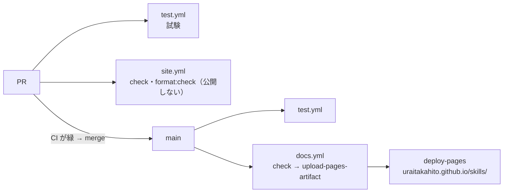

## 試験

TypeScript の道具（`tpm` と判定の道具）は `cli/` の pnpm の project にある。試験は `cli/` で打つ。Node と pnpm は [はじめる](/getting-started/#node-と-pnpm-を入れる) のとおりに入れる（version は `.node-version`）。

```sh
cd cli
pnpm install --frozen-lockfile
pnpm run typecheck   # 型の検査（tsc）
pnpm run lint        # ESLint（TSDoc の書き方も見る）
pnpm run doccheck    # コメントの抜け（TypeDoc。ページは作らない）
pnpm test            # Vitest
```

build は無い。`cli/bin/tpm` は `cli/src/cli.ts` を node で直に動かす（Node が型を消して動かす）ので、main を pull すれば次から新しいコードで動く。そのため `cli/src/` には消せる型だけを書き、import の先は `.ts` と書く（`cli/tsconfig.json` の `erasableSyntaxOnly`・`allowImportingTsExtensions`）。GitHub Actions でも上と同じ順に流す（`.github/workflows/test.yml`）。

`cli/src/` のコメントの決まり:

- export した関数・型・class・定数と method には、`/** */` で一言を書く（何か・何を返すか）。`pnpm run doccheck` が抜けを止める（設定は `cli/typedoc.json`）。interface の欄には、名前で分からない物にだけ書く。
- `@param`・`@returns` は書かない。引数は、要る時だけ文の中で名前を出して書く。
- `/** */` の中の `<…>` と `@` は `` `…` `` で囲む（TSDoc が HTML や tag と読む。`pnpm run lint` の `tsdoc/syntax` が止める）。
- file の頭の説明は `//` で書く。

## tpm のコード

`cli/src/` は層ごとにファイルを分けてある（層の説明は [担当のあいだの決まり](/protocol/#層)）。

| ファイル | 中身 |
|---|---|
| `cli/src/program.ts` | 命令の木（`tpm --help`）。`cli/src/cli.ts` が動かす |
| `cli/src/protocol.ts` | 担当の種類・見出しの表・状態の字の形・命令の一覧 |
| `cli/src/commands/` | 決まりの命令（`tpm-side.ts`・`role-side.ts`・`messages.ts`・`infra.ts`・`page.ts`・`issue.ts`） |
| `cli/src/roster.ts`・`cli/src/state.ts` | 名簿と、状態の folder |
| `cli/src/transport/` | 連携の口（`types.ts`）と adapter（`cmux.ts`・`file.ts`） |
| `cli/src/tracker/` | 課題管理の口（`types.ts`）と adapter（`jira.ts`・`github.ts`）、課題の Key の形で adapter を選ぶ `routed.ts` |
| `cli/src/guard.ts` | guard |
| `cli/src/run-role.ts` | 連携の道具が担当の居場所で動かす `tpm run-role`（名簿を読んで claude を起こす） |

- **見出しを足す・変える**: `cli/src/protocol.ts` の `HEADINGS` と、`skill-sets/core/.claude/skills/_shared/protocol.md` の表を合わせる（`check` が揃いを見る）。
- **命令を足す**: `cli/src/program.ts`（か `cli/src/commands/register.ts`）に足し、`cli/src/protocol.ts` の `COMMANDS` にも書く（試験が命令の木との揃いを、`check` が skill と docs の `tpm <命令>` が在るかを見る）。
- **道具を足す**: `transport/` か `tracker/` に口を満たす adapter を書き、`cli/src/config.ts` の選択肢と `cli/src/context.ts`（課題管理は `cli/src/tracker/routed.ts`）に足す。上の層は変えない。
- **試し方**: 決まりの命令は、連携を `file`（メッセージ・居場所・状態をファイルに書くだけ）にした project で cmux 無しに試せる（`cli/test/helpers.ts`）。実機で担当を起こして試すときは、`TPM_STATE` を一時の folder に向けて本物の名簿を汚さない。
- **道具を直に打つ**: `tpm` が起こした session では、guard が `cmux` のメッセージ・状態・居場所の命令と、`acli`・`gh issue` の記録と状態の命令の直打ちを止める（課題を読む命令は止めない。見るのは単純な命令の頭だけなので、commit の文や here-document に道具の名を書いても止まらない）。担当が置き場に消す要求（`curl -X DELETE …/api/pages…`・`…/api/files…`）を直に送るのも、置き場の CLI の消す命令（`pagetray page delete`・`pagetray file delete`・`pagetray api -X DELETE`）を打つのも止める（消してよいのは TPM 担当だけ。担当には環境変数 `PAGETRAY_NO_DELETE=1` も渡すので、guard をすり抜けても CLI が消さない）。adapter の開発で直に打つときは、命令の頭に `TPM_RAW=1` を付ける。

## pagetray（ページの置き場のサーバー）とのつなぎ

担当が置くページを DB に持つサーバー（Rust）は、別の repo [pagetray](https://github.com/uraitakahito/pagetray) にある（もとは、この repo の folder だった物を履歴ごと分けた）。作り・API の一覧・Rust の開発の手引きは、[pagetray の docs](https://uraitakahito.github.io/pagetray/)（[開発](https://uraitakahito.github.io/pagetray/development.html) の章）。この repo が持つのは、その API を `curl` で呼ぶ側（`tpm page put`・`path`・`list`・`import`・`delete` は `cli/src/commands/page.ts`、`tpm file put`・`path`・`list`・`delete` は `cli/src/commands/file.ts`、curl で頼む足場と控えの folder は `cli/src/commands/store.ts`）と、つなぎの試験。

- **合わせる版**: `.pagetray-version` に、合わせる pagetray の版を `v<版>@<image の digest>` の形で書く（digest は pagetray の release にある）。workflow の `pagetray-e2e`（`.github/workflows/pagetray-e2e.yml`）が、その版の image（`ghcr.io/uraitakahito/pagetray`）を digest で pull して起こし、`cli/test/pagetray-e2e.test.ts` で `tpm page put`・`path`・`list`・`import`・`delete` を本物に向けて流す（`cli/src/` のすべての役割とページの種類で 1 枚ずつ置いて読む）。`tpm file` の試験は、置き場が `GET /api/files` に `200` を返す時（pagetray 0.4.0 から）だけ流し、それより前の版では飛ばす。
- **偽の置き場**: `cli/` のほかの試験は、偽の置き場（`cli/test/helpers.ts` の `FakeStore`）で流す。API の形（URL・引数の名・JSON の欄）が変わったら、`FakeStore` と `page.ts`・`file.ts` を合わせて直す。受ける file の種類（`file.ts` の `FILE_TYPES`）は、pagetray の `crates/api` の一覧と揃える。
- **API の版**: 置き場は、どの答えにも header `Pagetray-Api` で API の版を付ける（決まりは pagetray の docs の「[API の仕様](https://uraitakahito.github.io/pagetray/api.html)」）。`tpm page`・`tpm file` は、話せる版（`cli/src/commands/store.ts` の `PAGES_API`）と違う答えを使わずに止まる。header の無い答え（API の版ができる前の置き場）は通す。
- **pagetray を上げる時**: pagetray で release を出す → この repo で `.pagetray-version` を新しい版と digest にする PR を出す（つなぎの試験が通る）→ [運用](/operations/#版を上げる)の「版を上げる」で container を作り直し、読むだけの試験で一覧の UI を見る。API を変える変更は、古い cli でも新しい cli でも通る順に分ける。
- **手元で流す**: pagetray の checkout で `PAGETRAY_DB=/tmp/pages.db PAGETRAY_LISTEN=127.0.0.1:18801 cargo run --bin pagetray-server` と起こした後に、`cd cli && TPM_E2E_PAGES_URL=http://127.0.0.1:18801 pnpm exec vitest run test/pagetray-e2e.test.ts`。
- **種類と役割の名**: 一覧は `cli/src/` だけが持つ。サーバーは字の形（英小文字で始まり、英小文字・数字・`-` で 32 字まで）だけを見るので、`cli` に種類や役割を足してもサーバーは変えない。
- **だれが消してよいか**: サーバーは人を見分けない。「消してよいのは TPM 担当だけ」という決まりは、`tpm page delete`・`tpm file delete` と guard（`cli/src/guard.ts`）が持つ。置き場の CLI（`pagetray`）の消す命令（ページも file も）も、guard と、担当に渡す `PAGETRAY_NO_DELETE=1` で止める。

## 判定の道具

Dependabot の PR の判定の道具は `cli/src/release-age.ts`（`node cli/src/release-age.ts <owner>/<repo> <PR> [--hours <時間>] [--now <ISO 時刻>]`）。version は PR の差分（pnpm-lock・package-lock・yarn.lock・workflow の `uses:`）から読み、依存の依存も数える。終了コードは 0 対象・10 まだ・20 判定できない・1 道具の誤り。skill は Dependabot の PR を見る repo の folder でこれを打つが、nodenv の `node` の shim は渡された script の folder から `.node-version` を探すので、この repo の version で動く。`cli/bin/tpm` も同じ訳で、`~/.local/bin/tpm` のような repo の外の symlink から呼ばれても、本当の在り処の path を `node` に渡す sh にしてある。

## この docs

原稿は `docs-site/src/content/docs/` の Markdown（Astro + Starlight）。`docs-site/` は `cli/` と別の pnpm の project で、依存と lockfile を自分で持つ。

```sh
pnpm --dir docs-site install --frozen-lockfile
pnpm --dir docs-site run dev            # 手元で見る（http://localhost:4321/skills/）
pnpm --dir docs-site run check          # build と、原稿と repo の食い違いの検査
pnpm --dir docs-site run format         # code（astro.config.ts・src/ の .ts・scripts/）を Prettier で整える
pnpm --dir docs-site run format:check   # 整っているかと、md の中の JSON の塊と *.jsonc を見る（site.yml が流す）
```

Prettier は既定の設定のまま使い、設定のファイルは置かない。原稿の `.md` は Prettier に掛けない（表や日本語の折り返しを崩させないため）。その代わり、`format:check` は `docs-site/scripts/check-md-json.mjs` で repo の `.md`（skill・原稿・README など、git が追跡する物と add 前の新しい物）の中の ` ```json `・` ```jsonc ` の塊だけを取り出し、読めることと、Prettier（`--parser json`・`--parser jsonc`）で整えた形と同じことを見る。repo の `*.jsonc` の file（`.claude/roles/config.jsonc` など）も、file 全体を ` ```jsonc ` の塊と同じに見る。` ```jsonc ` の塊と `*.jsonc` の file は、`tpm` が `config.jsonc` を読むのと同じ `cli/src/jsonc.ts` で読む。`<id>` などの置き字は、文字列の中に書けば読める。落ちたら、塊を `prettier --parser json`（`jsonc`）に通した形に書き換える。`cli/` の整形は Prettier でなく ESLint（`@stylistic`）が見る。

Prettier の `--parser jsonc` は複数行の最後に末尾のカンマを付けるが、VS Code は知らない `.jsonc` の末尾のカンマに警告（`jsonc(519)`）を出す。そこで `.vscode/settings.json` が、repo の `*.jsonc` に `.vscode/jsonc.schema.json`（`allowComments`・`allowTrailingCommas` だけの schema）を当てて、警告を出させない。欄の名や型は見ない。

`astro build` は `.md` のページの中で何が落ちても exit 0 で終わるので、`check` は build の後に `docs-site/scripts/check-refs.mjs` を流す。見る物は、ページへのリンク・本文が名指した repo の path（git が追跡する物と、add 前の新しい物だけを数える。build の書き出しなど `.gitignore` にある物は、手元に在っても無いとみなす）・README の URL・skill が名指す原稿の見出し・`config.jsonc` の欄の揃い・skill の中の相対パス（`${CLAUDE_SKILL_DIR}/…` の先）・skill が名指す `_shared/` の決まりの見出し・画面の絵（`docs-site/src/assets/screens/`）と本文の参照の揃い・skill に連携と課題管理の道具の命令が直に書かれていないこと・skill と原稿が書いた `tpm` の命令が在ること・`protocol.md` の見出しと `cli/src/protocol.ts` の見出しの表の揃い。Mermaid の図は書き間違えても検査を通るので、図を変えたら手元で見る。

skill は Pages ではなく原稿の Markdown を読む（`/dependabot-triage` と `/sustaining-engineer` が [設定](/configuration/) を読む）。原稿の見出しや表を変えたら、`check` が skill の読む先を確かめる。

### 公開の流れ

main への push のたびに https://uraitakahito.github.io/skills/ に出す（この repo にタグは無い）。



`deploy-pages` は、上げた直後の artifact を「0 個」と見て落ちることがある（上げた物が一覧に出るまでの遅れ）。`docs.yml` は落ちても job を止めず、30 秒おいて同じ回の中で 1 度だけやり直す。それでも落ちたら job は赤になる。そのときは `gh workflow run docs.yml --ref main` で新しい回を流す。落ちた回の `gh run rerun` は、前の試みの artifact が残って同じ名の物が 2 つになり、また落ちる。merge した担当は main の回が通ったかを見て、落ちていれば【merged】に書く（`/software-engineer` の 2）。

Pages の deploy を main だけに絞っているのは、`github-pages` の environment の branch の決まりだけ。この決まりは environment を書いた job にしか効かないので、書かない job が `pages: write`・`id-token: write` で `actions/deploy-pages` を流すと、PR の branch からでも本物の site に出る（repo の設定に、Pages の deploy に environment を求める欄は無い）。そこで `check` は `docs-site/scripts/check-workflows.mjs` で、workflow の頭の `permissions` に `pages`・`id-token` の write（と `write-all`）が無いこと、それを持つ job と `actions/deploy-pages` を使う job が `environment: github-pages` を書いていることを見る。PR の検査で落ちても、その PR の workflow はもう走っているので、workflow を足す・変えるときは push の前に手元で `pnpm --dir docs-site run check` を流す。確かめ用の workflow で `deploy-pages` を流す形もこの検査で落ちる。落ちるのを承知で流すなら、`pages`・`id-token` の権限を渡さない。
