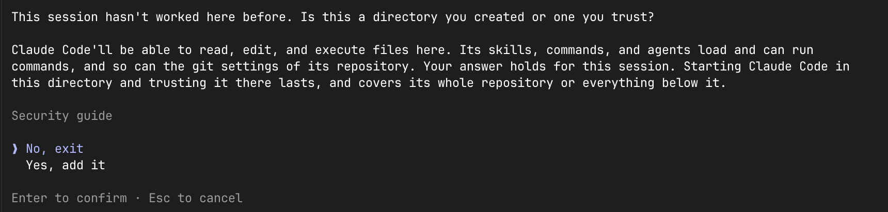

## Node と pnpm を入れる

Node の version は repo の一番上の `.node-version` で決める（GitHub Actions も同じファイルを読む）。nodenv で入れる。

```sh
cd </foo/bar/roster> # rosterの置き場所
nodenv install       # .node-version の version を入れる（入っていれば何もしない）
npm install -g corepack && corepack enable && nodenv rehash   # pnpm を出す（Node 25 から corepack は Node に入っていない）
(cd cli && pnpm -v) # cli/package.json の packageManager の版が出る
```

corepack は、`pnpm` を打った folder から上へ `package.json` を探し、その `packageManager` で pnpm の版を決める。`--dir`（`-C`）の先は見ない。roster の一番上には `package.json` が無いので、`pnpm` は `cli/`（docs なら `docs-site/`）に入ってから打つ。一番上で打つと、corepack が前に使った版か最新の版を出し、それが `packageManager` と合わなければ止まる。

pnpm は Node の version ごとに入る。`.node-version` を上げたら、新しい version でもう 1 度 corepack を入れる。合わない Node で `pnpm install` を打つと、`engines.node` の誤りで止まる（`pnpm-workspace.yaml` の `engineStrict`）。

## 起動のしかた

`cli/bin/roster start` が出す 1 行を写して打つ。

```sh
cd </foo/bar/roster> # rosterの置き場所
cd cli && pnpm install --frozen-lockfile   # build は無い（roster は src/ を node で直に動かす）
cd </your/workspace> # あなたが作業する場所
/foo/bar/roster/cli/bin/roster start --verbose             # 今いる folder で TPM 担当を起こす 1 行を出す
/foo/bar/roster/cli/bin/roster start --verbose <folder>    # その folder で起こす 1 行を出す
```

担当どうしのメッセージは、メッセージキュー（NATS JetStream）で配る。TPM 担当を起こす前に、roster を動かす機械で NATS が動いていること（起こし方は[運用](/operations/#メッセージキューnats)）。止まっていると、送る命令はみな「メッセージキューが応えません。送っていません」で止まる。

`roster start` は claude を起こさない。folder と、その直下の folder の `.claude/roles/config.jsonc`（[設定](/configuration/#直下の-folder-の設定)）を読み、`skill-sets` を確かめて、次の 1 行を出すだけ。それをそのまま打てばClaude Codeが適切に起動する。`PATH=…` は、TPM 担当が `roster` を名前だけで打てるようにする。`--settings` は、shell の命令を実行の前に `roster guard` に見せる hook（[担当のあいだの決まり](/protocol/#guard)）。`<repo>` は roster を置いた場所（上の例なら `/foo/bar/roster`）に替わる。違う場所に置いたときも、`<repo>` のところだけが変わる（場所に空白などがあれば `roster start` が引用符も付けるので、出た 1 行をそのまま写す）。

```sh
# skill-sets が無い（既定）
cd <folder> && PATH=<repo>/cli/bin:"$PATH" claude --model claude-opus-5-5 --effort medium --permission-mode bypassPermissions --settings '{"hooks":{"PreToolUse":[{"matcher":"Bash","hooks":[{"type":"command","command":"<repo>/cli/bin/roster guard"}]}]}}' --add-dir <repo>/skill-sets/core -- /tpm
# "skill-sets": ["dependabot"]
cd <folder> && PATH=<repo>/cli/bin:"$PATH" claude --model claude-opus-5-5 --effort medium --permission-mode bypassPermissions --settings '{"hooks":{"PreToolUse":[{"matcher":"Bash","hooks":[{"type":"command","command":"<repo>/cli/bin/roster guard"}]}]}}' --add-dir <repo>/skill-sets/core <repo>/skill-sets/dependabot -- /tpm
```

**最初の入力は `--` の後に置く**（`--add-dir` は後ろの語もまとめて folder として読むため）。

### model と effort を替える

上の 1 行の `--model claude-opus-5-5 --effort medium --permission-mode bypassPermissions` は既定。替えるときは 1 行を書き替えず、環境変数 `ROSTER_MODEL`・`ROSTER_EFFORT`・`ROSTER_PERMISSION_MODE` を書いてから `roster start` を打つ。

```sh
# いつも替える: shell の profile（~/.zshrc など）で export する。TPM 担当にも、TPM 担当が起こす担当にも効く
export ROSTER_MODEL=claude-fable-5-2
export ROSTER_EFFORT=medium

# 1 回だけ替える: roster start の前に付ける。出る 1 行を打った TPM 担当と、その TPM 担当が起こす担当に効く
ROSTER_EFFORT=high /foo/bar/roster/cli/bin/roster start
```

`roster start` は、書いてある `ROSTER_MODEL`・`ROSTER_EFFORT`・`ROSTER_PERMISSION_MODE` を 1 行の頭（`PATH=…` の隣）にも写す。1 回だけ付けた値も TPM 担当の Claude Code の環境に入るので、TPM 担当の状態の `model` と、`roster assign` で起こす担当に、profile に書いたときと同じに効く。

```sh
# ROSTER_EFFORT=high roster start が出す 1 行（skill-sets が無いとき）
cd <folder> && PATH=<repo>/cli/bin:"$PATH" ROSTER_EFFORT=high claude --model claude-opus-5-5 --effort high --permission-mode bypassPermissions --settings '…' --add-dir <repo>/skill-sets/core -- /tpm
```

欄ごとに、命令の旗（`roster assign --model` など）> `.claude/roles/config.jsonc` の担当の欄 > 環境変数 > コードの既定 の順で、先に値がある物が使われる。project の config に `"devops-engineer": { "effort": "low" }` と書いてあれば、`ROSTER_EFFORT=high` でもその project の DevOps Engineer 担当は low のまま。表は[設定](/configuration/#model-などの既定の環境変数任意)。

## Auditor の席を起こす

監査（担当の仕組みが信頼でき、安全で、むだなく回っているかを見る）は、Auditor の席 `Audit` でする。席は自動では起きない。Product Manager が自分の手で起こし、その席で監査を呼ぶ（目安は週 1）。

```sh
cd </your/workspace> # TPM 担当を起こした folder
/foo/bar/roster/cli/bin/roster audit start   # cmux の中の shell で打つ
```

- cmux に `Audit` の居場所ができ、Auditor が名乗って待つ。席は project に 1 つ。もうあれば、起こさずに「その席で `/clear` を打ってから、`/audit` を呼んでください」と返す。
- TPM 担当とほかの担当の居場所からは打てない（命令と guard が止める）。
- 既定の model は Fable 5.2・effort は high。替えるなら `--model`・`--effort` を付けるか、`.claude/roles/config.jsonc` の `auditor` に書く。

起きた `Audit` の席で打つ。

| 打つ字 | すること |
|---|---|
| `/audit` | 定期の監査 |
| `/audit 7 9` | 臨時の監査。台帳の番号で件を名指す |

2 度目からは、先に `/clear` を打つ。報告の読み方と答え方、席の閉じ方は[運用の「監査」](/operations/#監査auditor-の席)。

## 信頼のダイアログ

`--add-dir` の先が信頼されていないと、対話で起こしたときに「Adding a new directory … trust?」のダイアログで止まる（既定は No・`-p` では出ない）。



画面は「Adding a new directory:」と folder の path の下の部分。

- 信頼は、信頼した folder が git の repo ならその repo 全体に、そうでなければその下の全部に効く。**この repo は別の git の repo なので、信頼済みの folder の下に置いても信頼は及ばない**（信頼済みの folder の下の、git の repo でない folder では出なかった）。
- 置いた場所ごとに、**この repo の folder で 1 度 Claude Code を対話で起こし**、「Yes, I trust this folder」を選んでおく。信頼は残る。
- 起こした担当がこのダイアログで止まると、担当が名乗らない。`roster assign` は 90 秒待っても名乗らなければ画面を読み、このダイアログなら Yes を押さずに閉じて、人に信頼を頼むよう返す。
