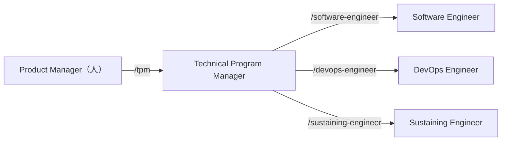

skills は、Product Manager（人）を、Claude Code の各担当が cmux の上で助けるための skill の一式です。

## skill で呼び出される担当者

| 担当 | 人間か AI か |
|---|---|
| `Product Manager` | 人間 |
| `Technical Program Manager` | AI |
| `Software Engineer` | AI |
| `DevOps Engineer` | AI |
| `Sustaining Engineer` | AI |

起動のしかた・skill・設定は、いまは repo の [README](https://github.com/uraitakahito/skills#readme) にあります。
