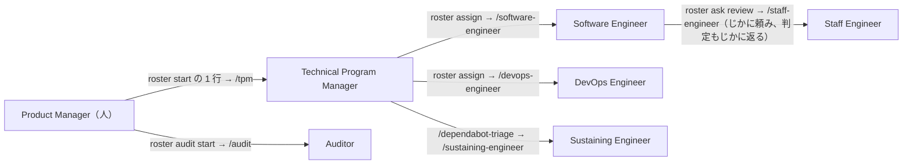

roster は、Product Manager（人）を、Claude Code の各担当が助けるための skill の一式です。担当どうしのやりとり（担当を起こす・メッセージを送る・課題に記録する・共有の環境を守る）は `roster` の CLI が受け持ち、課題管理（Jira・GitHub の Issue）と連携（cmux）の道具は project ごとに設定で選びます。担当どうしのメッセージは、メッセージキュー（NATS JetStream）で配ります（cmux は、担当の居場所と状態を見せる道具で、メッセージは運びません）。

## skill で呼び出される担当者

Product Manager が TPM 担当を起こし、TPM 担当が課題ごとにほかの担当を起こします。Staff Engineer 担当の席は、課題の担当がレビューを頼んだ時に、頼みの命令がその課題の隣に起こします（頼みと判定は、TPM 担当を通らず、じかに届きます）。監査の担当（Auditor）だけは、TPM 担当の回し方も見るので、Product Manager が起こします。

## 読む順

- [はじめる](/getting-started/): install と、TPM 担当を起こす 1 行
- [skill](/skill/): skill セットと、skill ごとの起こす人・すること
- [担当のあいだの決まり](/protocol/): 担当どうしの連絡の決まりがどこにあるかと、層の分け方
- [設定](/configuration/): 使う側の project に置く設定（課題管理・連携・インフラの環境）
- [運用](/operations/): repo を移す手順
- [開発](/development/): 試験・判定の道具・この docs の直し方
