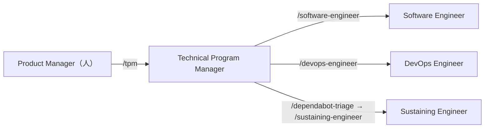

skills は、Product Manager（人）を、Claude Code の各担当が cmux の上で助けるための skill の一式です。

## skill で呼び出される担当者

| 担当 | 人間か AI か |
|---|---|
| `Product Manager` | 人間 |
| `Technical Program Manager` | AI |
| `Software Engineer` | AI |
| `DevOps Engineer` | AI |
| `Sustaining Engineer` | AI |

担当はこう起こし合います。Product Manager が TPM 担当を起こし、TPM 担当が課題ごとにほかの担当を起こします。

## 読む順

- [はじめる](/getting-started/): install と、TPM 担当を起こす 1 行
- [skill](/skill/): skill セットと、skill ごとの起こす人・すること
- [担当のあいだの決まり](/protocol/): 担当どうしの連絡の決まりがどこにあるか
- [設定](/configuration/): 使う側の project に置く設定
- [運用](/operations/): repo を移す手順
- [開発](/development/): 試験・判定の道具・この docs の直し方
