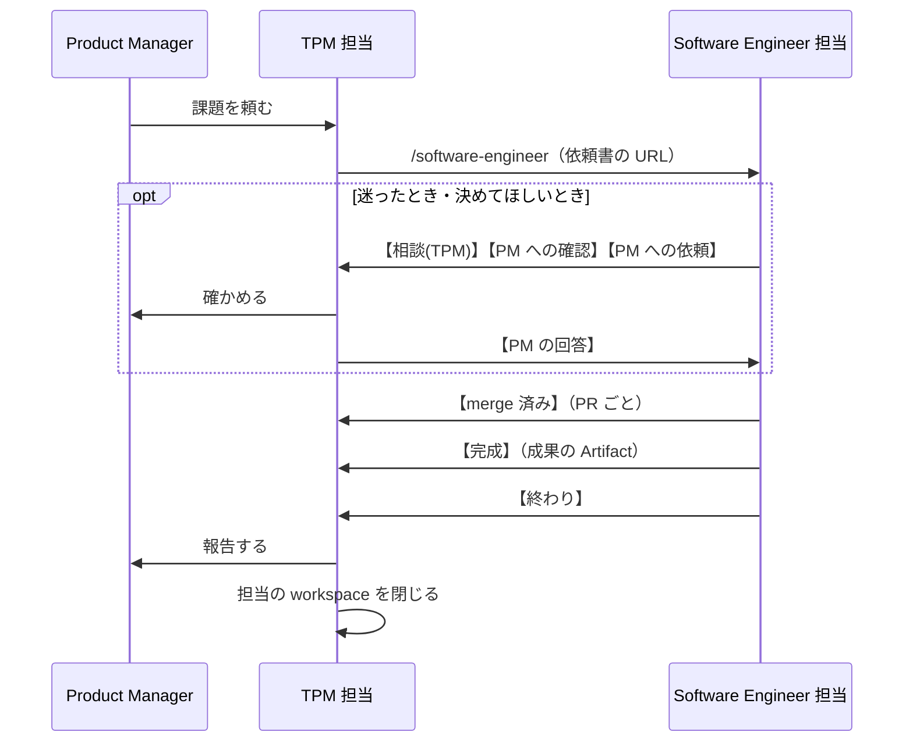

「連絡の仕方と見出し・サイドバーの `model` と `wait`・Product Manager への確かめ方・文書の食い違い・共有の環境・終わり方」は `core/.claude/skills/_shared/protocol.md` の 1 か所に書き、どの担当もそれを読む。決まりの本文は、このページには写さない（skill が読む原本は `protocol.md`）。

TPM 担当が書く依頼書には、その課題だけのことを書く（ひな形は `core/.claude/skills/tpm/brief-template.md`）。

## 見出しの流れ

担当どうしは、`cmux agent message` で見出しの付いた知らせを送り合う。Software Engineer 担当の 1 つの課題では、おおよそ次の順に流れる（見出しの一覧と中身は `protocol.md`）。

