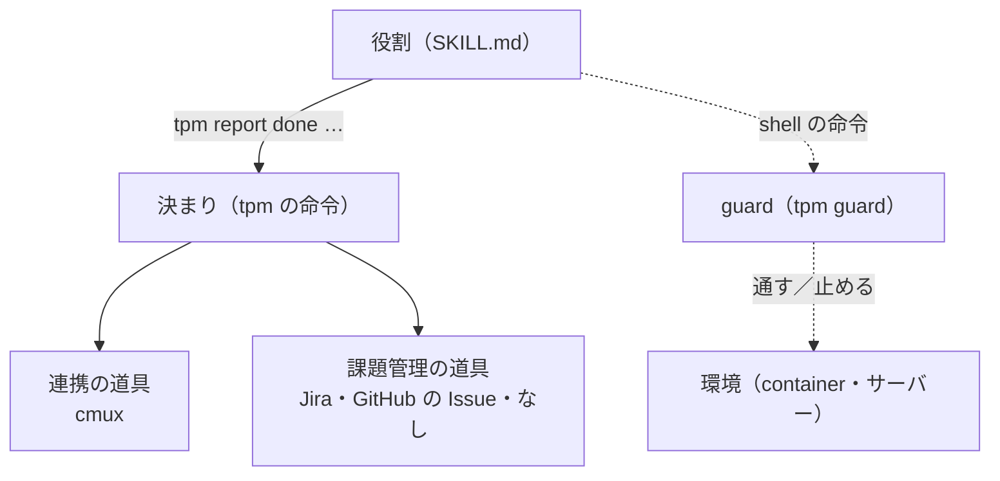
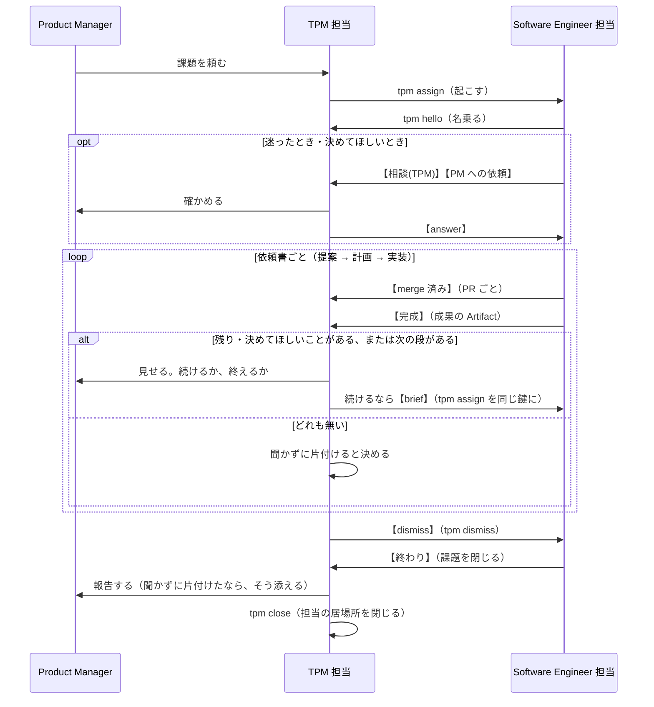

担当どうしのやりとりは、文とコードに分けてある。

- **文**（`skill-sets/core/.claude/skills/_shared/protocol.md`）: いつ・なぜ知らせるか、どの命令を打つか。どの担当もこれを読む。
- **コード**（`cli/src/`）: 見出しの表・知らせの文の形・課題への記録・状態の字・名簿。担当は `tpm` の命令を打ち、命令が道具（cmux・acli・gh）を動かす。

TPM 担当が書く依頼書には、その課題だけのことを書く（ひな形は `skill-sets/core/.claude/skills/tpm/brief-template.md`）。

## 層

上の層は下の層の道具を知らない。道具は使う側の project の設定で選ぶ（[設定](/configuration/)）。

| 層 | 中身 | 置き場所 |
|---|---|---|
| 役割 | 誰が何を受け持つか | `skill-sets/` の `SKILL.md` |
| 決まり | 見出し・順番・記録・名簿 | `protocol.md` の文と、`cli/src/protocol.ts`・`cli/src/roster.ts`・`cli/src/commands/` |
| 連携の道具 | 知らせを送る・担当を起こす・状態を出す | `cli/src/transport/`（`cmux`・試験用の `file`） |
| 課題管理の道具 | 課題に記録を書く・読む・課題を閉じる | `cli/src/tracker/`（`jira`・`github`・`none`） |
| guard | 共有の環境と、道具の直打ちを止める | `cli/src/guard.ts`（Claude Code の hook から呼ばれる） |

## 名簿と状態の置き場

`tpm` は、TPM 担当を起こした folder（project）ごとに状態を持つ。置き場所は `~/.local/state/tpm/<project の path から作った名>/`（`$XDG_STATE_HOME` があればその下）。

| ファイル | 中身 |
|---|---|
| `tpm.jsonc` | TPM 担当の宛先。担当は知らせを送るたびに読むので、TPM 担当を起こし直しても担当に知らせ直さなくてよい |
| `roles/<鍵>.jsonc` | 名簿。課題の鍵 → 役割・居場所の宛先・依頼書・課題管理の課題 |
| `approvals/<環境>.jsonc` | Product Manager の承認と期限 |
| `log.jsonl`・`infra.jsonl` | 送った知らせと、`tpm infra run` で打った命令の記録 |

1 件 1 ファイルの物は、`config.jsonc` と同じく JSONC（コメントと末尾のカンマを許す JSON）として読む。`tpm` は読んだ値を書き直すので、手で足したコメントは書き直しで消える。足していく記録は 1 行 1 件の JSON（JSON Lines）のまま。古い名の `*.json` が残っていれば、`tpm` が最初に動いたときに `*.jsonc` に名前を替えて移す。

名簿は「鍵 → 宛先」を覚えるだけで、動いているかは毎回、連携の道具に聞く。`tpm roles` は、名簿にあって居場所が無い担当を「消えた」と出す。

## 状態

各担当は、連携の道具の表示（cmux ならサイドバー）に `model` と `wait` の 2 つだけを出す。`wait` は「今、誰が何を待っているか」を 1 つだけ出し、状況が変わるたびに上書きする（`tpm wait` などのやりとりの命令が出す。字の形は `protocol.md` の「状態」）。

## 見出しの流れ

担当どうしは、`tpm` の命令で見出しの付いた知らせを送り合う。Software Engineer 担当の 1 つの課題では、おおよそ次の順に流れる（見出しと命令の一覧は `protocol.md`）。

## guard

`tpm start` の 1 行と `tpm assign` は、起こす claude に `--settings` で hook を付ける。担当が shell の命令を打つと、実行の前に `tpm guard` が見て、通すか止めるかを決める（hook の拒否は `bypassPermissions` でも効く）。

止めるのは 2 つ。

- **共有の環境に触る命令**: 設定の `infra` の `match` に当たる命令を、環境の手続きで見る（[設定](/configuration/)）。「TPM に相談」と「PM の承認」は DevOps Engineer 担当だけが通り、「PM の承認」は `tpm infra approve` で書いた承認の期限の中だけ通る。
- **道具の直打ち**: `cmux agent message`・`cmux set-status`・`cmux workspace create`・`cmux workspace close`、`acli` の記録と状態、（課題管理が GitHub の Issue の project では）`gh issue comment`・`gh issue close`。`tpm` を通さないと記録と状態が抜けるため。

guard は字の一致で見るので、防げるのは「うっかり」まで。script に包んだ命令や別名はすり抜ける。ほかの人と共有の環境を確実に守るには、担当に渡す権限を読むだけにする。
