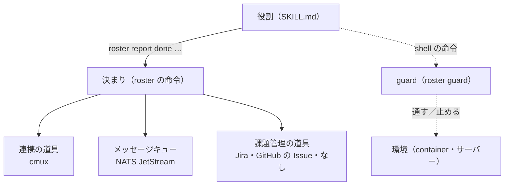
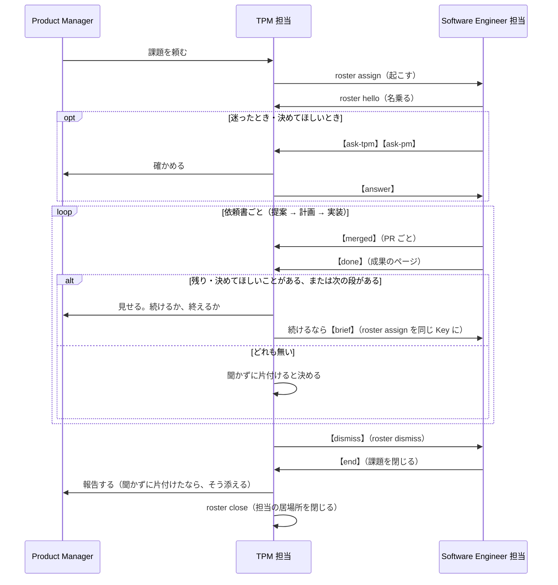
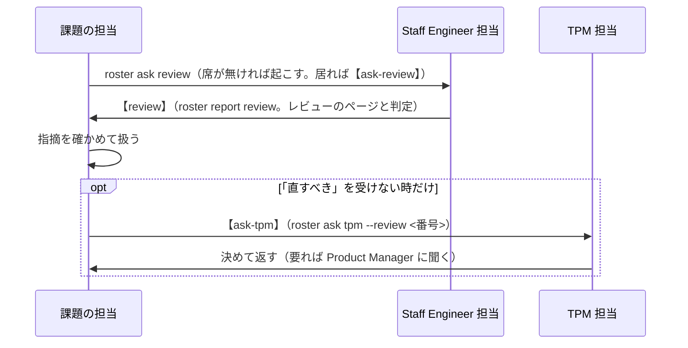

担当どうしのやりとりは、文とコードに分けてある。

- **文**（`skill-sets/core/.claude/skills/_shared/protocol.md`）: いつ・なぜ知らせるか、どの命令を打つか。どの担当もこれを読む。
- **コード**（`cli/src/`）: 見出しの表・メッセージの書式・課題への記録・状態の字・名簿。担当は `roster` の命令を打ち、命令が道具（cmux・acli・gh）を動かす。

TPM 担当が書く依頼書には、その課題だけのことを書く（ひな形は `skill-sets/core/.claude/skills/tpm/brief-template.md`）。TPM 担当は振る前に課題を読み（`roster issue view`）、新しい担当を起こす依頼書には課題の概要の節を書く。repo や資料を調べて案を出すのは担当。

## 層

上の層は下の層の道具を知らない。道具は使う側の project の設定で選ぶ（[設定](/configuration/)）。

| 層 | 中身 | 置き場所 |
|---|---|---|
| 役割 | 誰が何を受け持つか | `skill-sets/` の `SKILL.md` |
| 決まり | 見出し・順番・記録・名簿 | `protocol.md` の文と、`cli/src/protocol.ts`・`cli/src/roster.ts`・`cli/src/commands/` |
| 連携の道具 | 担当を起こす・居場所の題と状態を出す（メッセージは運ばない） | `cli/src/transport/`（`cmux`・試験用の `file`） |
| メッセージキュー | 担当どうしのメッセージを預かり、受け手ごとに配る | `cli/src/mailroom/`（`nats`・試験用の `memory`） |
| 課題管理の道具 | 課題を読む・課題に記録を書く・課題を閉じる | `cli/src/tracker/`（`jira`・`github`・`none`） |
| guard | 共有の環境と、道具の直打ちと、担当が置き場のページを消す要求と、読むだけの担当（Auditor・Staff Engineer 担当）が repo・設定・記録を変えることと、Audit の席を起こす命令と、pattern で process に合図を送る命令を止める | `cli/src/guard.ts`（Claude Code の hook から呼ばれる） |
| バナー | 通知のバナーを、居場所の役割 × きっかけで出すか消すか（[設定](/configuration/#通知のバナー任意)） | `cli/src/banner.ts`・`cli/src/commands/banner.ts`（cmux の通知の hook から呼ばれる） |

## 名簿と状態の置き場

`roster` は、TPM 担当を起こした folder（project）ごとに状態を持つ。置き場所は `~/.local/state/roster/<project の path から作った名>/`（`$XDG_STATE_HOME` があればその下）。

| ファイル | 中身 |
|---|---|
| `tpm.jsonc` | TPM 担当の宛先。担当はメッセージを送るたびに読むので、TPM 担当を起こし直しても担当に知らせ直さなくてよい |
| `roles/<Key>.jsonc` | 名簿。課題の Key → 役割・居場所の宛先・依頼書・課題管理の課題。Staff Engineer 担当の席は、課題の担当と並べるために名簿の Key を `<課題の Key>.staff` にし、見ている課題の Key を `subject` に持つ。Tech Lead 担当が起こした repo の席は、名簿の Key が `<課題の Key>.<名>` で、Tech Lead 担当の課題の Key を `subject` に持つ（下の「[Tech Lead 担当と repo の席](#tech-lead-担当と-repo-の席)」）。Tech Lead 担当の行は、起こしてよい repo の席の数の上限 `seats` を持つ |
| `repo-seats.jsonl` | Tech Lead 担当が起こした repo の席の控え（時刻・Tech Lead 担当の課題の Key・repo の席の名簿の Key）。`roster seat add` が足し、席を閉じても消さない。出来事の時系列が、閉じた席の記録を親の課題にまとめるのに読む |
| `reviews/<番号>.jsonc` | レビューの頼み 1 件（下の「Staff Engineer 担当の席」。repo の席の頼みは、見る者 `reviewer` が `tech-lead`）。課題の Key・見る物・頼んだ担当と時刻・渡した依頼書・判定・レビューのページ・返った時刻・TPM 担当に上げた時刻。レビューを 1 度も頼んでいない project には無い |
| `approvals/<環境>.jsonc` | Product Manager の承認と期限 |
| `log.jsonl`・`infra.jsonl` | 送ったメッセージ（時刻・Key・見出し・本文・返事の先・送り手と届く担当。前の版の行には、送った後 2 秒の内に届いたかの `delivered` もある。今の版は書かず、運んだ道 `carrier: "nats"` と受け手の名を書く。席を起こす時の依頼書で渡した頼みの行は、`carrier: "launch"` と印 `launch: true` を持つ（メッセージとしては送っていない。下の「返事の先」）。見た時刻は `cli/src/seen.ts` の口が、手元の渡した記録 `delivered.jsonl` から引く。運んだ道の無い古い行は、`deliveries.jsonl`・`shown/`・`returned.jsonl` から引く）と、`roster infra run` で打った命令の記録 |
| `message-records.jsonl` | 送った記録を置き場に写せなかった回と、送り手を付けずに置いた回（時刻・メッセージの id・訳の短い字。後の回には `placed` の欄が付く。下の「[ページの置き場](#ページの置き場)」の「送った記録の写し」）。写せた時は書かない。1 度も写しそこねていない project には無い |
| `deliveries.jsonl` | 前の版の記録（もう増えない。読むだけ）。前の版で cmux が運んだメッセージの、送った・届いた・読んだ時刻の写し。見た時刻の口が、古い行（運んだ道の無い行）の届いた時刻に使う。同じ id の行は後ろが新しい。前の版を使っていない project には無い |
| `tracker.jsonl` | `roster` が課題管理に書いた物（コメント・済み）。時刻・打った担当・課題・記録の種類・通ったか。課題管理の履歴は人も担当も同じ account なので、`roster` の手かどうかはここで見分ける |
| `guard.jsonl`・`gate.jsonl` | guard が止めた命令（頭の 300 字と訳）と、入口の検査が送る・置くのを止めた回（読んでいないメッセージ・merge していない PR・読めない PR・main の workflow がまだ動いている PR・main の workflow を読めない PR・同じメッセージの 2 度送り・TPM 担当が送って済んでいない物・前の監査の文脈が残ったまま始めようとした監査） |
| `review-guard.jsonl` | Staff Engineer 担当の席（と手伝い）が打った命令のうち、通す側の表（`cli/src/review-guard.ts`）に無い形と、redirect の書く先（打った手・道具・命令の頭の 300 字・訳）。段 1a は止めずに記録だけ（t-n4j9。下の「[guard](#guard)」） |
| `audits.jsonl` | 監査線の記録（下の「Auditor の席」）。Auditor の席を起こした・新しい文脈になった（席を起こした時と `/clear` の時）・監査を始めた・報告した・決定を渡した・Auditor の置いたページを消した、を 1 行ずつ。Auditor の席を 1 度も起こしていない project には無い |
| `waits.jsonl` | 状態 `wait` の移り変わり（`waits/<宛先>.jsonc` は最後の 1 つだけ）。`roster time <Key>` が、課題の時間の分けに読む（[運用](/operations/#課題の時間の分けroster-time)） |
| `watch.jsonl` | 見張り（`roster watch`）の 1 回ごとの記録。始めた時刻・種類（`pr`・`main`・`tag`・`github`）・見張った物（PR の URL・repo・`<owner/repo>@<tag>`）・結果・終了コード・聞いた回数・かかった秒・打った担当の課題の Key と役割。命令の字やメッセージは入らない。`roster watch` を 1 度も打っていない project には無い（[運用](/operations/#ci-と-github-の見張りroster-watch)） |
| `shown/<宛先>.jsonc` | 前の版の記録（もう書かない。読むだけ）。前の版で、`roster inbox` と送る前の検査が居場所に見せたメッセージの id と、初めて見せた時刻。見た時刻の口（`cli/src/seen.ts`）が、古い行（運んだ道の無い行）の「担当がメッセージを見た時」に使う。今の版が見せた物は、`delivered.jsonl` の `output` の行と `mail/passed/` に残る（下の「[メッセージを NATS で配る道](#メッセージを-nats-で配る道)」） |
| `incidents/<番号>.jsonc` | 台帳。思わぬ出来事（信頼性・安全性・効率性が落ちた時）の 1 件 1 ファイル。書いた担当・種類・起きた事実・tag・扱い（未決・振った・調べない・済み）と、結んだ振り先・PR |
| `waits/<宛先>.jsonc` | 居場所が最後に打った `roster wait` の種類と時刻。バナーの hook が「この回に `roster wait pm` を打ったか」を見る |
| `sessions/<session の id>.jsonc`・`launches/<起こしの id>.jsonc` | castlist に登録した session の本当の id と名・稼働中か・送った出来事の番号・最後に送った見た model と effort・写し（Claude Code の session の記録）の path（[アクターの台帳](#アクターの台帳castlist)）と、起こし 1 回の session の並び。castlist を設定した project にだけある |
| `usage/<session の id>.jsonc`・`usage/<session の id>.lock`・`usage/checked.jsonc`・`usage-refused.jsonl` | トークンの使用量の取り込み（[下](#トークンの使用量)）の控え: 写しの file ごとの読んだ所・数えた応答の id・送った行の数・送る前に書く「送る行」と、席ごとの鍵、片付けが判じた時刻・次に聞いてよい時刻・次に回る席、castlist が断った行の記録。数だけを持ち、会話の字は持たない |
| `banner/last-turn/<宛先>.jsonc`・`banner.jsonl` | バナーの hook が覚える、居場所の前の「答え終わった」の時刻と、決めたことの記録 |

1 件 1 ファイルの物は、`config.jsonc` と同じく JSONC（コメントと末尾のカンマを許す JSON）として読む。`roster` は読んだ値を書き直すので、手で足したコメントは書き直しで消える。足していく記録は 1 行 1 件の JSON（JSON Lines）のまま。記録（`*.jsonl`）は、後から「何が・いつ・誰の手で起きたか」を言うための証拠で、`roster` は消さない（`banner.jsonl` だけは 7 日）。メッセージや命令の字が入るので、roster を動かす機械の外（課題のコメント・PR の本文）には写さない。古い名の `*.json` が残っていれば、`roster` が最初に動いたときに `*.jsonc` に名前を替えて移す。

名簿は「Key → 宛先」を覚えるだけで、動いているかは毎回、連携の道具に聞く。`roster roles` は、名簿にあって居場所が無い担当を「消えた」と出す。

## ページの置き場

依頼書・確認・提案・計画・結果の HTML を置く、roster を動かす機械の中だけの置き場。ページを DB に持つサーバー（別の repo の pagetray）の container が、`127.0.0.1` だけで待ち受ける（起こし方は [運用](/operations/#ページの置き場pagetray)。起こす・止めるのは DevOps Engineer 担当）。ページの一覧は callboard の画面（`http://127.0.0.1:8803/pages/`。Key の画面は `/pages/?project=<状態の folder の名>&key=<Key>`）で、Product Manager は、置いた担当の役割・居場所（workspace の ID）・Key・種類で絞り、時刻で並べ、題と本文を探して、選んだ 1 枚を同じ画面で読む。

- `roster page put <file> --kind <種類>` が、file を置き場に送り、URL（`<置き場の URL>/<状態の folder の名>/<Key>/<種類>-<番号>.html`）を出す。置いた担当の役割（`$ROSTER_ROLE`。TPM 担当は `tpm`）と居場所の宛先も、一緒に置き場に入る。同じ中身を、roster を動かす機械の控えの folder（`<控えの folder>/<状態の folder の名>/<Key>/<種類>-<番号>.html`）にも写す。種類は `brief`・`confirm`・`proposal`・`plan`・`result`・`review`（Staff Engineer 担当のレビュー）・`issue`（課題の写し。ふだんは `roster assign` が置く）・`timeline`（時系列。`roster incident timeline` が置く）・`audit`（監査。思わぬ出来事の原因と改善案）。Key は担当なら今の課題の Key（Staff Engineer 担当の席は、見ている課題の Key）、TPM 担当は `--key` で書く。番号は置き場が決める（同じ Key・同じ種類の次の番号。多くの担当が同時に置いても重ならない。消したページの番号も使わない）。置いたページの本文を書き換えるエンドポイントは無い（置き直すと次の番号。置いた後に変わるのは、下の返事の状態だけ）。
- project は `$ROSTER_PROJECT`、無ければ今いる folder。`.claude/roles/config.jsonc` も TPM 担当が起きた印（状態の folder の `tpm.jsonc`）も無い folder（scratchpad など）から `roster page put` を打つと、置き場に頼む前に止まる（その folder の名が別の project として置かれるのを防ぐ）。project の folder で打つか、`$ROSTER_PROJECT` を付ける。
- 置き場が応えなければ、ページは置けない。控えにあるページは読める。`roster ask devops` で起こすよう頼む。
- **送り手**: castlist の設定（[下](#アクターの台帳castlist)）があり、`$CLAUDE_CODE_SESSION_ID` がある時、`roster page put`・`roster file put`（と、`roster assign` の課題の写し・`roster incident timeline` の時系列）は、置く要求の引数に送り手の付随する id（`actor_issuer` は session を登録する時と同じ issuer、`actor_ref` は `claude.session:<session の id>`）を付ける。置き場は、受けたその時に castlist に送り手を聞き、記録の `sender` に残す（callboard のページの一覧に送り手の名が出る）。どちらかが無ければ付けず、今までどおり置く。`roster page import` も付けない（置いた担当はわからない）。置き場が断った時は、ページも file も置かれておらず、`roster` は送り直さない。
  - `503`（置き場が castlist に聞けない）: 「castlist に送り手を聞けませんでした」と出て止まる。castlist が起きてから打ち直す。castlist が起きているのに続く時は、`roster report incident` で台帳に挙げる（置き場から castlist に届いていない。[運用](/operations/#起こす)）。
  - `400`（欄 `/actorRef`。castlist に、この session の登録が無い）: 「castlist に登録が無いと、置き場が答えました（400）」と出て止まる。`/actorRef` の形の誤り（打ち直しても通らない）は、置き場が断った訳をそのまま出す。session は Bash・Monitor の前に guard が登録するので、打ち直す。続く時は `roster report incident` で台帳に挙げる。
- `roster page path <URL>` が、置き場の URL を控えの file の path にする（Read tool で読むため）。控えに無ければ、置き場から取って控えに写す。前の置き場の `http://127.0.0.1:8800` の URL も、同じ控えの path になる（browser では、置き場が 8800 でも同じ path で返す）。ページの `src`・`href` が相対で参照する file（下）のうち控えに無い物も取り、ページから同じ相対の所に写して、`参照の file:` の行に path を出す（取れなければ `注意:` の行を出し、ページの path は返す）。
- `roster page list` が、置き場のページを絞って探す（`--key`・`--role`・`--workspace`・`--kind`・`--q`・`--reply`。`--json` は記録の配列）。既定は今の project の新しい順 50 件で、`--all-projects` でほかの project も出す。
- **返事の状態**: 置き場は、Product Manager の返事が要るページに「返事待ち」「答えた」の状態を持ち、callboard のページの一覧は、操作の帯の「返事待ち N 件」・行の印・絞り込みの「返事」で出す。書くのは `roster` の命令で、担当は手で書かない。
  - `roster ask pm --url <確認の URL>` が、【ask-pm】を送った後に、そのページを返事待ちにする（置いただけの確認には印が付かない）。
  - `roster ask pm --supersede <古い確認の URL>`（何度でも）が、この確認で置き換える古い確認の返事待ちを外す。受けるのは同じ Key の返事待ちの確認だけで、別の project・Key・答え済み・送っていない確認・送る確認そのものは、送る前に断る。【ask-pm】の本文に「置き換える確認:」と URL が載る（log に残る）。置き場が応えない時は確かめずに送り、外せなかったことと `roster page reply <URL> --answered` の直し方を出す。
  - `roster answer <Key> "<答え>"` が、【answer】を返した後に、その Key の返事待ちのページを答えたにする。返事待ちが 2 枚以上ある時は、送る前に止まって URL を並べる（別の確認まで答えたにしないため）。どのページへの答えかを `--url <確認の URL>`（何度でも）で書くか、みなへの答えなら `--all` を付ける。
  - `roster page reply <URL>… --waiting|--answered` が、状態を手で直す（TPM 担当だけ）。`roster answer` を通らずに済んだ確認と、置き場が応えない間に送った確認に使う。`roster page list --reply waiting` が、今の返事待ちを並べる。`roster dismiss` は、その Key に返事待ちのページが残っていれば URL を出す（止めない）。
  - 置き場が応えない時も、`roster ask pm`・`roster answer`・`roster dismiss` はメッセージを送り、`置き場の印: 付けていない` と訳を出す。`roster page reply` だけは誤りで止まる。
  - 置き場が `.pagetray-version` より古い版で、呼ぶ操作を持たない時は、置き場に頼む命令はどれも「置き場が、この roster の呼ぶ操作を持たない」で止まる（[運用](/operations/#版を上げる)の 4）。
  - `roster ask pm` で送っていないページは、状態を持たない（印は付かない）。
- **送った記録の写し**: `roster` は、メッセージを送るたびに、送った記録（`log.jsonl` の 1 行）を置き場にも 1 件置く（pagetray 1.1.0 から）。Product Manager は、メッセージの記録の画面（callboard の `http://127.0.0.1:8803/messages`）で、誰が誰に何を送ったかを見る。写すのは、Key・見出し・送り手の名と受け手の名（下）・本文（8,000 字を超える時は、頭の 7,990 字に「…（長いので切った）」を付ける）・送った時刻・返事の先の id。castlist の設定と session の id があれば、ページを置く時と同じ送り手の付随する id も付ける。
  - 置き場の記録の送り手・受け手の名（`from`・`to`）は、担当の Key（人が読む名。TPM 担当は `tpm`）。配りの受け手の名（Key と起こした回の組。下の「[メッセージを NATS で配る道](#メッセージを-nats-で配る道)」）とは別。置き場は初めの値から替えないので、替わる居場所の題では書かない（送り手の組の無い前の版の行だけ居場所の題、届く担当の分からない行は宛先の字。200 字を超える名は切る）。
  - 状態は、送った時は `waiting`（届くのを待っている）。受け手の hook が渡すと `delivered`、届かないまま終わると `undeliverable`・`expired` になる（下の「[メッセージを NATS で配る道](#メッセージを-nats-で配る道)」）。`carried`（ほかの道具で運んだ）は、席を起こす時の依頼書で渡した頼みの行（下の「[返事の先](#返事の先)」）と、前の版で cmux が運んだ行の状態で、届いたかは置き場に書いていない。
  - **写せなくても、送りは止めない**。置き場が応えない・古い版・形の誤りのどれでも、送った事と `log.jsonl` は変わらず、命令の出力にも何も出ない。写せなかった事だけが、状態の folder の `message-records.jsonl` に 1 行残る。後から写し直す命令は無い。
  - 置き場が送り手を castlist に聞けない（503）・castlist に登録が無いと断った時は、送り手の付随する id を外して 1 度だけ置き直す（送り手が空の記録になる）。置けたら、その事を `message-records.jsonl` に `placed` の欄を付けて残す。
  - 置き場が答えない時は、送る命令の終わりが 2 秒（置き直しが入ると長くて 4 秒）遅れる。
- **レビューの印**: 置き場は、返事待ちの相手（Product Manager・レビューの席・TPM 担当）と、レビューの判定・見た物も持つ。TPM 担当を通らないレビューのやりとりを、Product Manager と TPM 担当が callboard のページの一覧で追うための物。書くのは `roster` の命令で、担当は手で書かない。置き場に写すのは、判定の語・見た物の URL・時刻だけ。
  - `roster ask review` と、Staff Engineer 担当の席の起こし直し（`roster ask review`・`roster assign --role staff-engineer`）が、依頼書に見る物（置き場のページは path、PR は URL）を書いて「レビュー待ち」にする。起こし直しで置き換えた前の依頼書は、返っていない頼みがほかに無ければ待ちを外す。
  - `roster report review` が、レビューのページに判定と、済ませた頼みの見る物をみな書き、依頼書を「レビュー済み」にする。ページの一覧は、レビューの行に判定の印と「見た物:」の link、見られたページの行に「レビュー: review-N 判定」を出す。
  - `roster ask tpm --review <番号>` が、レビューのページを「上げた」（TPM 担当の返事待ち）にする。TPM 担当は、決めたら `roster page reply <URL> --answered --on tpm` で「決まった」にする。ページの一覧の操作の帯に「レビュー待ち N 件」「上げた N 件」が出る。
  - 「返事待ち N 件」・`roster answer` の数・`roster ask pm --supersede` の確かめは、Product Manager の待ちだけを見る。`roster page list --reply waiting --on review|tpm` で、ほかの相手の待ちを並べる。`roster dismiss` は、残ったレビュー待ち・上げた件も、相手ごとに並べる。
- `roster page import` が、控えの folder にあって置き場に無いページを、同じ番号・file の時刻で置き場に入れる（DB を失った後。何度打っても同じ結果）。置いた担当はわからないので、役割は依頼書と課題の写しだけ `roster`、ほかは `unknown` で入る。控えの `<Key>/files/` の file も同じ決まりで入れる（役割は `unknown`）。
- `roster page delete` が、ページを置き場と控えの folder から消す（戻せない）。**消してよいのは TPM 担当だけ**で、担当の居場所から打つと止まる。Auditor が置いたページ（置いた担当の役割が `auditor`）は、Product Manager の言葉を `--pm "<言葉>"` に添えなければ消せず、消した事は `audits.jsonl` に残る（担当は `roster ask tpm` で、消すページの URL と訳を送って頼む。置き場に消す要求を直に送る `curl` と、置き場の CLI の `pagetray page delete` も guard が止める）。URL を名指すと 1 枚、`--key <Key>` でその Key のページみな、`--project <名>` だけで、その project（状態の folder の名）のページみなを消す（`--key`・`--project` は、合う file も一緒に消す）。まず消す物を一覧で出し、`--yes` を付けたときだけ消す。消したページの URL は `410` を返し、その番号は 2 度使われず、`roster page import` でも入らない。
- ページに付ける画像・PDF・字の file（png・jpg・jpeg・gif・webp・pdf・txt・log・md・csv・json。1 つ 16 MiB まで）は、`roster file` で置き場に上げる。URL は `<置き場の URL>/<状態の folder の名>/<Key>/files/<語>-<番号>.<拡張子>` で、ページからは相対で参照する（同じ Key なら `files/<語>-<番号>.<拡張子>`、別の Key なら `../<Key>/files/…`）。控えも同じ形（`<控えの folder>/<状態の folder の名>/<Key>/files/`）に写すので、置き場でも控えでも図が出る。
  - `roster file put <file>` が上げて、控えに写し、URL と `ページからの参照:` を出す。名は元の file の名から作る（小文字にし、英小文字・数字・`-`・`_` でない字を `-` にする。`--name <語>.<拡張子>` で替えられる）。番号は置き場が決め、同じ名で上げ直すと次の番号。
  - 上げた物は model にも人にも見えるので、画像と PDF は `--reviewed` が無いと止まる（Read tool で見て、token・鍵・個人の情報・ほかの人の画面・roster を動かす機械の path が写っていないか確かめてから付ける）。字の file は秘密の形（GitHub・AWS・Slack・Atlassian の token、`sk-` の鍵、秘密の鍵の頭など）を走査し、当たれば行の番号を出して止まる。わざと上げるなら `--allow-secret`（状態の folder の `file-secret.jsonl` に残る）。EXIF のある JPEG は、上げた上で位置情報の注意を出す。
  - `roster file path <URL>` が控えの path を返す（控えに無ければ取る）。`roster file list` が探す（`--key`・`--role`・`--q`・`--json`・`--all-projects`）。
  - `roster file delete <URL>…` が消す（**TPM 担当だけ**。戻せない）。まず消す物と、それを参照している同じ project のページを出し、`--yes` を付けたときだけ消す。消した URL は `410` を返す。
- Product Manager が読むページ（確認・提案・計画・結果・監査）には、図をページの中の inline の SVG で入れる。どのページにどの図を入れるかは `skill-sets/core/.claude/skills/_shared/protocol.md` の「ページ」の図の項、ひな形（選ぶ問いの木・流れ・前と後・数の棒・並べと、明るい画面と暗い画面の色の変数）は `skill-sets/core/.claude/skills/_shared/figures.md`。提案・計画・結果の「流れ」「前と後」の図は、Archify で描く（担当は図の中身を JSON で書き、Haiku で動く skill `figure-fix` が直しと検査をし、`roster figure embed` が文書の図の形に整えて埋める。手順は `figures.md` の「6. Archify で描く」、作りは [開発](/development/#archify図を描く道具とのつなぎ)）。依頼書は、読むのが担当なので要る所だけ。図を入れないページには、入れない訳を頭に 1 行書く。
- project の名に状態の folder の名を使うので、TPM 担当と、起こされた担当とで URL がずれない。課題の folder の URL（`…/<Key>/`）は、その課題で絞った一覧を出す。
- 控えの folder と置き場の URL は、環境変数 `ROSTER_PAGES_DIR`・`ROSTER_PAGES_URL` で替えられる（[設定](/configuration/)）。

## アクターの台帳（castlist）

設定に `castlist` の URL（[設定](/configuration/#アクターの台帳castlist任意)）があれば、`roster` は、Claude Code の session 1 つ（TPM 担当・担当・Auditor）を castlist のアクター 1 つとして登録し、登場から退場までを送る（API は castlist の docs の [API](https://uraitakahito.github.io/castlist/api.html)。コードは `cli/src/castlist.ts`・`cli/src/commands/castlist.ts`）。設定が無ければ、何も送らず、`roster start`（stderr。terminal なら赤の太字）と `roster hello`（出力の頭）が、枠で囲んだ警告を出す（止めない。足す 1 行と、直下の folder の設定にだけ castlist があれば読まないことを書く）。

| いつ | 送る物 |
|---|---|
| `roster start` | `/healthz` を見て、Product Manager を人のアクター（鍵 `tpm.person:product-manager`・名の接頭辞 `product-manager`）として登録する（何度打っても同じアクター）。1 行の頭に、起こしの印（下）を付ける |
| session の始まり（SessionStart の hook の `roster castlist session-start`） | session を登録する（鍵は `claude.session:<session の id>`。cmux の連携なら `cmux.workspace.ref`、`$CMUX_WORKSPACE_ID` があれば `cmux.workspace.uuid` も付ける）。ラベルは `tpm.project`・`tpm.launch`・`tpm.key`（担当だけ。名簿の Key）・`tpm.role`（TPM 担当は `tpm`）・`tpm.subject`（Staff Engineer 担当の席だけ。見ている課題の Key。`tpm.key` は `<課題の Key>.staff` で、名の接頭辞は `<課題の Key>-staff`）。続けて、source ごとに: 起こした（startup）→ 登場（`entered`）と、起こした者からの線（`launched`）／続きから開いた（resume）→ 再登場（`reentered`）／要約した（compact）→ 要約（`compacted`）／`/clear` → 新しい session の登場（`entered`・`detail.source` が `clear`）と、同じ起こしの前の session からの継ぐ線（`continued`）／fork → 分身（`forked`）と継ぐ線 |
| session の終わり（SessionEnd の hook の `roster castlist session-end`） | `/clear` なら交代（`cleared`）、ほかは退場（`exited`）。訳は `detail.reason`。続けて、その session のトークンの使用量を送る（[下](#トークンの使用量)） |
| Bash・Monitor の前（`roster guard`） | まだ登録していない session を登録する。推しの幕引き（下）で居ないにした session が打てば、生きていたので、今の居場所で登録し直して番号つきの再登場（`reentered`・`detail.source` が `guard`）を送る（退場・交代・`roster close` の後は送らない）。hook の入力の effort と、写し（transcript）の最後の model（`<synthetic>` は飛ばす）が、前に送った物と違えば「見た」model と effort（`source: observed`）を送る。写しから model を読めなければ（写しの形が変わった）、session に 1 度だけ model 不明（`model_unreadable`）を送る（止めない） |
| `roster hello` | 名乗り（`reported_in`）。出力の頭に `アクター: <名>`（`t-23zs-swe.1` など）。推しの幕引きで居ないにした session なら、名乗りの前に、guard と同じく登録し直して再登場（`detail.source` が `hello`）を送る |
| `roster close` | その担当の起こしの session のトークンの使用量を送り（[下](#トークンの使用量)）、起こしのアクターのうち、まだ居る物に幕引き（`closed`） |
| `roster hello`（Auditor を除く）・`roster roles`・`roster assign` | 落ちた session の突き合わせ（下の「推しの幕引き」） |

- **名**: castlist が `<接頭辞>.<番号>` で出す（番号は issuer と接頭辞ごと）。接頭辞は、担当が `<Key>-<役割の略>`（`swe`・`lead`・`devops`・`sus`・`staff`。Staff Engineer 担当の席は、名簿の Key でなく、見ている課題の Key から作る: `ai-33-staff`。Tech Lead 担当が起こした repo の席は、名簿の Key から作る: `ai-36-pagetray-swe`）、TPM 担当が `<project の folder の名>-tpm`、Auditor が `<project の folder の名>-audit`。castlist の接頭辞は英小文字・数字・`-` だけなので、`.` でなく `-` でつなぎ、Key の大文字は小文字に、ほかの字は `-` に替える。issuer は `tpm.` と状態の folder の名（英小文字に替える。64 字を超える名は、頭を残して hash を足す）。
- **起こしの印**（環境変数）: 起こす側が付け、hook が読む。`ROSTER_LAUNCH`（起こしの id。`roster start` の 1 行は打つたびに `uuidgen` で作り、`roster assign`・`roster audit start` は名簿の `launch` に書く）・`ROSTER_LAUNCHED_BY`（起こした者。`roster assign` は打った TPM 担当の `claude.session:<$CLAUDE_CODE_SESSION_ID>`、`roster start` と `roster audit start` は Product Manager）・`ROSTER_LAUNCH_MODEL`・`ROSTER_LAUNCH_EFFORT`（claude の `--model`・`--effort` と同じ値）・`ROSTER_LAUNCH_FRESH=1`（起こしたばかりの印）。担当には `roster run-role` が名簿から付ける。
- **頼んだ model と effort**（`requested`）は、起こしたばかりの process の初めの登録（startup か resume）でだけ送る。`/clear` の後の session は同じ環境変数を持つが、その間に `/model` で替えたかもしれないので送らない。どの起こしで送ったかは状態の folder の `launches/<起こしの id>.jsonc` に残す。
- **id**: 出来事・線・model と effort の id は、issuer・session・種類（と、何度も起きる物は番号）で決める。送り直しても同じ id なので、castlist は 2 度足さない。番号は送れた時だけ進める。登録の答え（本当の id と名）は `sessions/<session の id>.jsonc` に控える。
- **castlist が止まっている時**: `roster start`・`roster assign`・`roster audit start`・`roster hello` は、起こさず・名乗らずに止まり、Product Manager が自分の terminal で打つ 1 行を出す（container `castlist.box` が在れば `container start castlist.box`、0.1.0 の名 `castlist` の container だけが在ればその名で起こし直す 1 行と名を替える docs、どちらも無ければ `container run …`。castlist を起こすのは Product Manager だけ）。`roster assign` は、TPM 担当が `roster wait pm "castlist を起こす" --hand` で Product Manager に頼むよう添える。hook は何も送らずに終わり（Claude Code を止めない）、登録までは `roster guard` が shell の命令（Bash・Monitor）を同じ 1 行を添えて止める。登録した後も、送る物（見た model と effort など）があるのに止まっていれば止める。`roster close` は止めず、送れなかったと 1 行出す。
- **推しの幕引き**: kill・クラッシュ・roster を動かす機械の止まりで落ちた session は、終わりを送れない。そこで roster は、上の 3 つの命令のたびに cmux の居場所の一覧（`cmux --json workspace list --id-format both`。uuid と ref）と、控えで「居る」ままの session を突き合わせ、次のどちらかなら幕引き（`closed`。`detail` は `{"inferred": true, "reason": …}`。id は番号つきで、`roster close` の幕引きと別）を送って、控えを居ないにする（出力に 1 行）。castlist はこれを点線の帯と「停止（推し）」で描く。
  - `workspace_gone`: その session の居場所の uuid が、一覧に無い。
  - `superseded`: uuid は残り ref が替わった（cmux が起こし直され、居場所を同じ uuid で復元した）うえ、今の組（uuid と今の ref）に別の session が登録した。ref が替わっただけでは送らない（cmux は起こし直しの後に Claude の session を続けることがある）。ref も同じ組に 2 つ居ても、後先を決められないので送らない。
  - 居場所は、登録の時に控え（`sessions/<session の id>.jsonc` の `workspace`）に書く。控えに無い session（前の版で登録した物）は、castlist のアクターの付随する id（種類ごとに最新）から引く。
  - 自分の session は見ない。自分の session の id（`$CLAUDE_CODE_SESSION_ID`）が無い（roster の起こした session の外で打った）・一覧が引けない・一覧に自分の組が無い（一覧を信じられない）時は何もしない。cmux でない連携（file）でもしない。castlist が応えなければ、そこでやめて 1 行出す。送れなくても命令は止めず、送れなかった session を 1 行で出す。
  - 控えに居場所を書く時は、読み直した控えに居場所だけを足す（その間に session の hook が書いた物を消さない）。
  - 気づけないのは、Claude Code だけが落ちて居場所が残った時。castlist では稼働中のまま残る。
  - 誤って閉じうるのは、生きている session の復元された居場所で、別の pane から roster の起こした session が始まった時（その session を `superseded` で閉じる）。生きていれば、次の Bash か `roster hello` で再登場して戻る。
- **ページと file の送り手**: castlist の設定があれば、`roster page put`・`roster file put` が、置き場に送り手（session の付随する id）を付けて置き、置き場が castlist に聞いて記録に残す（[ページの置き場](#ページの置き場)の「送り手」。置き場の側の設定は [運用](/operations/#起こす) の `PAGETRAY_CASTLIST_URL`）。roster は castlist に何も送らない。
- **時計**: 起こす前に見る `/healthz` の時刻と roster を動かす機械の時計が 2 秒より離れていれば、`roster report incident` で台帳に挙げるよう 1 行出す（止めない。`roster start` は stderr に出す）。

### トークンの使用量

席（session）の文脈の長さと使用量を、定常で測るための記録（castlist 2.1.0 から。castlist の側は API の `PutUsage`・`ListUsage`）。roster が、Claude Code の session の記録（写し）から**数だけ**を読んで castlist に送る（コードは、数える `cli/src/usage.ts` と、読んで送る `cli/src/commands/usage.ts`）。会話の字・命令の出力・path は読まず、送らない。

- **1 行**: 席 1 つの、時計の 10 分の枠（UTC。`:00`〜`:10` など。枠は UTC の時の内に収まる）の内の、同じ種類（model・手伝い（subagent）の種類・speed・service tier）の回のまとめ。回の数・トークンの数（入力・出力・cache の読み・cache の書きの 5 分と 1 時間）・web の検索と取得の回数・額（100 万分の 1 ドル）・いちばん長い文脈・文脈の長さの段（2.5 万刻み）ごとの数。手伝いの回は、親の席のアクターに付ける。行の区間（`fromAt`〜`toAt`）は、まとめた回の初めと終わりの時刻。roster の PR #302 より前に送った行は、1 時間（UTC の時）の枠でまとめてある（castlist の行は書き替えられないので、そのまま残る。区間が 10 分の境をまたぐ行は、どの 10 分の回かが分からない）。
- **読む側の決まり**: 同じ席・同じ枠・同じ種類の行は、2 つ以上在りうる（枠の途中で送った後に、増えた分を新しい行で送る）。数は足し、いちばん長い文脈は大きい方を取る。期間で絞る時は、端を時の境に揃える（行が窓に入るかは、行の終わりの時刻で決まる）。
- **額**: 使った量を、API の値段の表（`cli/src/usage.ts` の `PRICES`。いつから効くかの日付つき）に直した目安。定額の契約で払う額ではない。web の検索の値段と、Claude Code が裏で呼ぶ回（写しに出ない）は入らない。表に無い model の回は、額を 0 で数える（突き合わせの命令が名を出す）。
- **いつ送るか**（どれも、誤りでも呼んだ命令を止めない）:
  - 席が閉じる時（SessionEnd の hook の `roster castlist session-end`）。
  - 席を閉じる命令（`roster close`。閉じる前に送る。閉じた後の hook が届くかは、閉じ方による）。
  - TPM 担当の側の片付け（TPM 担当が名乗る時と、送る命令を打つ時）。1 時間に 1 度、まだ送っていない席をみな見る。長く続く TPM 担当の席・hook が届かなかった席・前の版で起こした席を、ここで拾う。1 回に掛けるのは 3 秒まで（1 つの送りを待つのも、残りの時間まで）で、残りは次の命令で、止めた席から続ける。castlist が答えない・混んでいる時は、5 分の間、聞き直さない（TPM 担当の命令のたびに、送りの時間切れを待たない）。席は、起こしごとに、起こしの控えの並び（古い順）で回る。
  - 手で流すなら `roster castlist usage`。
- **写しの在り処**: その席の hook の入力（`transcript_path`）から、席の控え（`sessions/<session の id>.jsonc` の `transcript`）に書く。控えに無い席は、Claude Code の置き場（`$CLAUDE_CONFIG_DIR`。無ければ `~/.claude`）の `projects/*/<session の id>.jsonl` を探す。手伝いの写しは、その隣の `<session の id>/subagents/`。写しは Claude Code が 30 日で消すので、その前に送る（上の片付けが動いていれば、送られる）。
- **2 度数えない**: 1 つの応答は、写しの中で何行にも分かれる（間に別の行を挟む）ので、応答の id で 1 つにする。数えた応答の id（送る途中の控えの物も）は控え（`usage/<session の id>.jsonc`）に持ち、読みを分けた時と、同じ起こしのほかの session の写し（resume・fork で写された行）で、同じ応答を除く。同じ席を 2 つの process（席の hook と TPM 担当の片付け）が同時に取り込まないよう、席ごとの鍵（`usage/<session の id>.lock`。10 分より古い物は、落ちて残った物とみなして取り直す）を取る。
- **送り直し**: 送る前に、送る行（id・送り手の時刻・本文）を控えに書く。途中で落ちたら、次の回に、同じ id・同じ本文で送り直す（castlist は、同じ id で同じ本文なら足さない）。行の id は `u-<issuer の hash>-<session>-<番号>`。castlist が断った行（形の誤り・同じ id で違う本文）は、`usage-refused.jsonl` に残して先へ進む。数の口を持たない版の castlist（2.0.0 まで）には、何も残さず、1 時間後に聞き直す。
- **突き合わせ**: `roster castlist usage-check [--from <時刻>] [--to <時刻>]` が、窓（既定は 31 日前〜1 時間前。端は時の境）の内の回を、写しから直に数えた値と、castlist の行の合計を、席ごとに並べる（読むだけ）。違う席・写しが見つからない席・値段の表に無い model・castlist が断った行の数を出す。同じ起こしの session が分け合う回は、取り込みが付けた席（その席の控えの id）に数える。
- **圧縮の出来事**: 要約（`compacted`）の `detail` に、写しの圧縮の印の欄をそのまま載せる（`trigger`（自動か人か）・`preTokens`・`postTokens`。読めなければ空）。

### 監査の検索を読む

Auditor が、件の記録に残っている物（Key・役割・時刻）で castlist を引くための、読むだけの命令（コードは `cli/src/commands/castlist-read.ts`。castlist の側は API の「監査の検索」）。どれも GET だけを送り、castlist にも状態の folder にも書かない（Auditor の guard も止めない）。旗は `cli/src/castlist-query.ts` が castlist の操作の引数に直す（`--active-from`・`--active-to`・`--launched-by` は `activeFrom`・`activeTo`・`launchedBy`、`--limit` は `maxResults`、`--after` は `nextToken`、`settings --actor` の `--at` は `time`）。

| 命令 | 聞く所 | 出す物 |
|---|---|---|
| `roster castlist find` | `ListActors`（`GET /api/actors`）。`--label <鍵:値>`（何度でも）・`--binding <種類:値>`・`--at`・`--active-from`・`--active-to`・`--active <true\|false>`・`--model`・`--effort`・`--launched-by`・`--skewed`・`--kind`・`--sort`・`--order`・`--limit`・`--after` | アクター 1 つを 1 行（名・種類・状態（稼働中・停止）・最初の登場と最後の退場・最新の model と effort・ラベル・プロフィールの画面の URL `<callboard>/actors/<id>`）。続きがあれば、`--after` に渡す `next` |
| `roster castlist show <名か id>` | `GetActor`（`GET /api/actors/<id>`）と `GetLineage`（`GET /api/actors/<id>/lineage`） | ラベル・付随する id（種類ごとの最新）・今の状態・最新の model と effort・線の要約（上は人まで、下は 1 段）・プロフィールの画面の URL |
| `roster castlist lineage <名か id>` | `GetLineage`（`GET /api/actors/<id>/lineage`）。`--direction`・`--depth`・`--type` | 点（名と URL）と線 |
| `roster castlist events` | `ListEvents`（`GET /api/events`）。`--type`（何度でも）・`--actor`・`--from`・`--to`・`--reason`・`--source`・`--skewed`・`--limit`・`--after` | 出来事 1 つを 1 行（受けた時刻・アクターの名・種類・detail・URL） |
| `roster castlist settings` | `--actor` が無ければ `ListSettings`（`GET /api/settings`。`--model`・`--effort`・`--source`・`--from`・`--to`・`--mismatch`・`--skewed`・`--limit`・`--after`）、あれば `GetActor`（行に付けるアクターの名）の後に `ListActorSettings`（`GET /api/actors/<id>/settings`）か、`--at` でその時に効いていた 1 行の `GetActorSettingAt`（`GET /api/actors/<id>/settings/at`） | model と effort の行（受けた時刻・アクターの名・model と effort と source・URL） |

- **名**: castlist には名で引く道が無い。`show`・`lineage` の引数と `--actor`・`--launched-by` の名（`t-23zs-swe.1` など）は、この project の roster が登録して控えた物（状態の folder の `sessions/`）で id にする。控えに無い字は id とみなす（castlist に無ければ、404 の訳に `roster castlist find` で探すよう添える）。Product Manager のアクターは控えないので、`find --kind human` などで id を探す。
- **時刻**: 時刻の条件は RFC 3339（`2026-11-22T11:00:00+09:00` など）。`roster` が UTC に直して送る。castlist が受けた時刻（`received_at`）と比べる。
- **頁**: 1 度に読むのは 1 頁（`--limit`。castlist の既定は 100）。続きがあれば「続きがある: --after …」の 1 行に、`--after` に渡す字（castlist の `nextToken`）を出す。
- **断る値**: castlist は知らない引数を読み飛ばすので、読めない時刻・`true` か `false` でない `--active`・範囲の外の `--limit`（1〜1000）と `--depth`（1〜20）・`--actor` と一緒の `--at` のほかの旗は、`roster` が送らずに断る。ほかの値（決まりの外の `--sort` など）は castlist が断り、訳は castlist の物（引数の名も castlist の名）。
- `--json` は castlist の答えを、欄の名を `snake_case` にした形で出す（無い値は `null`・頁の印は `next`・時刻は UTC のミリ秒まで。`show --json` は `GetActor` の答え）。
- castlist が断ったら（400・404）訳をそのまま出し、止まっていれば `castlist に聞けない（<URL> が応えない）` の 1 行、設定が無ければ設定していないと言う 1 行で、どれも exit 1 で止まる。

## 状態

各担当は、連携の道具の表示（cmux ならサイドバー）に `model` と `wait` の 2 つだけを出す。`wait` は「今、誰が何を待っているか」を 1 つだけ出し、状況が変わるたびに上書きする（`roster wait` などのやりとりの命令が出す。字の形は `protocol.md` の「状態」）。

`roster wait` は、打った種類と時刻を状態の folder の `waits/<宛先>.jsonc` にも書く。通知のバナーの hook は、TPM 担当が前に答え終わった時より後に `roster wait pm` を打っていれば、その回の「答え終わった」のバナーを出す（[設定](/configuration/#通知のバナー任意)）。TPM 担当は手が空くと `回答待ち(PM): 指示` のまま待つので、状態の字だけでは、担当のメッセージをひとりで片付けた回と見分けられないため。だから TPM 担当は、Product Manager に返して手を止める回は毎回 `roster wait pm` を打つ（`/tpm` の skill）。

### 居場所の色

どの居場所も、役割ごとの色を 1 つ持つ（cmux ではサイドバーの左の端の帯）。帯の色で、題を読まずに役割が分かる。色は役割の表（`cli/src/protocol.ts` の `ROLES` の `color`。TPM 担当は `TPM_COLOR`）にある。

| 役割 | 色（cmux の色の名） |
|---|---|
| TPM 担当 | Amber（#7D6608） |
| Software Engineer 担当 | Green（#196F3D） |
| Tech Lead 担当 | Red（#C0392B） |
| DevOps Engineer 担当 | Orange（#A04000） |
| Sustaining Engineer 担当 | Magenta（#AD1457） |
| Staff Engineer 担当 | Purple（#6A1B9A） |
| Auditor | Olive（#4A5C18） |

- 色は、選んだ居場所の地の青と紛れない物から選ぶ（Blue・Navy・Indigo・Aqua・Teal・Charcoal は使わない）。どれも暗い画面の地より明るく、互いの色相も離す。課題ごとに色を替えない（同じ課題の席は、題の Key で分かる）。
- 色相のいちばん近い組は Red と Orange（18°）、Orange と Amber（24°）、Amber と Olive（28°）。Red は Orange より明るく、Orange・Amber・Olive はどれも 1 席だけの役割（DevOps・TPM 担当・Audit）で、題も短く違うので、そのままにしている。
- どの席も、`roster hello` で名乗る時に自分の居場所に付ける（TPM 担当の居場所は利用者が作り、Auditor の席は Product Manager が手で起こすこともあるため）。起こされる席（`roster assign`・`roster ask review`・`roster audit start`）は、名乗る前から帯が出るように、宛先を名簿に書いた後に起こす命令も連携の口の `setColor` で付ける。TPM 担当の居場所に利用者が手で付けた色は、名乗るたびに Amber に戻る。
- 色は飾りなので、付けられなくても止めずに 1 行で知らせる。
- 色は起こす時・名乗る時に付くので、前から居る席には、次に `roster hello` を打つ（起こし直す）まで付かない。

## 見出しの流れ

担当どうしは、`roster` の命令で見出しの付いたメッセージを送り合う。Software Engineer 担当の 1 つの課題では、おおよそ次の順に流れる（見出しと命令の一覧は `protocol.md`）。

### 返事の先

見出しには、やり取りの中での役がある（`cli/src/protocol.ts` の `HEADINGS` の `turn`）。返事を待つ頼み・返事・片道の知らせの 3 つ。役の欄は必ず書くので、見出しを足して役を決め忘れると、型の検査で止まる。

返事を送る命令は、返事の先（頼みのメッセージの id。送った記録と置き場の記録の `replyTo`）を、旗に頼らず自分で引いて付ける。頼みと返事がつながり、メッセージの記録の画面（callboard）が、頼みから返事までを 1 つの往復として見せられる（旗を打った時にだけ付く作りでは、返事の 96% に先が無かった）。

| 返事 | 返事の先 | 引き方 |
|---|---|---|
| 【done】 | 【brief】 | その【done】が済ませる依頼書（`--briefs` で名指した物。無ければ、見ていた依頼書のいちばん古い 1 つ）のうち、送った id の分かるいちばん古い物 |
| 【end】 | 【dismiss】 | その席が受けた、いちばん新しい【dismiss】 |
| 【review】 | 【ask-review】 | 頼みを渡したメッセージ（頼みの記録 `reviews/<番号>.jsonc` の `ask`） |
| 【answer】 | 【ask-pm】 | 答えた確認のページを送った【ask-pm】（いくつもあれば、いちばん古い物）。`--reply-to` があれば、旗が勝つ |
| 前の依頼書を取り消す【brief】（`--supersede`） | 【brief】 | 取り消した依頼書（送った id の分かるいちばん古い物） |
| 前の確認を置き換える【ask-pm】（`--supersede`） | 【ask-pm】 | 置き換えた確認を送った【ask-pm】 |
| 仕事を振る者の【notify】 | 【ask-tpm】【ask-devops】（Tech Lead 担当は【ask-lead】） | 相手の席の、まだ応えていない問いが 1 つなら、それ（付けたことを結果に 1 行出す）。`--reply-to` があれば旗、`--no-reply` なら付けない。問いが 2 つ以上なら、送らずに止まって問いを並べる |
| 仕事を振る者の【brief】【dismiss】 | 同じ | 相手の席の、まだ応えていない問いが 1 つなら、それ（付けたことを結果に 1 行出す。取り消す依頼書があれば、そちらが勝つ）。2 つ以上なら付けずに送る（止めない） |

- **まだ応えていない問い**: その席（今の居場所）が送った問いのうち、返事の先に指されておらず、仕事を振る者が「広く応えうる送り」をその席へ最後に送った時より後の物。広く応えうる送りは、返事の先を持たない【notify】【brief】【dismiss】【answer】（返事の先を付ける前の版の返事も、ここに入る。前の問いを溜めない）。返事の先を名指した送りは、指した問いだけを閉じる（ほかの問いは残り、次の【notify】が返事の先にする）。`--no-reply` の知らせは、行に印（`noReply: true`）を残し、どの問いも閉じない。先を名指さない【notify】は、返事の先を引く前に、同じ本文の 2 度送りを見る。【notify】が 2 つ以上の問いで止まった回は、`gate.jsonl` に種類 `asks` で残る。
- 返事の先は 1 つしか書けない（置き場の欄が 1 つ）。1 通でいくつもの頼みを閉じる時（`--briefs` に 2 つ以上・`roster answer --all`）は、いちばん古い 1 つだけを指す。
- 頼みが記録に無い時（前の版で起こした席・記録の抜け）は、返事の先を付けずに送る（送るのを止めない）。
- 片道の知らせ（【merged】【doc-fix】【incident】など）は、返事の先を持たない。
- **席を起こす時の頼みの行**: 新しい席への最初の依頼書と、Staff Engineer 担当の席を起こす時のレビューの頼みは、メッセージとしては送らない（起こす時の依頼書で渡す）。席を起こす命令（`roster assign`・`roster seat add`・`roster ask review`）は、居場所を作った直後に、その頼みを送った記録に、印（`launch: true`・`carrier: "launch"`）の付いた行として残す（配りの口には置かない。置き場には `carried` の記録として写る）。その返事（最初の【done】・最初の【review】）にも返事の先が付く。Staff Engineer 担当の席は、依頼書 1 つに 1 行（判定は依頼書ごとに 1 通で返る）で、行の id を頼みの記録の `ask` に書く。返っていない頼みのまま席を起こし直した時は、新しい行が、元の【ask-review】を返事の先に持ち（頼みが、前の頼みを閉じる）、判定は新しい行に返る。行の送り手は、TPM 担当が起こし直した時も、頼んだ課題の担当。印の行は、依頼書の数えに積まない: 最初の依頼書は名簿の `firstBrief` で 1 つだけ数え、印の行からは id だけを借りる。「まだ見ていない物」と 2 度送りの検査にも数えない。行を書けなくても、席は起こし、書けなかった事を命令の結果に 1 行出す。

## 入口の検査

メッセージを送る命令は、送る前に次を見る（`cli/src/commands/messages.ts` の `assertRead`・`assertMerged`・`assertNotRepeat`・`assertSettled`）。どれも、課題への記録や課題の写しを書く前に見るので、止まった回は何も残さない。

- **読んでいないメッセージ**: 自分宛てで、メッセージキュー（NATS）にまだ残っているメッセージ（相手が送った時、こちらが手を動かしていて、まだ渡っていない物）があれば、1 度止まる。本文は、止めた直後に hook が渡す（渡す hook を持たない session では、命令の結果に出る）。読んでから同じ命令を打ち直すと送る（細かい決まりは、下の「[メッセージを NATS で配る道](#メッセージを-nats-で配る道)」の「送る前の検査」）。相手のメッセージを読む前に次を送る行き違い（同じ問いを 2 度送る・答えを待たずに【done】を送る）を減らすため。TPM 担当は、送る相手の担当から来た物だけを見る（ほかの担当のメッセージでは止まらない）。送った後で相手が動いた行き違いは防げない。`roster page put` も、確認・提案・計画・結果・レビューのページ（`--kind confirm|proposal|plan|result|review`）を置く前に同じ検査をする（相手の答えを読む前に、古い前提のページを置かないため。`cli/src/commands/page.ts` の `assertReadBeforePut`）。担当は TPM 担当から来た物を、TPM 担当は `--key` の担当から来た物を見る。依頼書・課題の写し・時系列・監査のページは止めない。
- **PR が merge 済みか**: `roster report merged`・`roster report doc-fix`・`roster report end --pr` は、`gh pr view <URL> --json state` が `MERGED` を返さなければ送らない（merge が断られたのに【merged】を送らないため）。`gh` で読めない PR は、`--unchecked "<訳>"` で確かめずに送れる（訳はメッセージに載る）。
- **merge の後の main の workflow**: `roster report merged`・`roster report doc-fix` は、merge 済みと分かった後、merge の commit で main に動いた workflow も見る（`roster report end` は見ない）。判じ方は `roster watch main` と同じで、workflow ごとに、いちばん新しい回で判じる（[運用](/operations/#ci-と-github-の見張りroster-watch)）。担当が `gh run list` を打って読む回は要らない。
  - みな終わっていれば、結果を本文の後ろに命令が足して送る（`／main: workflow 2 つ通った`・`／main: 落ちた docs（<URL>）（ほか: 通った 1）`・`／main: この merge で動いた workflow は無い`）。落ちていても止めない。取り消された回（同じ concurrency の group で取り消された `docs` など）は、落ちたにも通ったにも数えず、「・取り消し 1 つ（後の回が済ませたかは見ていない）」と足す。
  - まだ動いている時と、merge から 2 分の内（回が、まだ作られきっていないことがある。在る回がみな終わっていても）は、送らずに止まる。落ちた回がもう在っても同じ（みな終わってから送る。送った本文が、後から変わらないように）。`roster watch main <URL>` を裏で起こして待ち、終わってから打ち直す。
  - 落ちた `docs` を `gh workflow run docs.yml --ref main` で流し直した時は、その回が終わってから打てば、新しい回の結果が載る。**ただし、流し直す前に main へ別の merge が入っていると載らない**（流し直した回は、その時の main の先頭の commit で動き、命令は merge の commit の回だけを見る）。その時は「落ちた docs」と出るので、流し直した回の URL と結果を `--note` に書く。
  - `gh` で読めない時は、送らずに止まる（PR の状態を読めない時と同じ）。`--pr` が PR の URL の形でない時（番号だけ、など）も、repo が分からないので止まる。`--unchecked "<訳>"` があれば、main の workflow も見ずに送る（1 つの旗が、merge の確かめと main の workflow の確かめを、両方とも外す。本文には「merge と main の workflow は確かめていない: <訳>」と載る。`roster report end` の本文は、今までどおり「merge は確かめていない: <訳>」）。
- **同じメッセージの 2 度送り**: 同じ差出人が、同じ宛先に、同じ見出し・本文のメッセージを 30 秒の内に送っていたら、2 度目を送らない（返事の先を旗で名指した時は、返事の先も同じ物だけ。旗の無い送りは、旗の付いた前の送りにも当たる。命令が引いた返事の先は比べない: 1 度目が頼みを済ませると、2 度目には違う物になる）。止まった命令の打ち直しを `;` や `||` で 1 行に続けて書くと、止まらなかった時にも 2 度目が動き、課題の記録も 2 件になるため（実際に起きた）。
- **TPM 担当が送って済んでいない物**: `roster dismiss` と続きの `roster assign` は、その担当に送って、担当がまだ見ていないメッセージ（届いておらず、`roster inbox`・送る前の検査でも見せていない物。assign は【brief】だけ）か、【done】が返っていない依頼書があれば、出して止まる（自分の送った物どうしの行き違いを減らすため）。依頼書は、起こしたときに渡した物と【brief】で送った物を積み（`--after` で送った物も）、【done】（Staff Engineer 担当の席は【review】）が 1 つ返るごとに、そのとき担当が見ていた依頼書のうちいちばん古い物を 1 つ済ませる（担当が `roster report done --briefs` で名指した【done】は、名指した依頼書をみな済ませる。名指しは、渡されていて済んでいない依頼書に、URL か、当たるのが 1 つの名で当たらなければ送らずに止まる）。担当が見た時は、見た時刻の口（`cli/src/seen.ts`）が決める: hook が本文を渡した時刻と、`roster inbox`・送る前の検査が命令の結果に本文を出した時刻の早い方（時系列のページも同じ口を使う。まだ見ていない依頼書の分に、行き違いの【done】を数えない）。`--supersede` で送った【brief】と【dismiss】は前の依頼書を取り消し、【end】は全部を済ませる。`--supersede`（取り消す）か `--after`（済ませてから。assign だけ）を付けると送り、本文に一言が載る。`roster answer`・`roster notify` は止めない。
- **TPM 担当だけの命令**: `roster assign`・`roster close`・`roster notify`・`roster answer`・`roster dismiss` は、担当の session（`$ROSTER_KEY` がある）から打つと、何も送らず・書かずに止まる（`cli/src/roster.ts` の `requireTpmSide`。`gate.jsonl` に `tpm-only`。`roster infra approve`・`roster infra revoke`・`roster incident add` も、同じ検査で断って残す）。送り手の名は命令が付けるので、担当が打つと TPM 担当の名で相手に届いてしまうため。
- **前の監査の文脈**: `roster audit begin` は、前の報告の後に新しい文脈（席を起こした・`/clear` した）になっていなければ、監査を始めずに止まる（下の「Auditor の席」）。

## メッセージを NATS で配る道

担当どうしのメッセージは、いつも NATS JetStream（メッセージキュー）で配る。連携の道具（cmux）は運ばない。project ごとに選ぶ所は無い（[設定](/configuration/#メッセージを配る道)）。

**受け手の名と名乗り**

- 配りの受け手の名は、担当の組（名簿の Key と、起こした回）から作る（`cli/src/mail.ts` の `recipientName`）。Key の英数字と `-` はそのまま、ほかの字は UTF-8 の byte ごとに `_` と 16 進 2 桁にし、起こした回があれば `__` と続ける（64 字まで）。違う組は同じ名にならない。TPM 担当だけは、起こした回を付けず、Key だけから作る（Key に当たる所は、TPM 担当は `tpm`）。TPM 担当の席は project に 1 つなので、起こし直した TPM 担当が、前の TPM 担当宛てで届いていなかった物を受け取る（前の session と今の session は、名乗りの process の番号と始まった時刻で見分ける）。置き場の記録の `from`・`to`（担当の Key）とは別の物。
- 席を起こす時に付く hook が、session の始めに「渡す hook を持つ」と名乗る（`roster mail claim`）。名乗りは、状態の folder に、Claude Code の process の番号と、その process が始まった時刻を書いた物。**効いているのは、その番号の process が居て、始まった時刻が合う間だけ**（時刻には頼らない）。session の終わりに消す（`roster mail release`）。Claude Code の process の番号が分からない時は名乗らない。名乗りが効いていない session（渡す hook を持たない。前の版で起こした席も）宛ての物も NATS に置かれ、その session の送る前の検査と `roster inbox` が、命令の結果に本文を出す（下）。

**届き方**

- 送る命令は、受け手の名乗りが効いているかを見ずに、メッセージを NATS の、受け手の名の箱に置く（名乗る前の席宛ても置く。席の hook が後で渡す）。返事の形（`--reply-to`）でも、届くのは名指した担当。送った記録（`log.jsonl`）に、運んだ道（`carrier: "nats"`）と受け手の名が残り、置き場の記録は `waiting` になる。受け手の名が作れない組（64 字を超える）宛ては、送らずに止まる。
- NATS で送る本文は 8,000 字まで（見出しを合わせ、JavaScript の字の長さ＝UTF-16 で数える。絵文字は 2 字に数える。hook が 1 度に渡す字の上限と同じ数え方）。超える時は、送らずに止まる（長い本文はページに書いて、URL を送る）。
- NATS に置く物には、置き場の記録に要る欄（Key・見出し・送り手と受け手の Key・送った時刻）を持たせる。受け手の側は、そこから置き場の記録を書き足すので、送り手の写しと受け手の書き足しの、どちらが先に置き場に着いても、同じ値の記録になる。送った記録の行（本文と id のほか）も持たせる: 送る命令が、置いた直後に落ちて `log.jsonl` に書けなかった時は、TPM 担当の側の片付け（TPM 担当が名乗る時と、送る命令の時に 1 時間に 1 度）が、置いてから 1 分を過ぎた物について、その行を `log.jsonl` の末尾に足し（`recovered` の印が付く。済んでいない依頼書の数えは、行を送った時刻の順に読むので、足した行も時刻の所で効く）、「送った記録の抜けを足した」と命令の結果に出す。
- 受け手の session には、hook が本文を渡す。渡す時は 3 つ: **手を止めている間**（`roster mail wait`。背景で待ち、来たら session を起こす）・**人が入力した時**（`roster mail prompt`）・**送る前の検査が止めた直後**（`roster mail gate`。道具（Bash）を使い終えた後の hook で、成功の後・失敗の後の両方に付ける。結果を pipe で切る書き方（`… | tail -1`）では、検査が止めても命令は「成功」になるため。止めた印が無ければ、file を見るだけで終わる）。どれも、手元の渡した記録（`delivered.jsonl`）を書いてから、NATS に「渡せた」を返す。これが「届いた時刻」になる（`cli/src/seen.ts`）。置き場の記録も `delivered` になる。
- 手を止めている間の待ち方（`roster mail wait`）は 2 つ。roster を動かす機械に NATS の CLI（`nats`）があれば、待つ所だけを CLI に任せる（軽い待ち方。`cli/bin/roster-mail-wait`。手を止めた席 1 つにつき memory が 32MB ほど）: 待つ者の印を書き（構える）、自分宛てが置かれた事を CLI で聞き（取り置かない）、聞こえたら Node.js を短く動かして取り置いて渡す。合図が来るのは、新しく置かれた時だけ。合図の無い物は、見直しで渡る: 聞き始める前や NATS と切れていた間に置かれた物は 5 分ごとの見直しで、ほかの hook が取り置いて返した物・取り置きの期限が切れた渡し直しは 30 秒ほど後の見直しで（手を止めた席では、これより早くは渡らない）。CLI が無ければ、Node.js の process が待ち続ける（1 席につき 127MB ほど）。CLI があるのにうまく待てない時（合図の空振りが 5 度・CLI の失敗が 3 度続く）も、Node.js の待ち方に替わる。どちらも、待つ者は session につき 1 つで、Claude Code が居る間だけ待ち、本文を取り置いた時だけ session を起こす。
- 待つ命令は、担当が作業を始めたら止める（作業の途中に、担当を起こさない）: 人が入力した時の hook（`roster mail prompt`）と、担当が道具（Bash）を使う前の guard（`roster guard`。手伝い（subagent）の Bash では止めない）が止める。
- 1 度に渡すのは 20 通・本文を合わせて 9,000 字まで。前に渡して「渡せた」が返らなかった物は、その 1 通だけを「渡し直し n 度目（前にも渡したかもしれない）」と付けて渡す。
- 担当が中で起こした手伝い（subagent）の中では、hook は何もしない。
- NATS が応えない時は、どの送る命令も「メッセージキューが応えません。送っていません」で止まり、居場所の状態にそう出る（直してと頼む `roster ask devops` も同じ。課題に記録を書く命令は、記録を書く前に確かめて止まる）。cmux に落として送る道は無い。**`roster report incident` だけは、止まらずに台帳に書き**、「メッセージキューが応えないので、TPM 担当には送っていない（台帳には書いた…）」と出して、誤りにせず終わる（メッセージキューが止まった事を、メッセージキューに頼らずに台帳に残すため。誤りで終わると、打ち直しで台帳に 2 件書かれる）。止まっている事は、台帳と、居場所の状態で気づく。hook は何も渡さずに終わる（待つ命令は、間を空けて試し続ける）。応えなかった回は `gate.jsonl` に `queue` と残る。

**送る前の検査（送る命令・ページを置く命令を打った時）**

検査が聞くのは NATS だけ。自分（この session）の名乗りが効いているかで、形が 2 つある。初めの 3 つは、名乗りが効いている session の形。

- 自分宛てで、まだ渡っていない物が NATS に残っていれば、止まる。**本文は出さない**（見出しと送り手だけを並べる）。止めた直後に hook（`roster mail gate`）が本文を渡すので、読んでから同じ命令を打ち直す。
- 止めた後の打ち直しで、hook が渡していない時: 止めてから 35 秒（取り置きの長さ 30 秒＋5 秒）の内で、取り置き中の物（渡している途中）があれば、もう 1 度止まる（長くて 30 秒待つ）。そうでなければ（取り置き中が無い・35 秒を過ぎた）、hook が働いていないと見て、本文を命令の結果に出して通す。この時は「届いた」とは記録せず、NATS にも残す（hook が後で渡せる）。出した物では、次の送りは止まらない。
- **hook が渡した直後の送り**: hook が、この session の自分宛てを渡してから 2 秒の内に来た送りは、1 度止まる（「直前に、hook がメッセージを渡しました。渡された物を読んでから、同じ命令を打ち直してください」。本文は出さない。`gate.jsonl` に `fresh`）。1 度の返答で送る命令を並べて書くと、前の命令が検査で止まって hook が本文を渡した直後に、後ろの命令が、本文を読む前に書かれたまま動くため。渡された本文を読んで次の命令を書くには 1 回の往復が要るので、2 秒を過ぎた打ち直しは通る。
- NATS が預かった物を配る箱へ写し終えていない時（ふだんは一瞬）は、長くて 2 秒待ち、残っていれば「メッセージキューの写しが遅れています。送っていません」で止まる。
- **名乗りが効いていない session**（渡す hook を持たない: Claude Code の process の番号が分からなかった session・前の版で起こした席）: 自分宛てで NATS に残っている物のうち、まだ見せていない物があれば、本文を命令の結果に出して 1 度止まる（「まだ読んでいないメッセージが N 件あります」）。見せた物は、「検査では止めない」の印と、渡した記録（`delivered.jsonl`）の `output` で覚えるので、読んだうえでの打ち直しは通る。届いたには数えず、NATS の物も消さない（期限で消える）。NATS が応えない時・写しが遅れている時は、名乗っている時と同じく止まる。 この形になるのは、roster の席の session だけ（担当＝`$ROSTER_KEY` がある、か、TPM 担当が名乗った居場所）。席でない session（人の terminal で打った `roster` など。`$ROSTER_KEY` が無いと、受け手の名は TPM 担当の名になる）では、検査をせず、`roster inbox` も出すだけで、見せたとは覚えない（TPM 担当が読まないまま「見せた」にならないように）。
- TPM 担当が担当に送る時は、どちらの形でも、その担当からの物だけで止まる。
- `roster inbox` は、NATS に残っている自分宛てを出す。名乗りが効いている session では、出すだけ（取り置かない・届いたにしない。hook が後で渡し、送る前の検査は、その後も止まる）。名乗りが効いていない session では、まだ見せていない物を出して、見せたと覚える（`output`。ここで見せた物では、送る前の検査は止まらない）。
- `roster mail left`（TPM 担当だけ）は、NATS に残っている物を、受け手ごとに数と、1 通ごとの見出し・送り手・置いた時刻で出す（読むだけ。渡す hook を持たない席宛ての物は、見せた後も、期限で消えるまで残る。[運用](/operations/#届くことを確かめる戻す)）。

**届かないまま終わった物**（TPM 担当が `roster hello` を打った時と、担当に送る命令を打った時に見る。1 通につき 1 度だけ、命令の結果に 1 行出る）

- **渡せない**: 5 度渡しても「渡せた」が返らなかった物。NATS が渡すのをやめるので、記録して配る箱から片付ける。
- **期限切れ**: 置いてから 72 時間、届かないまま残って消えた物。命令の結果に本文を見せた物（`output`。渡す hook を持たない session）は、受け手が読んでいるので、期限切れに数えない。
- **期限切れ（席を閉じた）**: `roster close` が、その受け手の取り口と残りを消した時に、残っていた物（担当の交代の後の close では消さない）。TPM 担当が名乗る時には、名簿に無い受け手の取り口も掃く。
- どれも `mail-ended.jsonl` に残り、置き場の記録は `undeliverable`・`expired` になる。要る中身なら、TPM 担当が送り直す。`roster dismiss` と続きの `roster assign` の検査は、これを「届かないまま終わった」と分けて挙げる。

**状態の folder の file**

| ファイル | 中身 |
|---|---|
| `mail/claims/<受け手の名>.jsonc` | 「渡す hook を持つ」の名乗り（担当の組・session の id・Claude Code の process の番号と始まった時刻・番号をどこから知ったか） |
| `delivered.jsonl` | 手元の渡した記録。hook が本文を渡すたびに 1 行（メッセージの id・受け手の名・時刻・どの時か（`gate`・`wake`・`prompt`。`output` は、送る前の検査・`roster inbox` が命令の結果に出した回で、届いたには数えない）・何度目か・その時の会話の記録の行の数と session の id） |
| `mail/gate/<受け手の名>.jsonc` | 送る前の検査が止めた印（止めた時刻・止めた id・止めた訳）。止めた後の hook が、これを見て本文を渡し、消す |
| `mail/passed/<受け手の名>.jsonc` | 「検査では止めない」の印を付けた id（命令の結果に本文を出した物。新しい 200 件） |
| `mail/waiters/<受け手の名>.jsonc` | 待つ命令の process の番号と始まった時刻（待つ者を、session につき 1 つに保つ。軽い待ち方では `roster-mail-wait` の sh の番号） |
| `mail-ended.jsonl` | 届かないまま終わった物（id・受け手の名・渡せない・期限切れ・席を閉じた） |
| `mail/expired-check.jsonc` | 期限切れを最後に判じた時刻（送る命令の時は、1 時間に 1 度だけ判じ直す） |
| `mail/guarded/<受け手の名>.jsonc`・`mail-guard.jsonl` | guard が 1 度止めた渡した記録の行と、見送った回（下の「[guard](#guard)」） |

## 届け違い

今は起きない。前の版では、待っているメッセージを連携の道具（cmux）が持ち、居場所の中の面で次に起きた Claude に配ったので、前の session 宛てで待っていた物が、同じ居場所で起きた別の担当の session に配られることがあった（2026-11-23、台帳 #84）。session の始まりの hook（`roster returned check`）が、それを見分けて配らせず、台帳に書き（tag「届け違い」）、TPM 担当へ【returned】で返していた。

- 今は、メッセージを NATS が運び、受け手の名に名簿の Key と起こした回が入るので、前の session 宛ての物を、別の担当の session が受け取ることは無い（上の「[メッセージを NATS で配る道](#メッセージを-nats-で配る道)」の「受け手の名と名乗り」）。TPM 担当の名は Key だけで、起こし直した TPM 担当が前の TPM 担当宛てを受けるのは決まりどおり。起こした回は castlist を設定した時だけあるので、設定していない project では、同じ Key で起こし直した担当が、前の担当宛てで残っていた物を受け取る。
- 届け違いの検査と【returned】は外した（今は、どの命令も hook も【returned】を送らない）。`roster returned check` は、前の版が起こした席の hook がまだ呼ぶので、何もしない命令として残してある（新しく起こす席には付けない）。
- 前の版の記録は残り、読める。`roster returned show <id>`（TPM 担当。読むだけ）が、返った物の宛先と全文を、送った記録から出す。返した id の控え（`returned.jsonl`）は、もう増えないが、見た時刻の口（`cli/src/seen.ts`）が読み、返した物を「宛先の担当はまだ見ていない」とする（`roster dismiss`・続きの `roster assign` の検査と、時系列のページは「届け違いで返した」と出す）。

## Staff Engineer 担当の席

Staff Engineer 担当（役割 `staff-engineer`。題は `レビュー <課題の Key>: <見る物>`、名簿の Key は `<課題の Key>.staff`。skill は `/staff-engineer`）は、課題の担当が頼んだ計画・提案・PR を見て助言する担当。席は課題ごとに、課題の担当の隣に立つ。**頼み（【ask-review】）と判定（【review】）は、TPM 担当を通らず、課題の担当と席の間をじかに届く**（担当から担当への道は、この 2 通だけ。見出しの表（`cli/src/protocol.ts` の `HEADINGS`）の `peer` の印）。席は、頼みの命令が起こす。課題の担当が判定を受けない時だけ、`roster ask tpm --review <番号>` で TPM 担当に上がる。いつ頼むか・判定の意味・助言で縛らないことは、決まり（`skill-sets/core/.claude/skills/_shared/protocol.md` の「レビュー」と「連携の 3 つの形」）。コードは `cli/src/reviews.ts`・`cli/src/commands/review.ts` と、`cli/src/commands/staff.ts` の `askReview`・`reportReview`・`launchStaff`、`cli/src/commands/messages.ts` の `toPeer`。

席の題・説明・色は、席を起こす命令（`roster ask review`。起こし直しは `roster assign`）が頼みから作る（`cli/src/reviews.ts` の `reviewLabel`）。見る物は、PR なら `PR #<番号>`、置き場のページなら種類の名と file の名（`計画 plan-2`・`提案 proposal-1`・`結果 result-3`、ほかの種類は file の名だけ）。依頼書の頼みが 2 つ以上なら、番号の新しい頼みに `+<残りの数>` を付ける。説明は新しい頼みの見てほしい所（24 字で切る。無ければ付けない）。色は Purple（上の「居場所の色」）。居る席に頼み（【ask-review】。TPM 担当の起こし直しでは【brief】）を送る時は、連携の口の `relabel` で題と説明を替え、名簿の題も同じ字にする（通知のバナーの hook は、居場所の題と名簿の題が同じかで席を探す）。替えられなければ名簿は替えず、命令が 1 行で知らせる。Staff の席に `--title` を書くと、`roster assign` は止まる。

| 命令 | 打つ人 | すること |
|---|---|---|
| `roster ask review --url <見る物> [--focus <見てほしい所>]` | 課題の担当 | 頼みを書き（番号は「在れば失敗」で取る）、頼みから依頼書のページ（見る物・見てほしい所・課題の担当の依頼書）を作って置く。席が無ければ（落ちていても）起こして依頼書を名簿の行で渡し（返っていない前の頼みも渡し直す。名乗りを 90 秒まで待つ）、居れば【ask-review】（頭が依頼書の URL）を席へじかに送る。前の頼みが返っていなければ、後ろに積む（席の題は、新しい頼みと `+<返っていない残りの数>`）。まだ席に渡していない前の頼み（前の流れで TPM 担当に送られたままの物）があれば、同じ依頼書で一緒に渡す。状態を `回答待ち(レビュー): <見る物>` にする。見る物は、置き場のページか PR の URL。同じ物の頼みがまだ返っていなければ、2 度目は断る。送る前・居場所を作る前に止まった回は、頼みを残さない（送った後・居場所を作った後の失敗では、席に渡してあるので残す）。席の model などは設定の `staff-engineer` の欄で決まる（旗は無い） |
| `roster report review --url <レビューのページ> --verdict <判定> --summary <一言>` | Staff Engineer 担当 | いちばん古い依頼書の頼みに判定を書き、課題に「レビュー」の記録を書き、頼んだ課題の担当へじかに【review】を送り、状態を `回答待ち(レビュー): 次の頼み` にする。判定は `approve`・`concerns`・`reject`・`not-assessed`。ページは、その課題の `review` のページだけを受ける。課題の担当の居場所が無ければ、送らず・記録も書かずに止まる |
| `roster ask tpm "<訳と案>" --waiting-for <何を> --review <番号>` | 課題の担当 | 判定を受けずに TPM 担当に上げる。本文の頭にレビューの番号・判定・レビューのページの URL を足し、頼みの記録に上げた時刻を書く。自分の課題の、判定が「直すべき」の頼みだけを受ける。2 度上げても、最初に上げた時刻を残す |
| `roster assign <課題の Key> --role staff-engineer` | TPM 担当 | 席の起こし直し（返っていない頼みがあるのに席が落ちた・名乗らない時。居場所が残っていれば、先に `roster close <課題の Key>.staff` で閉じる）。返っていない頼みから依頼書を作って置き、席を起こす。席が居て、まだ依頼書にしていない頼みがあれば【brief】で送る。`--brief`・`--title` は受けない。頼みが無い・課題の担当が名簿に居ない・skill が無ければ止まる。`--supersede` は、じかに届いた頼みも含めて取り消し、新しい依頼書に入れ直す |
| `roster review list [--key <Key>]` | 誰でも（読むだけ） | 頼みごとの行と、判定ごとの数・TPM 担当に上げた数。初めての頼みより後に結果の【done】を出した課題のうち、レビューを頼んでいない課題の数 |
| `roster review checkout <PR の URL>` | Staff Engineer 担当（課題の担当も打てる） | 課題のレビューの場所に、PR の head を出す。clone が無ければ、GitHub の URL から作る（project の直下に本体があれば物を借り、`--dissociate` で切る）。git の folder は作業の木の外（`<場所>/.git-<repo>/`）。`refs/pull/<番号>/head` を fetch して detach で出し、push の先は `no-push` にする。見直しでは同じ clone に出し直す（build の物は残す）。手元の git は、いつも `--git-dir`・`--work-tree` を名指し、hook・fsmonitor・外の diff・pager を切り、submodule に降りない形（`diff.ignoreSubmodules=all` など）で打つ（`cli/src/review-place.ts`）。Key と repo の名は、英数字で始まり英数字と `. _ # -` だけの名に限る |
| `roster review git [--repo <名>] [--main <repo>\|<owner>/<repo>] -- <命令…>` | Staff Engineer 担当 | 場所の clone（`--main` なら、GitHub から取り直した main）を、読むだけの git（`show`・`diff`・`log`・`status`・`rev-parse`・`ls-files`・`ls-tree`・`blame`・`grep`・`cat-file`・`merge-base`）で読む。git の folder を名指して打つので、作業の木の `.git` の file を読まない。`--ext-diff`・`--textconv`・`-O`・`--open-files-in-pager`・`--output`・`--upload-pack`・`--exec`・submodule の旗は、略した形（2 字以上の頭）も断る。`--main` は project の folder の本体を読まない（本体は pull されるまで古く、project の外の repo（web-capture の下など）は無い。t-rgd2）: 打つたびに、場所の `.main/` の下の clone（git の folder は `.main/.git-<repo>/`。`clonedRepos` に数えず、container にも見せない）へ origin の既定の branch を fetch し、`origin/main` に detach で出して読む。clone が無ければ作る（PR の clone か project の本体があれば物を借り、`--dissociate` で切る）。`<repo>` だけなら、PR の clone（無ければ前に取った main の clone）の origin から URL を引き、どちらも無ければ `<owner>/<repo>` を求めて止まる。取り直せなければ止まり、前に取った古い main は読まない。読んだ commit は stderr に 1 行出す |
| `roster review run [--repo <名>] [--image <node\|rust>] [--memory <量>] -- <命令…>` | Staff Engineer 担当 | 場所の clone の作業の木を、使い捨ての container（Apple の container）で試す（`cli/src/review-run.ts`）。mount は作業の木（`/work`）と課題ごとの cache（`/cache`・cargo の取り込み物）だけで、git の folder・課題の担当の worktree・本体・home は見えない。network は専用の `roster-review`（無ければ作る。default の container と手元の口に届かず、npm・crates.io・GitHub に届く）。image は `review/images/` の Containerfile から作る `roster-review-<node\|rust>:<中身の hash>`（無ければ作る。種類は作業の木の `Cargo.toml`・`package.json` で、一番上に無ければ 1 つ下も見る）。メモリの既定は 4G（`run` の `-m` はその container だけに効く。builder を作り直す `build` の `-c`・`-m` は付けない）。同じ課題の中では 1 つずつ（lock。取った roster が切られて居なければ、次の `run` が残った container を止めて取り直す）。container は label（`roster.review.key`・`roster.review.kind`）で課題に結ぶ。serve が動いている間は `run` を断り、serve は課題ごとに 1 つまで。画面には出力の末の 40 行、全部は場所の `logs/` に置く。終了コードは命令の物 |
| `roster review serve … -- <命令…>`・`roster review stop [<名>]` | Staff Engineer 担当 | container を起こしたままにして名と IP を出す（手元から IP で届く。手元の口には出さない）。止めるのは `stop`（その課題の container だけ） |
| `roster review build [<種類>]` | 誰でも | image を作る（無ければ） |
| `roster review clean [<Key>]` | 誰でも | Key の場所を消す。Key が無ければ、名簿に居ない課題の場所のうち 1 時間より古い物を消す |

- **守り**: じかの 2 通も、送る前の検査（読んでいないメッセージ・同じメッセージの 2 度送り）を通る（2 度送りは、相手の宛先で数える）。じかに送った行は、送った記録（`log.jsonl`）に `peer` の印が付く。時系列のページの行き違いの印は、この印のある行では、課題の担当と席の間の逆向きのじかの物だけを相手に数える（`cli/src/commands/timeline.ts`。印の無い、前の流れの【ask-review】【review】は、今までどおり「同じ Key で向きが逆」で数える）。席の「済んでいない依頼書」には、じかに届いた【ask-review】も数える（`openBriefs`）。
- **見え方**: TPM 担当は【ask-review】【review】を受け取らない。課題の「レビュー」の記録・置き場のレビューのページ・`roster review list`・名簿（`roster roles`）・成果のページの「レビュー」の行で見える。席を起こした者（castlist の起こした線）は、課題の担当の session になる。
- **席の場所**（t-n4j9。監査 audit-2 の R14）: 席は、課題ごとのレビューの場所（`${XDG_CACHE_HOME:-~/.cache}/roster/review/<project の path を - でつないだ名>/<課題の Key>/`。`$ROSTER_REVIEW_DIR` で根を替えられる）で起きる（project の folder の外。設定は今までどおり project の folder から読む）。`roster ask review` が、席を起こす前（居れば送る前）に場所を作り、席を起こす時は、見る物が PR なら `roster review checkout` と同じ形で head を出す（出せなくても頼みは止めない）。席が居る時は出し直さない（前の頼みを見ている途中で作業の木を替えない）。席が頼みに取りかかる時に `roster review checkout` を打つ。手伝い（`/code-review` の手など）も席の起きた folder で起きるので、PR の head を探して課題の担当の worktree へ行く訳が無い。場所は、席を `roster close` で閉じる時に（その課題の container を止めてから）消え、名簿に居ない課題の古い場所は、次の `roster ask review` が消す。Claude Code は、信頼していない folder で起こすと信頼のダイアログで止まるので、場所の根（`~/.cache/roster/review/`）を Product Manager が 1 度だけ信頼しておく（信頼は下の folder に及ぶ）。
- 席に掛かる守りは Auditor と同じ（下の「guard」）: project・状態・ページの控えの folder への書き込みと、`git`・`gh` の変える命令（`gh pr review`・`gh pr comment` も）を止める。レビューは、PR のコメントでなく、置き場のページで返す。
- Staff Engineer 担当からの `roster report done`・`end`・`merged`・`doc-fix`・`roster ask pm`・`roster ask review` は断る（【end】を打てると、レビューが済んだだけで課題が済みになる）。`roster ask tpm`・`roster report incident` は打てる。
- TPM 担当は、席を名簿の Key（`<課題の Key>.staff`）で名指す（`roster notify`・`roster close`。どちらも、担当の session からは断る）。`roster dismiss` は断る（片付ける worktree が無い）。課題の担当の席を `roster close` で閉じると、Staff の席も一緒に閉じる。
- `roster hello` は、課題の Key と名簿の Key の両方を返す。`roster page put` は、課題の Key の folder に置く。`roster incident timeline <課題の Key>` は、Staff の席の行も集める。
- 考えは、[Claude-Code-Game-Studios](https://github.com/Donchitos/Claude-Code-Game-Studios) の連携の決まり（横の相談は相手を縛らない・食い違いは上に上げる）と、レビューの形（書いた文脈から切り離す・判定を決まった語で返す・見られなかった時を「よい」と分ける）から借りた。字は写していない。

## Tech Lead 担当と repo の席

Tech Lead 担当（役割 `tech-lead`。題は `Lead <課題の Key>: <短い題>`。skill は `/tech-lead`）は、いくつもの repo に渡る課題 1 つの全体をまとめる担当。TPM 担当が `roster assign <課題の Key> --role tech-lead --brief <URL>` で起こし（最初の依頼書は計画まで）、Product Manager が席の数を通した後の続きの依頼書で `--seats <数>` を渡す。Tech Lead 担当は、repo ごとの席（repo の席。役割は `software-engineer`）を自分で起こす。Tech Lead 担当と repo の席は、TPM 担当を通らず、じかに話す。repo の席の計画と PR は、Tech Lead 担当がレビューする。手順は skill（`/tech-lead` と、`/software-engineer` の「repo の席の時」）、決まりは `_shared/protocol.md` の「分けた課題の中」。

| 命令 | 打つ者 | すること |
|---|---|---|
| `roster assign <課題の Key> --role tech-lead --seats <数>` | TPM 担当 | Tech Lead 担当を起こす。`--seats` は、起こしてよい repo の席の数の上限（Product Manager が計画で通した数。名簿の行の `seats` に書く）。動いている Tech Lead 担当への続きの依頼書に付けると、上限を替える。落ちた Tech Lead 担当の起こし直しで付けなければ、前の行の上限を受け継ぐ。`--role tech-lead` のほかに付けると断る |
| `roster seat add <名> --brief <依頼書の URL> [--cwd <repo の folder>] [--title <短い題>]` | Tech Lead 担当 | 名簿に `<課題の Key>.<名>` の行（役割 `software-engineer`・`subject` は課題の Key・課題管理の課題は Tech Lead 担当と同じ）を書き、席を起こして、名乗りを待つ。依頼書は名簿の行で渡す（課題の概要の節が要る）。課題の写しは、Tech Lead 担当が受けた物（か、作らなかった訳）をそのまま渡し、席ごとに写し直さない。題は `SWE <課題の Key> <名>: <短い題>`。席を起こす所は `roster assign` と同じ関数（`cli/src/commands/launch.ts` の `launch`）を通るので、hook・色・castlist への知らせは同じ |
| `roster seat brief <名> --brief <依頼書の URL> [--note <一言>] [--supersede\|--after]` | Tech Lead 担当 | 居る repo の席に、次の依頼書を送る（【brief】）。済んでいない前の依頼書があれば止まり、`--supersede`（取り消す）か `--after`（済ませてから）で進む。TPM 担当の続きの `roster assign` と同じ検査と数え |
| `roster seat notify <名> <本文> [--reply-to <id>\|--no-reply]` | Tech Lead 担当 | repo の席に、知らせ・問いへの答えを送る（【notify】。返事の先は、上の「[返事の先](#返事の先)」） |
| `roster seat dismiss <名> [--supersede]` | Tech Lead 担当 | repo の席に、片付けの指示を送る（【dismiss】）。席は worktree を片付けて【end】を Tech Lead 担当へ返す |
| `roster seat close <名>` | Tech Lead 担当 | 自分の課題の repo の席を閉じ、名簿から消す。居場所の無い席か、片付けの終わり（【end】）を送った席だけ（起こし直して、まだ名乗っていない席は、前の席の【end】では閉じない）。その席の Staff Engineer 担当の席が残っていれば、一緒に閉じる |
| `roster ask lead <問い> --waiting-for <何を>` | repo の席 | Tech Lead 担当に問いを送り（【ask-lead】）、状態を `回答待ち(Lead)` にする。repo の席でない担当からは断る |

- **断る物**（`roster seat add`）: Tech Lead 担当でない session・名の形（英小文字・数字・`-`）・名 `staff`（Staff Engineer 担当の席の Key とぶつかる）・もう居る席・上限が渡されていない時・上限を超える分。上限は、今の名簿に居る repo の席で数える（落ちた席を同じ名で起こし直すのは数えない）。
- **TPM 担当の命令**: `roster assign` と `roster dismiss` は、repo の席を断る（名簿の行に親の課題があり、Staff Engineer 担当の席でない行。Key の形では見ないので、点を含む課題の Key は今までどおり振れる）。`roster close <課題の Key>` は、残った repo の席も一緒に閉じる。`roster roles` は、居場所の無い repo の席に、Tech Lead 担当の命令（`roster seat add`・`roster seat close`）を案内する（repo の席を親の課題にまとめて出す並べ替えは、していない。名簿は Key の順なので、親の課題の次に並ぶ）。`roster assign` は、動いている席と違う `--role` を受けると止まる（名簿は Key 1 つに 1 行なので、役割を替えたつもりの依頼書が今の席に届く。役割を替えるなら、`roster dismiss <Key> --handover` → 【end】 → `roster close <Key>` の後に振る）。
- **名乗り**: repo の席の `roster hello` は、課題の Key（親の課題）・名簿の Key・Tech Lead 担当の席の題を返す。ページは、親の課題の folder に置かれる。
- **上へ送る先**: repo の席の【done】【merged】【doc-fix】【end】は、TPM 担当でなく、親の課題の Tech Lead 担当へ届く（`cli/src/commands/messages.ts` の `bossOf`。送る関数・2 度送りの検査・箱へ置けるかの検査の 3 か所が、これで宛先を引く）。Tech Lead 担当の席が無ければ、送らず・記録も書かずに止まり、`roster ask tpm` を案内する。【incident】【ask-devops】【ask-tpm】は、repo の席からも TPM 担当へ届く。【done】の後の状態は `回答待ち(Lead): 次の依頼`、【end】の後は `回答待ち(Lead): 席を閉じる`。
- **依頼書の数え**: repo の席では、「仕事を振る者が送った物」を、記録の行の送り手の担当の Key（`sender`）が親の課題の Key かで見分ける（Tech Lead 担当の題は替わりうるので、題の字では見ない。`fromAssigner`）。Tech Lead 担当が送る行の Key は、受け手の repo の席の Key（TPM 担当の送りと同じ）。ほかの担当は、今までどおり送り手の題が TPM 担当の題かで見る。届かないまま終わった物（渡せない・期限切れ）を記録するのは、TPM 担当の命令の片付けだけなので、Tech Lead 担当の検査に「届かないまま終わった」と出るのは、その後。
- **終わり方**: Tech Lead 担当の【end】は、repo の席が名簿に残っていれば断る（席ごとに `roster seat dismiss` → 【end】 → `roster seat close`）。
- **課題管理の課題**: repo の席の片付けの終わり（【end】）は、課題を済みにしない（「課題は閉じない」と出す）。済みにするのは、Tech Lead 担当の【end】だけ。repo の席が書く記録の 1 行目は、席の名を添える（`【結果】Software Engineer（pagetray）: …`）。ほかの担当の記録の形は変わらない。
- **レビュー**: repo の席の `roster ask review` は、親の課題の Tech Lead 担当の席へ【ask-review】をじかに送る（`cli/src/commands/staff.ts` の `askLeadReview`。頼みの記録の `reviewer` が `tech-lead`）。Staff Engineer 担当の席は起こさず、Tech Lead 担当の席が無ければ、頼まずに止まって `roster ask tpm` を案内する。Tech Lead 担当は `roster report review` で返す: 自分の課題の repo の席の頼み（頼みの記録の `lead` が自分の Key の物）を束ねて受け、判定は頼んだ席へ届く。返していない頼みがいくつもある時は、どの頼みへの判定かを `--review <番号>` で名指す（名指さなければ、頼みの番号・席・見る物を並べて止まる。席いくつかの頼みを、ほかの仕事の合間に見るので、取り違えを命令で止める）。結果に、届けた席と見る物を出す。Staff Engineer 担当の席と違う所は 5 つ: (a) 頼みは Tech Lead 担当の依頼書の列に積まず、【review】は依頼書を済ませない（Tech Lead 担当の【done】は TPM 担当の依頼書だけを済ませる。頼みは `reviews/` の記録で数える）、(b) 頼みで席の依頼書（名簿の `brief`）と題を書き替えない、(c) 判定の後に状態を替えない、(d) 返す頼みと相手を repo の席の Key から引く、(e) レビューの依頼書の文（自分の計画と境の取り決めに照らす）。レビューの依頼書とレビューのページは、親の課題の folder に置かれる。Tech Lead 担当自身の頼みと、分けない課題の頼みは、今までどおり Staff Engineer 担当の席へ行く。【ask-review】は起こした回の受け箱へ届くので、落ちた Tech Lead 担当を起こし直すと、前の席に届いた頼みは新しい席に渡らない。そこで Tech Lead 担当の `roster hello` は、返していない頼み（`lead` が自分の Key で、依頼書にした物）を `reviews/` の記録から引き直し、「返していないレビューの頼み: N 件」の下に番号・頼んだ席・見る物・依頼書の URL・見てほしい所を並べる（`cli/src/reviews.ts` の `leadReviews`。`roster report review` が返す頼みを引くのも同じ関数）。`roster review list` は、repo の席の頼みに「Tech Lead 担当が見ている」と出し（頼みは、依頼書を渡した席の起こしの id（`launch`）を持つ。席の今の id と違えば、前の回に渡した頼みとして「前の回の Tech Lead 担当に渡した。今の回には roster hello が並べる」と出す。t-9tac）、`--key <課題の Key>` で、その課題の repo の席（閉じた席も）の頼みも出す。`roster seat close` は、居る席が頼んだレビューが返っていなければ閉じない。居場所の無い席の返っていない頼みは、取り下げる（判定「見られなかった」と訳を書き、依頼書のレビュー待ちの印を外す）。出来事の時系列は、じかの物の行き違いを、送り手と受け手の担当の組で見る（前の版の行は、Key の形で見る）。
- **Product Manager への確認**: repo の席の `roster ask pm` は断る（`roster ask lead` で Tech Lead 担当に送り、Tech Lead 担当がまとめて確認にする）。
- **台帳での名**（castlist）: repo の席の名の接頭辞は、名簿の Key から作る（`ai-36-pagetray-swe`。課題の Key から作ると、同じ課題の repo の席がみな同じ名になる）。Tech Lead 担当は `ai-36-lead`。ラベル `tpm.subject` に親の課題の Key が入る。
- **出来事の時系列**: `roster incident timeline <課題の Key>` は、その課題の repo の席（と、その席の Staff Engineer 担当の席）の記録も集める。repo の席は、`roster seat add` が起こすたびに足す控え（状態の folder の `repo-seats.jsonl`。席を閉じても消さない）と今の名簿で見分ける（Key の頭では見ない。点を含む別の課題の Key を混ぜないため）。
- guard は、`roster seat` を送る命令と見る（手伝い（subagent）に打たせない守りが、これで見分ける。`cli/src/guard.ts` の `SENDS`）。

## Auditor の席

Auditor（役割 `auditor`。題は `Audit`、課題の Key は `audit`。skill は `/audit`）は、担当の仕組みを見て勧める担当で、TPM 担当の回し方も見る。だから席は TPM 担当の手を通さない。何のために・どこまで・誰に、は監査の規程（`skill-sets/core/.claude/skills/_shared/audit-charter.md`。Product Manager が承認した物）、どう調べて書くかは監査の手順（`skill-sets/core/.claude/skills/_shared/audit.md`）、Product Manager の手は [運用](/operations/#監査auditor-の席)。コードは `cli/src/commands/audit.ts`・`cli/src/audits.ts` と、`cli/src/commands/messages.ts` の報告の命令。

| 命令 | 打つ人 | すること |
|---|---|---|
| `roster audit start` | Product Manager | 名簿に Auditor の行を書き、居場所を作って、名乗るまで待つ（`--model`・`--effort`・`--permission-mode`・`--wait`）。席は project に 1 つで、もうあれば断る。居場所が消えていれば起こし直す。skill `/audit` が無ければ断る |
| `roster hello` | Auditor | 居場所の題を `Audit` にし、色（Olive）を付け直し、状態を出し、監査の規程・手順の path と、前の監査・答えの出ていない報告を返す。TPM 担当が起きていなくても名乗れる |
| `roster audit begin [番号…]` | Auditor | 監査を始める（番号があれば、その件の臨時の監査）。**前の報告の後に新しい文脈になっていなければ、始めずに止まる**（`gate.jsonl` に `stale-context`）。通れば、監査の材料（規程・手順・前の監査・答えの出ていない報告・台帳の件数）を返す |
| `roster audit fresh` | Auditor の席の hook | 席を起こした時（`startup`）と `/clear` の時（`clear`）に、新しい文脈の印を書く。続きから開いた時（`resume`）と文脈を要約した時（`compact`）は書かない |
| `roster report audit` | Auditor | 監査のページを Product Manager へじかに報告した、と記録する。TPM 担当に写し（【audit】）を送り、状態を `回答待ち(PM): 監査の報告` にする（その回の終わりに通知のバナーが出る）。TPM 担当が起きていなければ、写しは送らずに記録だけ書く |
| `roster report decided` | Auditor | Product Manager の決定（する・受け入れる・見送る）を TPM 担当に渡す（【decided】）。TPM 担当が起きていなければ、送らず・記録せずに止まる |

- `roster audit start` は、担当の居場所（`$ROSTER_KEY` がある）からは打てない。TPM 担当と担当が道具として打つのは guard が止める（下の「guard」）。Product Manager は、cmux の中の shell で打つ。
- TPM 担当の `roster assign`（役割 `auditor`・Key `audit`）・`roster dismiss`・`roster close` は、Auditor の席を断る。`roster notify`・`roster answer` は通る（Auditor の【ask-tpm】への答え）。居場所が消えた Auditor は、`roster roles` に「起こし直すのは Product Manager」と出る。
- Auditor からの `roster report done`・`end`・`merged`・`doc-fix`・`roster ask pm`・`roster ask review` は断る（成果は PR や【done】でなく、Product Manager へじかに出す）。`roster ask tpm`・`roster report incident` は打てる。
- 新しい文脈の印は、Auditor の席の `--settings` に付けた SessionStart の hook が書く。前の監査の文脈が残ったまま次の監査を始めると、同じ Auditor が自分の前の勧告を自分で追いかけることになるので、`/clear` してから `/audit` を呼ぶ決まりを、この検査で守る。
- TPM 担当の `roster hello`・`roster roles` は、Auditor の席を 1 度でも起こした project では、終わりに「前の監査: 2026-11-22（8 日前。目安は週 1）」の 1 行を出す（7 日を過ぎたら「Product Manager に一言伝える」と添える）。出すだけで、何も起こさない。

## 台帳

思わぬ出来事を、気づいた担当がその場で 1 行書く置き場（いつ・何を書くかは `protocol.md` の「思わぬ出来事」「監査」と `/tpm` の「監査」）。コードは `cli/src/incidents.ts` と `cli/src/commands/incident.ts`。

| 入り口 | 命令 | 打つ担当 |
|---|---|---|
| 気づいた出来事 | `roster incident add`・`roster report incident`（【incident】） | TPM 担当・担当 |
| 【done】の「残り」・【end】の「残っている物」 | `roster report done`・`roster report end`（「なし」で始まらなければ入る。【end】は、同じ Key の未決の【done】の「残り」があれば、そのいちばん新しい件に寄せる） | 担当 |
| Product Manager に頼んだ手の操作 | `roster wait pm "<何を>" --hand`（前の wait がその頼みのまま打ち直したら、前の件に寄せる） | TPM 担当 |

- 番号は、今の最大＋1 から、無い番号の file を「在れば失敗」で作って決める（担当が同時に書いても同じ番号にならない）。
- 種類（`--type`）は `reliability`・`safety`・`efficiency`。tag は任意で、書いた時に同じ tag の前の件数を返す（「権限: これで 4 件目」）。
- 見直す（`roster incident review`）・tag を足す（`roster incident tag`）・扱いを決める（`roster incident assign`・`roster incident drop`・`roster incident close`）のは、TPM 担当と Auditor（役割 `auditor`）。ほかの担当の居場所からは止まる。扱いを決めると、件に誰が決めたか（`decidedBy`。課題の Key と役割）が残る。
- **種類のある件（出来事）を「調べない」「済み」にできるのは Auditor だけ**（`roster incident drop`・`roster incident close`。TPM 担当の誤りの件を、TPM 担当が自分で決めないため。tag で分けると、付けなければすり抜けるので、役割で分ける）。種類の無い件（「残り」と「PM の手」）は TPM 担当も決められる。名指した件に出来事が 1 つでも混じっていれば、どれも書き替えない。tag を足す・振り先を結ぶのは、TPM 担当もできる。
- `roster incident follow` は、追いかけの一覧を出す（読むだけ。TPM 担当と Auditor）。振ったまま（振った件と、振り先が名簿に居るか・最後に返した【done】【end】【merged】）、済みの後の再発（tag ごとに、いちばん新しい済みの後に起きた件）、古い残り（未決の「残り」と「PM の手」を古い順に）、TPM 担当の決め（TPM 担当が調べない・済みにした件。`--since <日付>` で、前の監査より後に絞る）。`--json` もある。
- `roster incident timeline <番号|Key>` が、時系列のページ（種類は `timeline`）を置く（`cli/src/commands/timeline.ts`）。番号なら、引き金のメッセージ（`--msg`）の前後 30 分（`--minutes`）の、その Key の記録を拾い、件に URL を結ぶ。引き金の無い件は、出来事がいつかが分からない（件は出来事のしばらく後に書かれる）ので、その Key の初めから、件を書いた 30 分後までを拾う。Key なら、その Key の記録をみな拾う。並べるのは `log.jsonl`（見た時刻の口 `cli/src/seen.ts` の、届いた・見せた時刻を添える）・`tracker.jsonl`・`guard.jsonl`・`gate.jsonl`・`waits.jsonl`・`infra.jsonl`・台帳。あるメッセージが届く前に、相手（向きが逆）が送ったメッセージがあれば「行き違い」の印を付ける。castlist を設定した project では「アクター」の欄を足し、行ごとに、その時刻にその席（担当は課題の Key、TPM 担当は `tpm`）に居たアクターを castlist に聞いて（`ListActors`。`GET /api/actors?label=tpm.project:<project>&label=tpm.key:<Key>&activeFrom=<時刻>&activeTo=<時刻>`。TPM 担当の席は `tpm.key` の代わりに `tpm.role:tpm`）、プロフィールの画面への link で出す。castlist が止まっていれば欄に「castlist に聞けない」と書き、ページは置く。
- 原因の調べは、Auditor がする（上の「Auditor の席」。Product Manager が `Audit` の席で `/audit` を呼ぶ）。Auditor は監査のページ（種類は `audit`）を置き、`roster report audit` で報告する。Product Manager が「する」とした改善は、TPM 担当が課題にして振り、`roster incident assign` で件に振り先を結ぶ。入ったと確かめて `roster incident close` で済みにするのは、次の監査の Auditor。
- 【incident】は課題管理に記録を書かない。台帳の中身と時系列のページは、roster を動かす機械の外に写さない。

## guard

`roster start` の 1 行と `roster assign` は、起こす claude に `--settings` で hook を付ける。担当が shell の命令を打つと、実行の前に `roster guard` が見て、通すか止めるかを決める（hook の拒否は `bypassPermissions` でも効く）。

同じ `--settings` で、session の始まりと終わりに `roster castlist session-start`・`roster castlist session-end` を呼ぶ hook も付ける（[アクターの台帳](#アクターの台帳castlist)。castlist を設定していなければ何もしない）。

同じ `--settings` で、メッセージを渡す hook（`roster mail claim`・`roster mail release`・`roster mail gate`・`roster mail wait`・`roster mail prompt`）も、どの席にも、その後ろに付ける（[メッセージを NATS で配る道](#メッセージを-nats-で配る道)）。TPM 担当の席にだけ、手を止める時に返事の言葉を数える hook（`roster reply-language check`）も付ける: 最後の返事の仮名と漢字が 2 割より少なければ、1 回だけ日本語で書き直させる（コードの枠と `` `…` `` の中・URL と path・`>` で写した原文は数えない。`` `…` `` で囲まない file の名と命令の名は数える。中身は[開発](/development/)）。前の版が付けた `roster returned check` の hook は付けない。guard は、次の 2 つも止める（どちらも、`roster ask`・`roster report`・`roster notify`・`roster answer`・`roster dismiss`・`roster assign`・`roster page put` を打つ時）。

- **手伝いの中からの送る命令**: 担当が中で起こした手伝い（subagent）が打った送る命令は止める（送る前の検査と、止めた後に本文を渡す hook は、担当の物）。手伝いは、送る中身を担当に返す。
- **同じ返答の中で渡した物がある時**: 送る命令を書いた返答より後に、hook が渡した物があれば、1 度止める（渡された物を読んでから、同じ命令を打ち直す）。返答の位置は、会話の記録（transcript）の中の、その道具の呼び出しの行で見る。行が見つからない時は止めず、`mail-guard.jsonl` に残す。**Claude Code 2.1.332 では、guard が動く時（PreToolUse）に、その返答の行がまだ会話の記録に書かれていないので、この守りは働かない**（いつも見送る）。並べた送りは、送る前の検査が時刻で止める（上の「[メッセージを NATS で配る道](#メッセージを-nats-で配る道)」の「hook が渡した直後の送り」）。

止めるのは 8 つ（castlist を設定した project では、castlist に送れない時の Bash・Monitor の命令も止める。[アクターの台帳](#アクターの台帳castlist)）。

- **共有の環境に触る命令**: 設定の `infra` の `match` に当たる命令を、環境の手続きで見る（[設定](/configuration/)）。「PM だけ」はどの担当も通らない（Product Manager が自分の terminal で直に打つ）。「TPM に相談」と「PM の承認」は DevOps Engineer 担当だけが通り、「PM の承認」は `roster infra approve` で書いた承認の期限の中だけ通る。
- **道具の直打ち**: `cmux agent message`・`cmux set-status`・`cmux workspace create`・`cmux workspace close`、`acli` の記録と状態、（課題管理が GitHub の Issue の project では）`gh issue comment`・`gh issue close`。`roster` を通さないと記録と状態が抜けるため。課題を読む命令（`acli jira workitem view` など）は止めない。
- **担当が置き場のページと file を消す命令**: 消す要求を直に送る `curl` と、置き場の CLI（`pagetray`）の消す命令。消してよいのは TPM 担当だけ。
- **読むだけの担当が repo・設定・記録を変えること**: Auditor（役割 `auditor`）と Staff Engineer 担当（役割 `staff-engineer`）は見て勧めるだけで、直さない。この 2 つの席だけ、hook を file を書き替える道具（Edit・Write・NotebookEdit）にも付け、project の folder・状態の folder・ページの控えの folder の下への書き込みを止める（書く先を読めない呼び出しも止める）。shell では、`git` の変える命令（`commit`・`push`・`pull`・`checkout`・`stash` など。`git -C <folder> …` の形も）と、`gh` の変える命令（`pr create`・`pr merge`・`pr review`・`pr comment`・`pr checkout` と別名の `co`・`pr update-branch`・`pr revert`・`issue develop`・`repo set-default`・`release`・書き込みの `api` など。`gh pr -R <repo> checkout …` のように小命令の前に置いた `-R`・`--repo` は除いて見る。出すだけの `repo set-default --view`・`issue develop --list` は通す。すり抜ける物: 利用者が `gh alias set` で足した別名）を止める。読む命令（`git log`・`git diff`・`git fetch`・`gh pr view`）は通す。`ROSTER_RAW=1` は効かない。Staff Engineer 担当の席では、通した命令をさらに通す側の表（`cli/src/review-guard.ts`。字を動かさない道具・読むだけの `gh`・`roster`。素の `git`・path で書いた命令・頭の代入・前置きの語・`<(…)`・置き換えのある here-document は表に無い）に照らし、表に無い形を `review-guard.jsonl` に残す。今は止めない（t-n4j9 の段 1a。記録を見て表を直してから止める。手伝いが手元で試験と build を流すのを止めるため。監査 audit-2 の R14）。
- **担当の席の素の `git push`**（2026-11-28 t-fcp8。監査 audit-2 の R15）: push は `roster push`（[運用](/operations/#push-の前の確かめroster-push)）で打つ。`roster push` は repo に宣言した確かめをみな流し、みな通った時だけ push する（確かめと `git commit`・`git push` を 1 行に続け、確かめが落ちたまま push した件が 2 日で 4 件あった。台帳 #217・#241・#327・#383）。頭だけでなく、単純な命令の語の並びの中の `git`（path を外した名）から、git の前に置く旗（値を取る物は値も）を飛ばした先が `push` の物を見るので、`cd x && git push`・`git -C x push`・`env -u X git push`・`nice -n 5 git push`・`timeout 60 git push`・`find … -exec git push`・`sh -c '…'`・`eval`・`$(…)` の中も止まる。名が変数か置き換えの命令（`$G push`・`"$(which git)" push`）の後ろの `push`、その場で作る別名（`git -c alias.p=push p`）と、別名を書く `git config alias.… push` も止める。字を出す・読むだけの道具（`echo`・`grep` など）の引数と、引用の中（`git commit -m "git push"`）は見ない。通すのは、branch を消すだけの形（`git push <remote> --delete <名>…`・`-d`・`git push <remote> :<名>…`。出力の量だけを替える `-q`・`--quiet`・`-v`・`--verbose` は並べてよい。ほかの語が 1 つでもあれば止める。消す名が `main`・`master`・`HEAD`・tag の形（`v1.2.3`・`1.2.3` の版の形・`refs/tags/`）でも止める。remote に書く `git send-pack`・`git subtree push` も止める）と、役割の無い session（Product Manager の terminal と TPM 担当の席。TPM 担当は repo を触らない）。`ROSTER_RAW=1` は効かない。すり抜ける物: script の中の `git push`・shell に pipe で渡す字（`echo git push | sh`）・shell の別名と関数・前から git の設定に在る別名（後から見つける手は、PR の head の sha が `pushes.jsonl` に無いかを数えること）。
- **Audit の席を起こす命令**: `roster audit start` を、TPM 担当と担当が道具として打つこと（Auditor の席を起こすのは Product Manager。`ROSTER_RAW=1` は効かない）。
- **pattern で process に合図を送る命令**: `pkill`・`killall`（引数に依らず）と、pid を名指さない `kill`（的が無い `pgrep … | xargs kill`・的が `$(…)` の `kill $(pgrep …)`・`kill 0`（自分の process group）・`kill -9 -1`（送れる process みな））。pattern で選ぶと思わぬ process に届くため（macOS の `pkill` は pattern の後ろの旗も 2 つ目の pattern に読み、2026-11-23 の朝（05:33 JST）に担当の session ごと 29 個の process を止めた。台帳 #89・#92）。`pgrep -fl '<型>'` で pid と command line を見て、当たった数を確かめてから、その数字を `kill <pid>` に書く。`kill` は、的がみな pid・job（`%1`）・変数（`$pid`・`$!`・`$$`）の時だけ通す（通す形を数える。的が `{}`・負の数（process group）でも止める）。`kill -l` も通す。TPM 担当にも効き、`ROSTER_RAW=1` は効かない。すり抜ける物: pgrep の出力を変数に入れて渡す形（`pid=$(pgrep -f x -n); kill $pid` は、pkill と同じく後ろの `-n` を pattern に読み、当たった pid をみな送る）、`timeout 5 pkill …` のように前に付く語の表に無い命令の後ろ、前に付く語の旗の値の後ろ（`sudo -u root pkill …`・`nice -n 10 pkill …`・`xargs -n 1 kill`・`xargs -I {} kill {}`。旗の値を命令の名と読む）。誤って止まる物: `command -v pkill`（`which pkill` で代える）、pid の file を読む `kill $(cat x.pid)`（file を読んで数字を書く）。
- **Chrome の直起こし**: Chrome・Chromium の仲間（Google Chrome・Chrome for Testing・Chromium・chrome-headless-shell・Microsoft Edge・Brave Browser など）のバイナリを直に起こす命令を、旗があっても止め、`roster chrome` の 1 行を案内する（[手元で起こす Chrome](/operations/#手元で起こす-chromeroster-chrome)。旗を書き忘れると、Chrome が macOS の keychain を読もうとし、Product Manager の画面にダイアログが出る。2026-11-28。台帳 #402・#403）。`sh -c`・`eval`・`exec`・`xargs`・`nohup`・`$(…)` の中と、`timeout`・`gtimeout`・`caffeinate`・`nice`・`env`（path つきも）・`arch` で包んだ形（重ねても）も見る。道具が変数の時は、名が `ROSTER_CHROME` か、同じ 1 行の中のその変数への代入の値が Chrome の時だけ止める（`"$R" chrome start` は通す）。代入の値が命令の置き換え（`CH=$(ls -d … Chrome for Testing …)`）なら、置き換えの中の字に Chrome の名があれば止める。道具が命令の置き換えだけ（`$(mdfind … chromium) --headless`）の時は、その頭の置き換え（`"$(…)"`・backtick も）の中の字に Chrome の名があれば止める（引数の置き換えは見ない）。案内の 1 行は、打ってそのまま通る形にする（`$` を含む語は二重引用、PATH で引く名は `"$(command -v chromium)"`、path の分からない Chrome for Testing は `--bin for-testing`、roster chrome が断る旗は外して訳に添える）。`open` の的が Chrome（`-a`・`-b` とまとめた旗・`.app` の path）の時は、別の訳で止める（Product Manager のふだんの Chrome で開く形。見せたいページは URL を報告に書く）。通すのは、`--version` だけの起こしと、`command -v`・`-V`。TPM 担当にも効き、`ROSTER_RAW=1` は効かない（`cli/src/guard-chrome.ts`）。すり抜ける物: script・node の `child_process` の中から起こす Chrome、前の命令で変数に入れた path（同じ 1 行に代入が無い）、ほかの包む道具（`stdbuf`・旗の値を取る `sudo -u <名>` など）の後ろ。

hook は shell の命令を動かす道具（Bash と Monitor。Monitor も入力の `command` を shell で動かすので、どの席でも同じに見る。台帳 #416）と、読むだけの担当の席では file を書き替える道具にだけ付くので、claude.ai の Atlassian の connector の道具は見ない。担当は、`acli` に命令の無い課題の欄（コンポーネントなど）だけを connector で書き、コメントと状態は connector で書かない（決まりの「Jira の課題の欄を書く」）。

見方は 2 つで違う。

- 共有の環境は、命令を単純な命令に分けて `match` の語で当て、語で当たらなくても命令の字全体に `match` の字が含まれれば止める（疑わしければ止める）。字の含みだけの当たりを通すのは、どの単純な命令も、引数も入力も命令として動かさない道具の表（`cat`・`echo`・`grep`・`tail`・`roster`・git の読む命令など。字を動かす旗は外す）か、命令を起こす呼び出しの字の無い `python`・`node` の時だけ（2026-11-28 t-y67q）。だから here-document で file を書く命令・pipe の先の `tail`・python で文を書き替える命令・`roster file put … --name <環境の名>-x.png | tail` では止まらない。`sh`・`bash`・`sed`・`awk`・`xargs` など表に無い道具が 1 つでもあれば、今までどおり止まる（[設定](/configuration/) の `infra`）。名を書かずに的を選ぶ命令（`--all`・`-a`・`$(…)`・xargs・変数・glob）は、その動詞を持つ環境にみな当たる（castlist にも当たるので、Product Manager だけ）。自分の container は、`container ls` で名を見て、名を書いて打つ。container の命令の旗は、書き方をそろえてから当てる（`--name=x`・`--volume=x`・`-v=x`・`-vx`・`--mount …,source=x` は、`--name x`・`-v x` の項目に当たる）。`--name`・`-v` の値を変数・`$(…)` で渡すと、名か volume を宣言した環境にみな当たる（同じ行の代入と環境変数は読まない）。名と volume も字で書いて打つ。
- 道具の直打ちは、命令を `;`・`&&`・`|`・改行などで単純な命令に分け、その頭（実際に打つ道具の命令）だけを見る（`cli/src/shell.ts` の `splitCommands`）。頭の代入（`FOO=1`）・前に付く語（`sudo`・`env`・`if` など）・path は外して見て、`$(…)`・`` `…` ``・`sh -c '…'` の中の命令も見る。引用の中の字・here-document の中身・注釈は命令でないので、commit の文や `grep` の型に道具の名が入っても止めない。

guard は字で見るので、防げるのは「うっかり」まで。script に包んだ命令や別名、shell の redirect での書き込みはすり抜ける。ほかの人と共有の環境を確実に守るには、担当に渡す権限を読むだけにする。
