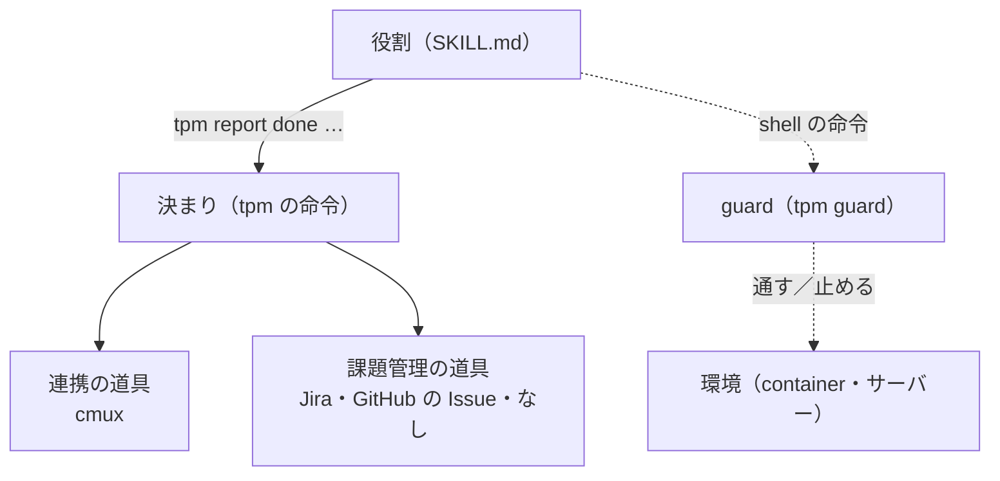
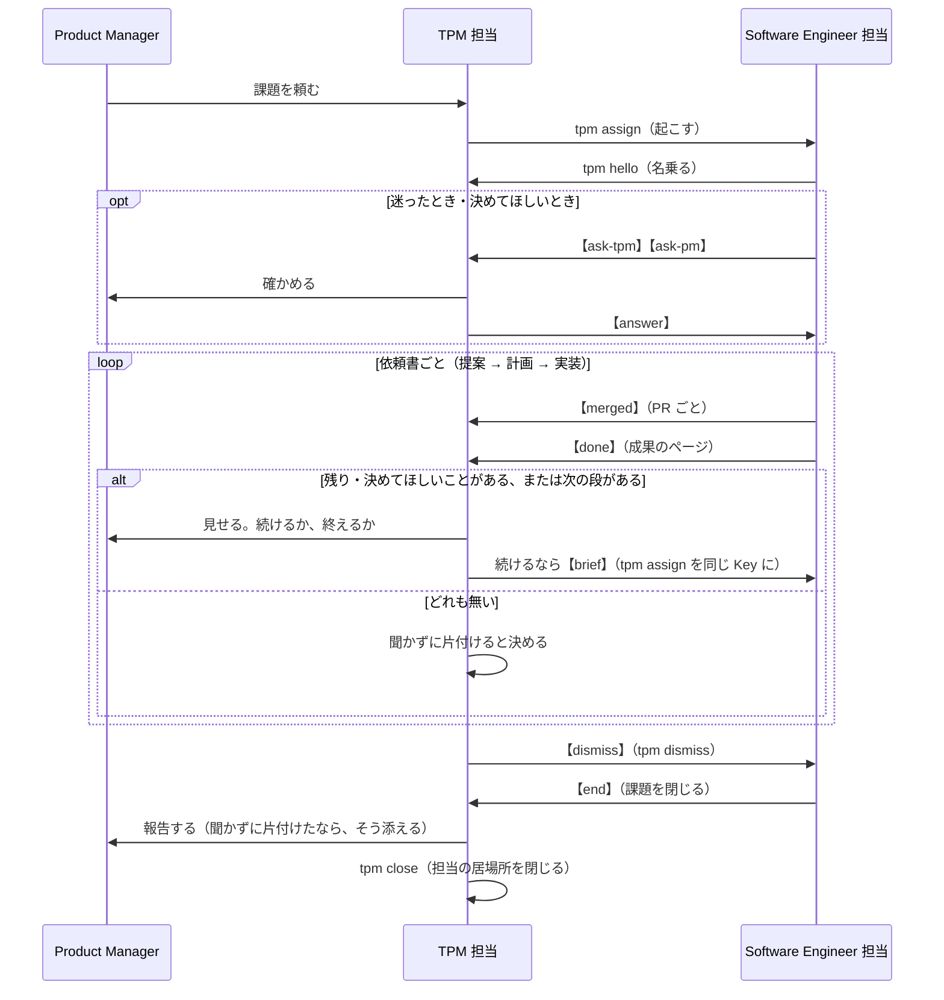

担当どうしのやりとりは、文とコードに分けてある。

- **文**（`skill-sets/core/.claude/skills/_shared/protocol.md`）: いつ・なぜ知らせるか、どの命令を打つか。どの担当もこれを読む。
- **コード**（`cli/src/`）: 見出しの表・メッセージの書式・課題への記録・状態の字・名簿。担当は `tpm` の命令を打ち、命令が道具（cmux・acli・gh）を動かす。

TPM 担当が書く依頼書には、その課題だけのことを書く（ひな形は `skill-sets/core/.claude/skills/tpm/brief-template.md`）。TPM 担当は振る前に課題を読み（`tpm issue view`）、新しい担当を起こす依頼書には課題の概要の節を書く。repo や資料を調べて案を出すのは担当。

## 層

上の層は下の層の道具を知らない。道具は使う側の project の設定で選ぶ（[設定](/configuration/)）。

| 層 | 中身 | 置き場所 |
|---|---|---|
| 役割 | 誰が何を受け持つか | `skill-sets/` の `SKILL.md` |
| 決まり | 見出し・順番・記録・名簿 | `protocol.md` の文と、`cli/src/protocol.ts`・`cli/src/roster.ts`・`cli/src/commands/` |
| 連携の道具 | メッセージを送る・担当を起こす・状態を出す | `cli/src/transport/`（`cmux`・試験用の `file`） |
| 課題管理の道具 | 課題を読む・課題に記録を書く・課題を閉じる | `cli/src/tracker/`（`jira`・`github`・`none`） |
| guard | 共有の環境と、道具の直打ちと、担当が置き場のページを消す要求を止める | `cli/src/guard.ts`（Claude Code の hook から呼ばれる） |
| バナー | Mac のバナーを、居場所の役割 × きっかけで出すか消すか（[設定](/configuration/#mac-のバナー任意)） | `cli/src/banner.ts`・`cli/src/commands/banner.ts`（cmux の通知の hook から呼ばれる） |

## 名簿と状態の置き場

`tpm` は、TPM 担当を起こした folder（project）ごとに状態を持つ。置き場所は `~/.local/state/tpm/<project の path から作った名>/`（`$XDG_STATE_HOME` があればその下）。

| ファイル | 中身 |
|---|---|
| `tpm.jsonc` | TPM 担当の宛先。担当はメッセージを送るたびに読むので、TPM 担当を起こし直しても担当に知らせ直さなくてよい |
| `roles/<Key>.jsonc` | 名簿。課題の Key → 役割・居場所の宛先・依頼書・課題管理の課題 |
| `approvals/<環境>.jsonc` | Product Manager の承認と期限 |
| `log.jsonl`・`infra.jsonl` | 送ったメッセージ（時刻・Key・見出し・本文・送った時に届いたか・返事の先）と、`tpm infra run` で打った命令の記録 |
| `deliveries.jsonl` | メッセージの送った・届いた・読んだ時刻（連携の道具が覚えている物の写し）。cmux は新しい 1,000 件より古い物を捨てるので、`tpm close` で居場所を閉じる前と、TPM 担当が `tpm hello` を打った時に写す。変わった時だけ 1 行足すので、同じ id の行は後ろが新しい |
| `tracker.jsonl` | `tpm` が課題管理に書いた物（コメント・済み）。時刻・打った担当・課題・記録の種類・通ったか。課題管理の履歴は人も担当も同じ account なので、`tpm` の手かどうかはここで見分ける |
| `guard.jsonl`・`gate.jsonl` | guard が止めた命令（頭の 300 字と訳）と、入口の検査が送るのを止めた回（読んでいないメッセージ・merge していない PR・読めない PR・同じメッセージの 2 度送り） |
| `waits.jsonl` | 状態 `wait` の移り変わり（`waits/<宛先>.jsonc` は最後の 1 つだけ） |
| `shown/<宛先>.jsonc` | 居場所に見せたメッセージの id（`tpm inbox` と、送る前の検査が見せた物。新しい 200 件）。送る前の検査は、ここに無いメッセージがあれば 1 度止まる |
| `incidents/<番号>.jsonc` | 台帳。思わぬ出来事（信頼性・安全性・効率性が落ちた時）の 1 件 1 ファイル。書いた担当・種類・起きた事実・tag・扱い（未決・振った・調べない・済み）と、結んだ振り先・PR |
| `waits/<宛先>.jsonc` | 居場所が最後に打った `tpm wait` の種類と時刻。バナーの hook が「この回に `tpm wait pm` を打ったか」を見る |
| `banner/last-turn/<宛先>.jsonc`・`banner.jsonl` | バナーの hook が覚える、居場所の前の「答え終わった」の時刻と、決めたことの記録 |

1 件 1 ファイルの物は、`config.jsonc` と同じく JSONC（コメントと末尾のカンマを許す JSON）として読む。`tpm` は読んだ値を書き直すので、手で足したコメントは書き直しで消える。足していく記録は 1 行 1 件の JSON（JSON Lines）のまま。記録（`*.jsonl`）は、後から「何が・いつ・誰の手で起きたか」を言うための証拠で、`tpm` は消さない（`banner.jsonl` だけは 7 日）。メッセージや命令の字が入るので、この Mac の外（課題のコメント・PR の本文）には写さない。古い名の `*.json` が残っていれば、`tpm` が最初に動いたときに `*.jsonc` に名前を替えて移す。

名簿は「Key → 宛先」を覚えるだけで、動いているかは毎回、連携の道具に聞く。`tpm roles` は、名簿にあって居場所が無い担当を「消えた」と出す。

## ページの置き場

依頼書・確認・提案・計画・結果の HTML を置く、この Mac だけの置き場。ページを DB に持つサーバー（別の repo の pagetray）の container が、`127.0.0.1` だけで待ち受ける（起こし方は [運用](/operations/#ページの置き場pagetray)。起こす・止めるのは DevOps Engineer 担当）。`http://127.0.0.1:8801/` が一覧の UI で、Product Manager は、置いた担当の役割・居場所（workspace の ID）・Key・種類で絞り、時刻で並べ、題と本文を探して、選んだ 1 枚を同じ画面で読む。

- `tpm page put <file> --kind <種類>` が、file を置き場に送り、URL（`<置き場の URL>/<状態の folder の名>/<Key>/<種類>-<番号>.html`）を出す。置いた担当の役割（`$TPM_ROLE`。TPM 担当は `tpm`）と居場所の宛先も、一緒に置き場に入る。同じ中身を、この Mac の控えの folder（`<控えの folder>/<状態の folder の名>/<Key>/<種類>-<番号>.html`）にも写す。種類は `brief`・`confirm`・`proposal`・`plan`・`result`・`issue`（課題の写し。ふだんは `tpm assign` が置く）・`timeline`（時系列。`tpm incident timeline` が置く）。Key は担当なら今の課題の Key、TPM 担当は `--key` で書く。番号は置き場が決める（同じ Key・同じ種類の次の番号。多くの担当が同時に置いても重ならない。消したページの番号も使わない）。置いたページを書き換えるエンドポイントは無い（置き直すと次の番号）。
- project は `$TPM_PROJECT`、無ければ今いる folder。`.claude/roles/config.jsonc` も TPM 担当が起きた印（状態の folder の `tpm.jsonc`）も無い folder（scratchpad など）から `tpm page put` を打つと、置き場に頼む前に止まる（その folder の名が別の project として置かれるのを防ぐ）。project の folder で打つか、`$TPM_PROJECT` を付ける。
- 置き場が応えなければ、ページは置けない。控えにあるページは読める。`tpm ask devops` で起こすよう頼む。
- `tpm page path <URL>` が、置き場の URL を控えの file の path にする（Read tool で読むため）。控えに無ければ、置き場から取って控えに写す。前の置き場の `http://127.0.0.1:8800` の URL も、同じ控えの path になる（browser では、置き場が 8800 でも同じ path で返す）。ページの `src`・`href` が相対で参照する file（下）のうち控えに無い物も取り、ページから同じ相対の所に写して、`参照の file:` の行に path を出す（取れなければ `注意:` の行を出し、ページの path は返す）。
- `tpm page list` が、置き場のページを絞って探す（`--key`・`--role`・`--workspace`・`--kind`・`--q`。`--json` は記録の配列）。既定は今の project の新しい順 50 件で、`--all-projects` でほかの project も出す。
- `tpm page import` が、控えの folder にあって置き場に無いページを、同じ番号・file の時刻で置き場に入れる（DB を失った後。何度打っても同じ結果）。置いた担当はわからないので、役割は依頼書と課題の写しだけ `tpm`、ほかは `unknown` で入る。控えの `<Key>/files/` の file も同じ決まりで入れる（役割は `unknown`）。
- `tpm page delete` が、ページを置き場と控えの folder から消す（戻せない）。**消してよいのは TPM 担当だけ**で、担当の居場所から打つと止まる（担当は `tpm ask tpm` で、消すページの URL と訳を送って頼む。置き場に消す要求を直に送る `curl` と、置き場の CLI の `pagetray page delete` も guard が止める）。URL を名指すと 1 枚、`--key <Key>` でその Key のページみな、`--project <名>` だけで、その project（状態の folder の名）のページみなを消す（`--key`・`--project` は、合う file も一緒に消す）。まず消す物を一覧で出し、`--yes` を付けたときだけ消す。消したページの URL は `410` を返し、その番号は 2 度使われず、`tpm page import` でも入らない。
- ページに付ける画像・PDF・字の file（png・jpg・jpeg・gif・webp・pdf・txt・log・md・csv・json。1 つ 16 MiB まで）は、`tpm file` で置き場（pagetray 0.4.0 から）に上げる。URL は `<置き場の URL>/<状態の folder の名>/<Key>/files/<語>-<番号>.<拡張子>` で、ページからは相対で参照する（同じ Key なら `files/<語>-<番号>.<拡張子>`、別の Key なら `../<Key>/files/…`）。控えも同じ形（`<控えの folder>/<状態の folder の名>/<Key>/files/`）に写すので、置き場でも控えでも図が出る。
  - `tpm file put <file>` が上げて、控えに写し、URL と `ページからの参照:` を出す。名は元の file の名から作る（小文字にし、英小文字・数字・`-`・`_` でない字を `-` にする。`--name <語>.<拡張子>` で替えられる）。番号は置き場が決め、同じ名で上げ直すと次の番号。
  - 上げた物は model にも人にも見えるので、画像と PDF は `--reviewed` が無いと止まる（Read tool で見て、token・鍵・個人の情報・ほかの人の画面・この Mac の path が写っていないか確かめてから付ける）。字の file は秘密の形（GitHub・AWS・Slack・Atlassian の token、`sk-` の鍵、秘密の鍵の頭など）を走査し、当たれば行の番号を出して止まる。わざと上げるなら `--allow-secret`（状態の folder の `file-secret.jsonl` に残る）。EXIF のある JPEG は、上げた上で位置情報の注意を出す。
  - `tpm file path <URL>` が控えの path を返す（控えに無ければ取る）。`tpm file list` が探す（`--key`・`--role`・`--q`・`--json`・`--all-projects`）。
  - `tpm file delete <URL>…` が消す（**TPM 担当だけ**。戻せない）。まず消す物と、それを参照している同じ project のページを出し、`--yes` を付けたときだけ消す。消した URL は `410` を返す。
  - 置き場が file のエンドポイントを持たない（0.4.0 より前）と、`tpm file` は「置き場（pagetray）の版が古く」と言って止まる。`tpm page` は今までどおり動く。
- project の名に状態の folder の名を使うので、TPM 担当と、起こされた担当とで URL がずれない。課題の folder の URL（`…/<Key>/`）は、その課題で絞った一覧を出す。
- 控えの folder と置き場の URL は、環境変数 `TPM_PAGES_DIR`・`TPM_PAGES_URL` で替えられる（[設定](/configuration/)）。

## 状態

各担当は、連携の道具の表示（cmux ならサイドバー）に `model` と `wait` の 2 つだけを出す。`wait` は「今、誰が何を待っているか」を 1 つだけ出し、状況が変わるたびに上書きする（`tpm wait` などのやりとりの命令が出す。字の形は `protocol.md` の「状態」）。

`tpm wait` は、打った種類と時刻を状態の folder の `waits/<宛先>.jsonc` にも書く。Mac のバナーの hook は、TPM 担当が前に答え終わった時より後に `tpm wait pm` を打っていれば、その回の「答え終わった」のバナーを出す（[設定](/configuration/#mac-のバナー任意)）。TPM 担当は手が空くと `回答待ち(PM): 指示` のまま待つので、状態の字だけでは、担当のメッセージをひとりで片付けた回と見分けられないため。だから TPM 担当は、Product Manager に返して手を止める回は毎回 `tpm wait pm` を打つ（`/tpm` の skill）。

## 見出しの流れ

担当どうしは、`tpm` の命令で見出しの付いたメッセージを送り合う。Software Engineer 担当の 1 つの課題では、おおよそ次の順に流れる（見出しと命令の一覧は `protocol.md`）。

## 入口の検査

メッセージを送る命令は、送る前に 3 つを見る（`cli/src/commands/messages.ts` の `assertRead`・`assertMerged`・`assertNotRepeat`）。どれも、課題への記録や課題の写しを書く前に見るので、止まった回は何も残さない。

- **読んでいないメッセージ**: 自分宛てでまだ届いていないメッセージ（相手が送った時、こちらが手を動かしていた物）のうち、まだ見せていない物があれば、それを出して 1 度止まる。同じ命令を打ち直すと送る。相手のメッセージを読む前に次を送る行き違い（同じ問いを 2 度送る・答えを待たずに【done】を送る）を減らすため。TPM 担当は、送る相手の担当から来た物だけを見る（ほかの担当のメッセージでは止まらない）。`tpm inbox` で見た物では止まらない。送った後で相手が動いた行き違いは防げない。
- **PR が merge 済みか**: `tpm report merged`・`tpm report doc-fix`・`tpm report end --pr` は、`gh pr view <URL> --json state` が `MERGED` を返さなければ送らない（merge が断られたのに【merged】を送らないため）。`gh` で読めない PR は、`--unchecked "<訳>"` で確かめずに送れる（訳はメッセージに載る）。
- **同じメッセージの 2 度送り**: 同じ差出人が、同じ宛先に、同じ見出し・本文・返事の先のメッセージを 30 秒の内に送っていたら、2 度目を送らない。止まった命令の打ち直しを `;` や `||` で 1 行に続けて書くと、止まらなかった時にも 2 度目が動き、課題の記録も 2 件になるため（実際に起きた）。

## 台帳

思わぬ出来事を、気づいた担当がその場で 1 行書く置き場（いつ・何を書くかは `protocol.md` の「思わぬ出来事」と `/tpm` の「監査」）。コードは `cli/src/incidents.ts` と `cli/src/commands/incident.ts`。

| 入り口 | 命令 | 打つ担当 |
|---|---|---|
| 気づいた出来事 | `tpm incident add`・`tpm report incident`（【incident】） | TPM 担当・担当 |
| 【done】の「残り」・【end】の「残っている物」 | `tpm report done`・`tpm report end`（「なし」で始まらなければ入る） | 担当 |
| Product Manager に頼んだ手の操作 | `tpm wait pm "<何を>" --hand` | TPM 担当 |

- 番号は、今の最大＋1 から、無い番号の file を「在れば失敗」で作って決める（担当が同時に書いても同じ番号にならない）。
- 種類（`--type`）は `reliability`・`safety`・`efficiency`。tag は任意で、書いた時に同じ tag の前の件数を返す（「権限: これで 4 件目」）。
- 見直す（`tpm incident review`）・tag を足す（`tpm incident tag`）・扱いを決める（`tpm incident assign`・`tpm incident drop`・`tpm incident close`）のは TPM 担当だけ。担当の居場所からは止まる。
- `tpm incident timeline <番号|Key>` が、時系列のページ（種類は `timeline`）を置く（`cli/src/commands/timeline.ts`）。番号なら、引き金のメッセージ（`--msg`。無ければ件を書いた時刻）の前後 30 分（`--minutes`）の、その Key の記録を拾い、件に URL を結ぶ。Key なら、その Key の記録をみな拾う。並べるのは `log.jsonl`（`deliveries.jsonl` の届いた時刻を添える）・`tracker.jsonl`・`guard.jsonl`・`gate.jsonl`・`waits.jsonl`・`infra.jsonl`・台帳。あるメッセージが届く前に、相手（向きが逆）が送ったメッセージがあれば「行き違い」の印を付ける。作る前に、届いた時刻を連携の道具から写す。
- 【incident】は課題管理に記録を書かない。台帳の中身と時系列のページは、この Mac の外に写さない。

## guard

`tpm start` の 1 行と `tpm assign` は、起こす claude に `--settings` で hook を付ける。担当が shell の命令を打つと、実行の前に `tpm guard` が見て、通すか止めるかを決める（hook の拒否は `bypassPermissions` でも効く）。

止めるのは 2 つ。

- **共有の環境に触る命令**: 設定の `infra` の `match` に当たる命令を、環境の手続きで見る（[設定](/configuration/)）。「TPM に相談」と「PM の承認」は DevOps Engineer 担当だけが通り、「PM の承認」は `tpm infra approve` で書いた承認の期限の中だけ通る。
- **道具の直打ち**: `cmux agent message`・`cmux set-status`・`cmux workspace create`・`cmux workspace close`、`acli` の記録と状態、（課題管理が GitHub の Issue の project では）`gh issue comment`・`gh issue close`。`tpm` を通さないと記録と状態が抜けるため。課題を読む命令（`acli jira workitem view` など）は止めない。

見方は 2 つで違う。

- 共有の環境は、命令の字全体に `match` の字が含まれるかで見る。疑わしければ止める方に倒すため、commit の文に書いただけでも止まる。
- 道具の直打ちは、命令を `;`・`&&`・`|`・改行などで単純な命令に分け、その頭（実際に打つ道具の命令）だけを見る（`cli/src/shell.ts` の `splitCommands`）。頭の代入（`FOO=1`）・前に付く語（`sudo`・`env`・`if` など）・path は外して見て、`$(…)`・`` `…` ``・`sh -c '…'` の中の命令も見る。引用の中の字・here-document の中身・注釈は命令でないので、commit の文や `grep` の型に道具の名が入っても止めない。

guard は字で見るので、防げるのは「うっかり」まで。script に包んだ命令や別名はすり抜ける。ほかの人と共有の環境を確実に守るには、担当に渡す権限を読むだけにする。
