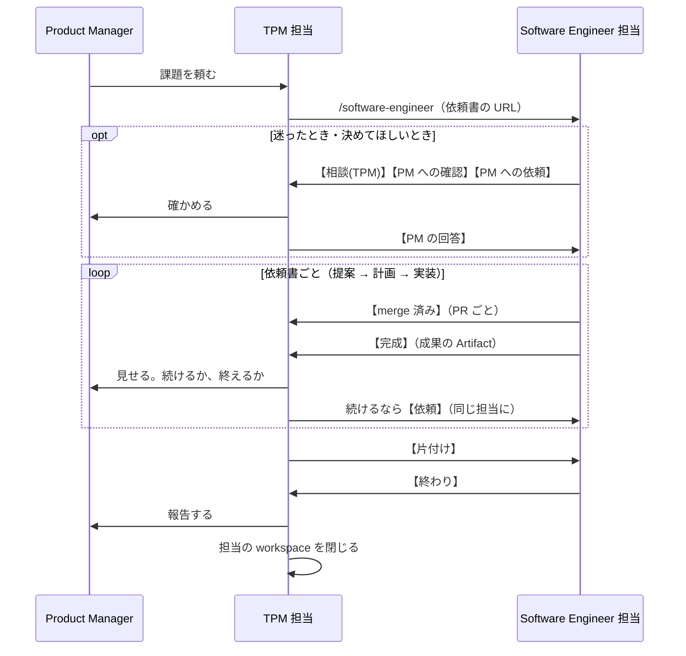

「連絡の仕方と見出し・サイドバーの `model` と `wait`・文書の食い違い・共有の環境・終わり方」は `skill-sets/core/.claude/skills/_shared/protocol.md` の 1 か所に書き、どの担当もそれを読む。Jira の課題へのコメントの書き方と読み方・Product Manager への確かめ方・状態の進め方・課題の登録は `skill-sets/core/.claude/skills/_shared/jira.md` に書き、Jira を触る担当がその場面で読む。決まりの本文は、このページには写さない（skill が読む原本は `protocol.md`）。

TPM 担当が書く依頼書には、その課題だけのことを書く（ひな形は `skill-sets/core/.claude/skills/tpm/brief-template.md`）。

## サイドバー

各担当は、cmux のサイドバーの自分の workspace に `model` と `wait` の 2 つだけを出す。`wait` は「今、誰が何を待っているか」を 1 つだけ出し、状況が変わるたびに上書きする（字の形は `protocol.md` の「サイドバー」）。

## 見出しの流れ

担当どうしは、`cmux agent message` で見出しの付いた知らせを送り合う。Software Engineer 担当の 1 つの課題では、おおよそ次の順に流れる（見出しの一覧と中身は `protocol.md`）。

