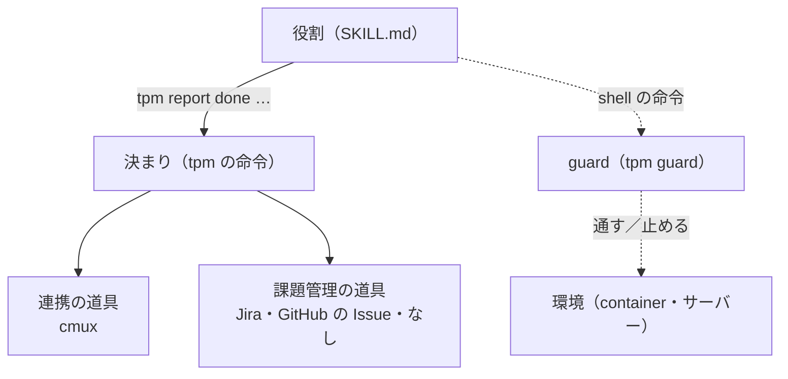
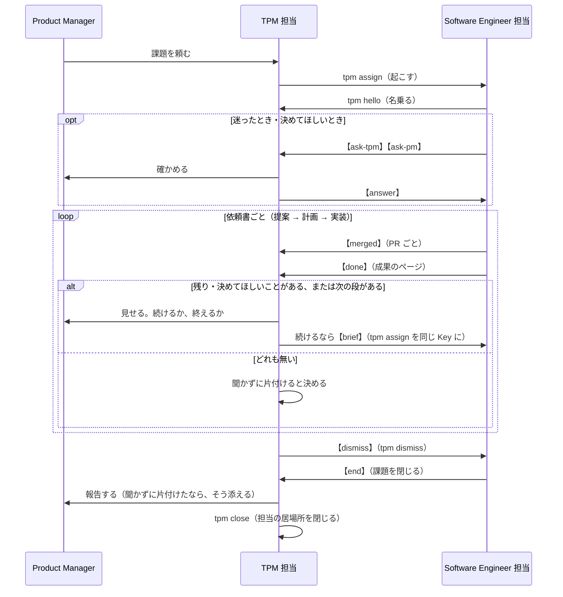

担当どうしのやりとりは、文とコードに分けてある。

- **文**（`skill-sets/core/.claude/skills/_shared/protocol.md`）: いつ・なぜ知らせるか、どの命令を打つか。どの担当もこれを読む。
- **コード**（`cli/src/`）: 見出しの表・メッセージの書式・課題への記録・状態の字・名簿。担当は `tpm` の命令を打ち、命令が道具（cmux・acli・gh）を動かす。

TPM 担当が書く依頼書には、その課題だけのことを書く（ひな形は `skill-sets/core/.claude/skills/tpm/brief-template.md`）。TPM 担当は振る前に課題を読み（`tpm issue view`）、新しい担当を起こす依頼書には課題の概要の節を書く。repo や資料を調べて案を出すのは担当。

## 層

上の層は下の層の道具を知らない。道具は使う側の project の設定で選ぶ（[設定](/configuration/)）。

| 層 | 中身 | 置き場所 |
|---|---|---|
| 役割 | 誰が何を受け持つか | `skill-sets/` の `SKILL.md` |
| 決まり | 見出し・順番・記録・名簿 | `protocol.md` の文と、`cli/src/protocol.ts`・`cli/src/roster.ts`・`cli/src/commands/` |
| 連携の道具 | メッセージを送る・担当を起こす・状態を出す | `cli/src/transport/`（`cmux`・試験用の `file`） |
| 課題管理の道具 | 課題を読む・課題に記録を書く・課題を閉じる | `cli/src/tracker/`（`jira`・`github`・`none`） |
| guard | 共有の環境と、道具の直打ちと、担当が置き場のページを消す要求と、Auditor が repo・設定・記録を変えることと、Audit の席を起こす命令を止める | `cli/src/guard.ts`（Claude Code の hook から呼ばれる） |
| バナー | Mac のバナーを、居場所の役割 × きっかけで出すか消すか（[設定](/configuration/#mac-のバナー任意)） | `cli/src/banner.ts`・`cli/src/commands/banner.ts`（cmux の通知の hook から呼ばれる） |

## 名簿と状態の置き場

`tpm` は、TPM 担当を起こした folder（project）ごとに状態を持つ。置き場所は `~/.local/state/tpm/<project の path から作った名>/`（`$XDG_STATE_HOME` があればその下）。

| ファイル | 中身 |
|---|---|
| `tpm.jsonc` | TPM 担当の宛先。担当はメッセージを送るたびに読むので、TPM 担当を起こし直しても担当に知らせ直さなくてよい |
| `roles/<Key>.jsonc` | 名簿。課題の Key → 役割・居場所の宛先・依頼書・課題管理の課題 |
| `approvals/<環境>.jsonc` | Product Manager の承認と期限 |
| `log.jsonl`・`infra.jsonl` | 送ったメッセージ（時刻・Key・見出し・本文・送った時に届いたか・返事の先）と、`tpm infra run` で打った命令の記録 |
| `deliveries.jsonl` | メッセージの送った・届いた・読んだ時刻（連携の道具が覚えている物の写し）。cmux は新しい 1,000 件より古い物を捨てるので、`tpm close` で居場所を閉じる前と、TPM 担当が `tpm hello` を打った時に写す。変わった時だけ 1 行足すので、同じ id の行は後ろが新しい |
| `tracker.jsonl` | `tpm` が課題管理に書いた物（コメント・済み）。時刻・打った担当・課題・記録の種類・通ったか。課題管理の履歴は人も担当も同じ account なので、`tpm` の手かどうかはここで見分ける |
| `guard.jsonl`・`gate.jsonl` | guard が止めた命令（頭の 300 字と訳）と、入口の検査が送る・置くのを止めた回（読んでいないメッセージ・merge していない PR・読めない PR・同じメッセージの 2 度送り・TPM 担当が送って済んでいない物・前の監査の文脈が残ったまま始めようとした監査） |
| `audits.jsonl` | 監査線の記録（下の「Auditor の席」）。Auditor の席を起こした・新しい文脈になった（席を起こした時と `/clear` の時）・監査を始めた・報告した・決定を渡した・Auditor の置いたページを消した、を 1 行ずつ。Auditor の席を 1 度も起こしていない project には無い |
| `waits.jsonl` | 状態 `wait` の移り変わり（`waits/<宛先>.jsonc` は最後の 1 つだけ） |
| `shown/<宛先>.jsonc` | 居場所に見せたメッセージの id と、初めて見せた時刻（`tpm inbox`・`tpm hello` と、送る前の検査が見せた物。新しい 200 件）。送る前の検査は、ここに無いメッセージがあれば 1 度止まる。TPM 担当が送って済んでいない物の検査は、この時刻を「担当が依頼書を見た時」に使う |
| `incidents/<番号>.jsonc` | 台帳。思わぬ出来事（信頼性・安全性・効率性が落ちた時）の 1 件 1 ファイル。書いた担当・種類・起きた事実・tag・扱い（未決・振った・調べない・済み）と、結んだ振り先・PR |
| `waits/<宛先>.jsonc` | 居場所が最後に打った `tpm wait` の種類と時刻。バナーの hook が「この回に `tpm wait pm` を打ったか」を見る |
| `sessions/<session の id>.jsonc`・`launches/<起こしの id>.jsonc` | castlist に登録した session の本当の id と名・居るか・送った出来事の番号・最後に送った見た model と effort（[アクターの台帳](#アクターの台帳castlist)）と、起こし 1 回の session の並び。castlist を設定した project にだけある |
| `banner/last-turn/<宛先>.jsonc`・`banner.jsonl` | バナーの hook が覚える、居場所の前の「答え終わった」の時刻と、決めたことの記録 |

1 件 1 ファイルの物は、`config.jsonc` と同じく JSONC（コメントと末尾のカンマを許す JSON）として読む。`tpm` は読んだ値を書き直すので、手で足したコメントは書き直しで消える。足していく記録は 1 行 1 件の JSON（JSON Lines）のまま。記録（`*.jsonl`）は、後から「何が・いつ・誰の手で起きたか」を言うための証拠で、`tpm` は消さない（`banner.jsonl` だけは 7 日）。メッセージや命令の字が入るので、この Mac の外（課題のコメント・PR の本文）には写さない。古い名の `*.json` が残っていれば、`tpm` が最初に動いたときに `*.jsonc` に名前を替えて移す。

名簿は「Key → 宛先」を覚えるだけで、動いているかは毎回、連携の道具に聞く。`tpm roles` は、名簿にあって居場所が無い担当を「消えた」と出す。

## ページの置き場

依頼書・確認・提案・計画・結果の HTML を置く、この Mac だけの置き場。ページを DB に持つサーバー（別の repo の pagetray）の container が、`127.0.0.1` だけで待ち受ける（起こし方は [運用](/operations/#ページの置き場pagetray)。起こす・止めるのは DevOps Engineer 担当）。`http://127.0.0.1:8801/` が一覧の UI で、Product Manager は、置いた担当の役割・居場所（workspace の ID）・Key・種類で絞り、時刻で並べ、題と本文を探して、選んだ 1 枚を同じ画面で読む。

- `tpm page put <file> --kind <種類>` が、file を置き場に送り、URL（`<置き場の URL>/<状態の folder の名>/<Key>/<種類>-<番号>.html`）を出す。置いた担当の役割（`$TPM_ROLE`。TPM 担当は `tpm`）と居場所の宛先も、一緒に置き場に入る。同じ中身を、この Mac の控えの folder（`<控えの folder>/<状態の folder の名>/<Key>/<種類>-<番号>.html`）にも写す。種類は `brief`・`confirm`・`proposal`・`plan`・`result`・`issue`（課題の写し。ふだんは `tpm assign` が置く）・`timeline`（時系列。`tpm incident timeline` が置く）・`audit`（監査。思わぬ出来事の原因と改善案）。Key は担当なら今の課題の Key、TPM 担当は `--key` で書く。番号は置き場が決める（同じ Key・同じ種類の次の番号。多くの担当が同時に置いても重ならない。消したページの番号も使わない）。置いたページの本文を書き換えるエンドポイントは無い（置き直すと次の番号。置いた後に変わるのは、下の返事の状態だけ）。
- project は `$TPM_PROJECT`、無ければ今いる folder。`.claude/roles/config.jsonc` も TPM 担当が起きた印（状態の folder の `tpm.jsonc`）も無い folder（scratchpad など）から `tpm page put` を打つと、置き場に頼む前に止まる（その folder の名が別の project として置かれるのを防ぐ）。project の folder で打つか、`$TPM_PROJECT` を付ける。
- 置き場が応えなければ、ページは置けない。控えにあるページは読める。`tpm ask devops` で起こすよう頼む。
- `tpm page path <URL>` が、置き場の URL を控えの file の path にする（Read tool で読むため）。控えに無ければ、置き場から取って控えに写す。前の置き場の `http://127.0.0.1:8800` の URL も、同じ控えの path になる（browser では、置き場が 8800 でも同じ path で返す）。ページの `src`・`href` が相対で参照する file（下）のうち控えに無い物も取り、ページから同じ相対の所に写して、`参照の file:` の行に path を出す（取れなければ `注意:` の行を出し、ページの path は返す）。
- `tpm page list` が、置き場のページを絞って探す（`--key`・`--role`・`--workspace`・`--kind`・`--q`・`--reply`。`--json` は記録の配列）。既定は今の project の新しい順 50 件で、`--all-projects` でほかの project も出す。
- **返事の状態**（pagetray 0.5.0 から）: 置き場は、Product Manager の返事が要るページに「返事待ち」「答えた」の状態を持ち、一覧の UI は、操作の帯の「返事待ち N 件」・行の印・絞り込みの「返事」で出す。書くのは `tpm` の命令で、担当は手で書かない。
  - `tpm ask pm --url <確認の URL>` が、【ask-pm】を送った後に、そのページを返事待ちにする（置いただけの確認には印が付かない）。
  - `tpm ask pm --supersede <古い確認の URL>`（何度でも）が、この確認で置き換える古い確認の返事待ちを外す。受けるのは同じ Key の返事待ちの確認だけで、別の project・Key・答え済み・送っていない確認・送る確認そのものは、送る前に断る。【ask-pm】の本文に「置き換える確認:」と URL が載る（log に残る）。置き場が応えない時は確かめずに送り、外せなかったことと `tpm page reply <URL> --answered` の直し方を出す。
  - `tpm answer <Key> "<答え>"` が、【answer】を返した後に、その Key の返事待ちのページを答えたにする。返事待ちが 2 枚以上ある時は、送る前に止まって URL を並べる（別の確認まで答えたにしないため）。どのページへの答えかを `--url <確認の URL>`（何度でも）で書くか、みなへの答えなら `--all` を付ける。
  - `tpm page reply <URL>… --waiting|--answered` が、状態を手で直す（TPM 担当だけ）。`tpm answer` を通らずに済んだ確認と、置き場が応えない間に送った確認に使う。`tpm page list --reply waiting` が、今の返事待ちを並べる。`tpm dismiss` は、その Key に返事待ちのページが残っていれば URL を出す（止めない）。
  - 状態を持てない置き場（止まっている・0.5.0 より前）でも、`tpm ask pm`・`tpm answer`・`tpm dismiss` はメッセージを送り、`置き場の印: 付けていない` と訳を出す。`tpm page reply` だけは誤りで止まる。
  - pagetray 0.5.0 より前に置かれたページと、`tpm ask pm` で送っていないページは、状態を持たない（印は付かない）。
- `tpm page import` が、控えの folder にあって置き場に無いページを、同じ番号・file の時刻で置き場に入れる（DB を失った後。何度打っても同じ結果）。置いた担当はわからないので、役割は依頼書と課題の写しだけ `tpm`、ほかは `unknown` で入る。控えの `<Key>/files/` の file も同じ決まりで入れる（役割は `unknown`）。
- `tpm page delete` が、ページを置き場と控えの folder から消す（戻せない）。**消してよいのは TPM 担当だけ**で、担当の居場所から打つと止まる。Auditor が置いたページ（置いた担当の役割が `auditor`）は、Product Manager の言葉を `--pm "<言葉>"` に添えなければ消せず、消した事は `audits.jsonl` に残る（担当は `tpm ask tpm` で、消すページの URL と訳を送って頼む。置き場に消す要求を直に送る `curl` と、置き場の CLI の `pagetray page delete` も guard が止める）。URL を名指すと 1 枚、`--key <Key>` でその Key のページみな、`--project <名>` だけで、その project（状態の folder の名）のページみなを消す（`--key`・`--project` は、合う file も一緒に消す）。まず消す物を一覧で出し、`--yes` を付けたときだけ消す。消したページの URL は `410` を返し、その番号は 2 度使われず、`tpm page import` でも入らない。
- ページに付ける画像・PDF・字の file（png・jpg・jpeg・gif・webp・pdf・txt・log・md・csv・json。1 つ 16 MiB まで）は、`tpm file` で置き場（pagetray 0.4.0 から）に上げる。URL は `<置き場の URL>/<状態の folder の名>/<Key>/files/<語>-<番号>.<拡張子>` で、ページからは相対で参照する（同じ Key なら `files/<語>-<番号>.<拡張子>`、別の Key なら `../<Key>/files/…`）。控えも同じ形（`<控えの folder>/<状態の folder の名>/<Key>/files/`）に写すので、置き場でも控えでも図が出る。
  - `tpm file put <file>` が上げて、控えに写し、URL と `ページからの参照:` を出す。名は元の file の名から作る（小文字にし、英小文字・数字・`-`・`_` でない字を `-` にする。`--name <語>.<拡張子>` で替えられる）。番号は置き場が決め、同じ名で上げ直すと次の番号。
  - 上げた物は model にも人にも見えるので、画像と PDF は `--reviewed` が無いと止まる（Read tool で見て、token・鍵・個人の情報・ほかの人の画面・この Mac の path が写っていないか確かめてから付ける）。字の file は秘密の形（GitHub・AWS・Slack・Atlassian の token、`sk-` の鍵、秘密の鍵の頭など）を走査し、当たれば行の番号を出して止まる。わざと上げるなら `--allow-secret`（状態の folder の `file-secret.jsonl` に残る）。EXIF のある JPEG は、上げた上で位置情報の注意を出す。
  - `tpm file path <URL>` が控えの path を返す（控えに無ければ取る）。`tpm file list` が探す（`--key`・`--role`・`--q`・`--json`・`--all-projects`）。
  - `tpm file delete <URL>…` が消す（**TPM 担当だけ**。戻せない）。まず消す物と、それを参照している同じ project のページを出し、`--yes` を付けたときだけ消す。消した URL は `410` を返す。
  - 置き場が file のエンドポイントを持たない（0.4.0 より前）と、`tpm file` は「置き場（pagetray）の版が古く」と言って止まる。`tpm page` は今までどおり動く。
- Product Manager が読むページ（確認・提案・計画・結果・監査）には、図をページの中の inline の SVG で入れる。どのページにどの図を入れるかは `skill-sets/core/.claude/skills/_shared/protocol.md` の「ページ」の図の項、ひな形（比べ・流れ・前と後・数の棒と、明るい画面と暗い画面の色の変数）は `skill-sets/core/.claude/skills/_shared/figures.md`。依頼書は、読むのが担当なので要る所だけ。図を入れないページには、入れない訳を頭に 1 行書く。
- project の名に状態の folder の名を使うので、TPM 担当と、起こされた担当とで URL がずれない。課題の folder の URL（`…/<Key>/`）は、その課題で絞った一覧を出す。
- 控えの folder と置き場の URL は、環境変数 `TPM_PAGES_DIR`・`TPM_PAGES_URL` で替えられる（[設定](/configuration/)）。

## アクターの台帳（castlist）

設定に `castlist` の URL（[設定](/configuration/#アクターの台帳castlist任意)）があれば、`tpm` は、Claude Code の session 1 つ（TPM 担当・担当・Auditor）を castlist のアクター 1 つとして登録し、登場から退場までを送る（API は castlist の docs の [API](https://uraitakahito.github.io/castlist/api.html)。コードは `cli/src/castlist.ts`・`cli/src/commands/castlist.ts`）。設定が無ければ、何も送らない。

| いつ | 送る物 |
|---|---|
| `tpm start` | `/healthz` を見て、Product Manager を人のアクター（鍵 `tpm.person:product-manager`・名の接頭辞 `product-manager`）として登録する（何度打っても同じアクター）。1 行の頭に、起こしの印（下）を付ける |
| session の始まり（SessionStart の hook の `tpm castlist session-start`） | session を登録する（鍵は `claude.session:<session の id>`。cmux の連携なら `cmux.workspace.ref`、`$CMUX_WORKSPACE_ID` があれば `cmux.workspace.uuid` も付ける）。札は `tpm.project`・`tpm.launch`・`tpm.key`（担当だけ）・`tpm.role`（TPM 担当は `tpm`）。続けて、source ごとに: 起こした（startup）→ 登場（`entered`）と、起こした者からの線（`launched`）／続きから開いた（resume）→ 再登場（`reentered`）／要約した（compact）→ 要約（`compacted`）／`/clear` → 新しい session の登場（`entered`・`detail.source` が `clear`）と、同じ起こしの前の session からの継ぐ線（`continued`）／fork → 分身（`forked`）と継ぐ線 |
| session の終わり（SessionEnd の hook の `tpm castlist session-end`） | `/clear` なら交代（`cleared`）、ほかは退場（`exited`）。訳は `detail.reason` |
| Bash の前（`tpm guard`） | まだ登録していない session を登録する。hook の入力の effort と、写し（transcript）の最後の model（`<synthetic>` は飛ばす）が、前に送った物と違えば「見た」model と effort（`source: observed`）を送る。写しから model を読めなければ（写しの形が変わった）、session に 1 度だけ model 不明（`model_unreadable`）を送る（止めない） |
| `tpm hello` | 名乗り（`reported_in`）。出力の頭に `アクター: <名>`（`t-23zs-swe.1` など） |
| `tpm close` | その担当の起こしのアクターのうち、まだ居る物に幕引き（`closed`） |

- **名**: castlist が `<接頭辞>.<番号>` で出す（番号は issuer と接頭辞ごと）。接頭辞は、担当が `<Key>-<役割の略>`（`swe`・`devops`・`sus`）、TPM 担当が `<project の folder の名>-tpm`、Auditor が `<project の folder の名>-audit`。castlist の接頭辞は英小文字・数字・`-` だけなので、`.` でなく `-` でつなぎ、Key の大文字は小文字に、ほかの字は `-` に替える。issuer は `tpm.` と状態の folder の名（英小文字に替える。64 字を超える名は、頭を残して hash を足す）。
- **起こしの印**（環境変数）: 起こす側が付け、hook が読む。`TPM_LAUNCH`（起こしの id。`tpm start` の 1 行は打つたびに `uuidgen` で作り、`tpm assign`・`tpm audit start` は名簿の `launch` に書く）・`TPM_LAUNCHED_BY`（起こした者。`tpm assign` は打った TPM 担当の `claude.session:<$CLAUDE_CODE_SESSION_ID>`、`tpm start` と `tpm audit start` は Product Manager）・`TPM_LAUNCH_MODEL`・`TPM_LAUNCH_EFFORT`（claude の `--model`・`--effort` と同じ値）・`TPM_LAUNCH_FRESH=1`（起こしたばかりの印）。担当には `tpm run-role` が名簿から付ける。
- **頼んだ model と effort**（`requested`）は、起こしたばかりの process の初めの登録（startup か resume）でだけ送る。`/clear` の後の session は同じ環境変数を持つが、その間に `/model` で替えたかもしれないので送らない。どの起こしで送ったかは状態の folder の `launches/<起こしの id>.jsonc` に残す。
- **id**: 出来事・線・model と effort の id は、issuer・session・種類（と、何度も起きる物は番号）で決める。送り直しても同じ id なので、castlist は 2 度足さない。番号は送れた時だけ進める。登録の答え（本当の id と名）は `sessions/<session の id>.jsonc` に控える。
- **castlist が止まっている時**: `tpm start`・`tpm assign`・`tpm audit start`・`tpm hello` は、起こさず・名乗らずに止まり、Product Manager が自分の terminal で打つ 1 行を出す（container が在れば `container start castlist`、無ければ `container run …`。castlist を起こすのは Product Manager だけ）。`tpm assign` は、TPM 担当が `tpm wait pm "castlist を起こす" --hand` で Product Manager に頼むよう添える。hook は何も送らずに終わり（Claude Code を止めない）、登録までは `tpm guard` が Bash を同じ 1 行を添えて止める。登録した後も、送る物（見た model と effort など）があるのに止まっていれば止める。`tpm close` は止めず、送れなかったと 1 行出す。
- **時計**: 起こす前に見る `/healthz` の時刻と Mac の時計が 2 秒より離れていれば、`tpm report incident` で台帳に挙げるよう 1 行出す（止めない。`tpm start` は stderr に出す）。

## 状態

各担当は、連携の道具の表示（cmux ならサイドバー）に `model` と `wait` の 2 つだけを出す。`wait` は「今、誰が何を待っているか」を 1 つだけ出し、状況が変わるたびに上書きする（`tpm wait` などのやりとりの命令が出す。字の形は `protocol.md` の「状態」）。

`tpm wait` は、打った種類と時刻を状態の folder の `waits/<宛先>.jsonc` にも書く。Mac のバナーの hook は、TPM 担当が前に答え終わった時より後に `tpm wait pm` を打っていれば、その回の「答え終わった」のバナーを出す（[設定](/configuration/#mac-のバナー任意)）。TPM 担当は手が空くと `回答待ち(PM): 指示` のまま待つので、状態の字だけでは、担当のメッセージをひとりで片付けた回と見分けられないため。だから TPM 担当は、Product Manager に返して手を止める回は毎回 `tpm wait pm` を打つ（`/tpm` の skill）。

## 見出しの流れ

担当どうしは、`tpm` の命令で見出しの付いたメッセージを送り合う。Software Engineer 担当の 1 つの課題では、おおよそ次の順に流れる（見出しと命令の一覧は `protocol.md`）。

## 入口の検査

メッセージを送る命令は、送る前に次を見る（`cli/src/commands/messages.ts` の `assertRead`・`assertMerged`・`assertNotRepeat`・`assertSettled`）。どれも、課題への記録や課題の写しを書く前に見るので、止まった回は何も残さない。

- **読んでいないメッセージ**: 自分宛てでまだ届いていないメッセージ（相手が送った時、こちらが手を動かしていた物）のうち、まだ見せていない物があれば、それを出して 1 度止まる。同じ命令を打ち直すと送る。相手のメッセージを読む前に次を送る行き違い（同じ問いを 2 度送る・答えを待たずに【done】を送る）を減らすため。TPM 担当は、送る相手の担当から来た物だけを見る（ほかの担当のメッセージでは止まらない）。`tpm inbox` で見た物では止まらない。送った後で相手が動いた行き違いは防げない。`tpm page put` も、確認・提案・計画・結果のページ（`--kind confirm|proposal|plan|result`）を置く前に同じ検査をする（相手の答えを読む前に、古い前提のページを置かないため。`cli/src/commands/page.ts` の `assertReadBeforePut`）。担当は TPM 担当から来た物を、TPM 担当は `--key` の担当から来た物を見る。依頼書・課題の写し・時系列・監査のページは止めない。
- **PR が merge 済みか**: `tpm report merged`・`tpm report doc-fix`・`tpm report end --pr` は、`gh pr view <URL> --json state` が `MERGED` を返さなければ送らない（merge が断られたのに【merged】を送らないため）。`gh` で読めない PR は、`--unchecked "<訳>"` で確かめずに送れる（訳はメッセージに載る）。
- **同じメッセージの 2 度送り**: 同じ差出人が、同じ宛先に、同じ見出し・本文・返事の先のメッセージを 30 秒の内に送っていたら、2 度目を送らない。止まった命令の打ち直しを `;` や `||` で 1 行に続けて書くと、止まらなかった時にも 2 度目が動き、課題の記録も 2 件になるため（実際に起きた）。
- **TPM 担当が送って済んでいない物**: `tpm dismiss` と続きの `tpm assign` は、その担当に送ってまだ届いていないメッセージ（assign は【brief】だけ）か、【done】が返っていない依頼書があれば、出して止まる（自分の送った物どうしの行き違いを減らすため）。依頼書は、起こしたときに渡した物と【brief】で送った物を積み（`--after` で送った物も）、【done】が 1 つ返るごとに、そのとき担当が見ていた依頼書のうちいちばん古い物を 1 つ済ませる。担当が見た時は、画面に届いた時刻と、`tpm inbox`・送る前の検査が見せた時刻の早い方（まだ見ていない依頼書の分に、行き違いの【done】を数えない）。`--supersede` で送った【brief】と【dismiss】は前の依頼書を取り消し、【end】は全部を済ませる。`--supersede`（取り消す）か `--after`（済ませてから。assign だけ）を付けると送り、本文に一言が載る。`tpm answer`・`tpm notify` は止めない。
- **前の監査の文脈**: `tpm audit begin` は、前の報告の後に新しい文脈（席を起こした・`/clear` した）になっていなければ、監査を始めずに止まる（下の「Auditor の席」）。

## Auditor の席

Auditor（役割 `auditor`。題は `Audit`、課題の Key は `audit`。skill は `/audit`）は、担当の仕組みを見て勧める担当で、TPM 担当の回し方も見る。だから席は TPM 担当の手を通さない。何のために・どこまで・誰に、は監査の規程（`skill-sets/core/.claude/skills/_shared/audit-charter.md`。Product Manager が承認した物）、どう調べて書くかは監査の手順（`skill-sets/core/.claude/skills/_shared/audit.md`）、Product Manager の手は [運用](/operations/#監査auditor-の席)。コードは `cli/src/commands/audit.ts`・`cli/src/audits.ts` と、`cli/src/commands/messages.ts` の報告の命令。

| 命令 | 打つ人 | すること |
|---|---|---|
| `tpm audit start` | Product Manager | 名簿に Auditor の行を書き、居場所を作って、名乗るまで待つ（`--model`・`--effort`・`--permission-mode`・`--wait`）。席は project に 1 つで、もうあれば断る。居場所が消えていれば起こし直す。skill `/audit` が無ければ断る |
| `tpm hello` | Auditor | 居場所の題を `Audit` にし、状態を出し、監査の規程・手順の path と、前の監査・答えの出ていない報告を返す。TPM 担当が起きていなくても名乗れる |
| `tpm audit begin [番号…]` | Auditor | 監査を始める（番号があれば、その件の臨時の監査）。**前の報告の後に新しい文脈になっていなければ、始めずに止まる**（`gate.jsonl` に `stale-context`）。通れば、監査の材料（規程・手順・前の監査・答えの出ていない報告・台帳の件数）を返す |
| `tpm audit fresh` | Auditor の席の hook | 席を起こした時（`startup`）と `/clear` の時（`clear`）に、新しい文脈の印を書く。続きから開いた時（`resume`）と文脈を要約した時（`compact`）は書かない |
| `tpm report audit` | Auditor | 監査のページを Product Manager へじかに報告した、と記録する。TPM 担当に写し（【audit】）を送り、状態を `回答待ち(PM): 監査の報告` にする（その回の終わりに Mac のバナーが出る）。TPM 担当が起きていなければ、写しは送らずに記録だけ書く |
| `tpm report decided` | Auditor | Product Manager の決定（する・受け入れる・見送る）を TPM 担当に渡す（【decided】）。TPM 担当が起きていなければ、送らず・記録せずに止まる |

- `tpm audit start` は、担当の居場所（`$TPM_KEY` がある）からは打てない。TPM 担当と担当が道具として打つのは guard が止める（下の「guard」）。Product Manager は、cmux の中の shell で打つ。
- TPM 担当の `tpm assign`（役割 `auditor`・Key `audit`）・`tpm dismiss`・`tpm close` は、Auditor の席を断る。`tpm notify`・`tpm answer` は通る（Auditor の【ask-tpm】への答え）。居場所が消えた Auditor は、`tpm roles` に「起こし直すのは Product Manager」と出る。
- Auditor からの `tpm report done`・`end`・`merged`・`doc-fix`・`tpm ask pm` は断る（成果は PR や【done】でなく、Product Manager へじかに出す）。`tpm ask tpm`・`tpm report incident` は打てる。
- 新しい文脈の印は、Auditor の席の `--settings` に付けた SessionStart の hook が書く。前の監査の文脈が残ったまま次の監査を始めると、同じ Auditor が自分の前の勧告を自分で追いかけることになるので、`/clear` してから `/audit` を呼ぶ決まりを、この検査で守る。
- TPM 担当の `tpm hello`・`tpm roles` は、Auditor の席を 1 度でも起こした project では、終わりに「前の監査: 2026-11-22（8 日前。目安は週 1）」の 1 行を出す（7 日を過ぎたら「Product Manager に一言伝える」と添える）。出すだけで、何も起こさない。

## 台帳

思わぬ出来事を、気づいた担当がその場で 1 行書く置き場（いつ・何を書くかは `protocol.md` の「思わぬ出来事」「監査」と `/tpm` の「監査」）。コードは `cli/src/incidents.ts` と `cli/src/commands/incident.ts`。

| 入り口 | 命令 | 打つ担当 |
|---|---|---|
| 気づいた出来事 | `tpm incident add`・`tpm report incident`（【incident】） | TPM 担当・担当 |
| 【done】の「残り」・【end】の「残っている物」 | `tpm report done`・`tpm report end`（「なし」で始まらなければ入る。【end】は、同じ Key の未決の【done】の「残り」があれば、そのいちばん新しい件に寄せる） | 担当 |
| Product Manager に頼んだ手の操作 | `tpm wait pm "<何を>" --hand`（前の wait がその頼みのまま打ち直したら、前の件に寄せる） | TPM 担当 |

- 番号は、今の最大＋1 から、無い番号の file を「在れば失敗」で作って決める（担当が同時に書いても同じ番号にならない）。
- 種類（`--type`）は `reliability`・`safety`・`efficiency`。tag は任意で、書いた時に同じ tag の前の件数を返す（「権限: これで 4 件目」）。
- 見直す（`tpm incident review`）・tag を足す（`tpm incident tag`）・扱いを決める（`tpm incident assign`・`tpm incident drop`・`tpm incident close`）のは、TPM 担当と Auditor（役割 `auditor`）。ほかの担当の居場所からは止まる。扱いを決めると、件に誰が決めたか（`decidedBy`。課題の Key と役割）が残る。
- **種類のある件（出来事）を「調べない」「済み」にできるのは Auditor だけ**（`tpm incident drop`・`tpm incident close`。TPM 担当の誤りの件を、TPM 担当が自分で決めないため。tag で分けると、付けなければすり抜けるので、役割で分ける）。種類の無い件（「残り」と「PM の手」）は TPM 担当も決められる。名指した件に出来事が 1 つでも混じっていれば、どれも書き替えない。tag を足す・振り先を結ぶのは、TPM 担当もできる。
- `tpm incident follow` は、追いかけの一覧を出す（読むだけ。TPM 担当と Auditor）。振ったまま（振った件と、振り先が名簿に居るか・最後に返した【done】【end】【merged】）、済みの後の再発（tag ごとに、いちばん新しい済みの後に起きた件）、古い残り（未決の「残り」と「PM の手」を古い順に）、TPM 担当の決め（TPM 担当が調べない・済みにした件。`--since <日付>` で、前の監査より後に絞る）。`--json` もある。
- `tpm incident timeline <番号|Key>` が、時系列のページ（種類は `timeline`）を置く（`cli/src/commands/timeline.ts`）。番号なら、引き金のメッセージ（`--msg`）の前後 30 分（`--minutes`）の、その Key の記録を拾い、件に URL を結ぶ。引き金の無い件は、出来事がいつかが分からない（件は出来事のしばらく後に書かれる）ので、その Key の初めから、件を書いた 30 分後までを拾う。Key なら、その Key の記録をみな拾う。並べるのは `log.jsonl`（`deliveries.jsonl` の届いた時刻を添える）・`tracker.jsonl`・`guard.jsonl`・`gate.jsonl`・`waits.jsonl`・`infra.jsonl`・台帳。あるメッセージが届く前に、相手（向きが逆）が送ったメッセージがあれば「行き違い」の印を付ける。作る前に、届いた時刻を連携の道具から写す。
- 原因の調べは、Auditor がする（上の「Auditor の席」。Product Manager が `Audit` の席で `/audit` を呼ぶ）。Auditor は監査のページ（種類は `audit`）を置き、`tpm report audit` で報告する。Product Manager が「する」とした改善は、TPM 担当が課題にして振り、`tpm incident assign` で件に振り先を結ぶ。入ったと確かめて `tpm incident close` で済みにするのは、次の監査の Auditor。
- 【incident】は課題管理に記録を書かない。台帳の中身と時系列のページは、この Mac の外に写さない。

## guard

`tpm start` の 1 行と `tpm assign` は、起こす claude に `--settings` で hook を付ける。担当が shell の命令を打つと、実行の前に `tpm guard` が見て、通すか止めるかを決める（hook の拒否は `bypassPermissions` でも効く）。

同じ `--settings` で、session の始まりと終わりに `tpm castlist session-start`・`tpm castlist session-end` を呼ぶ hook も付ける（[アクターの台帳](#アクターの台帳castlist)。castlist を設定していなければ何もしない）。

止めるのは 5 つ（castlist を設定した project では、castlist に送れない時の Bash も止める。[アクターの台帳](#アクターの台帳castlist)）。

- **共有の環境に触る命令**: 設定の `infra` の `match` に当たる命令を、環境の手続きで見る（[設定](/configuration/)）。「PM だけ」はどの担当も通らない（Product Manager が自分の terminal で直に打つ）。「TPM に相談」と「PM の承認」は DevOps Engineer 担当だけが通り、「PM の承認」は `tpm infra approve` で書いた承認の期限の中だけ通る。
- **道具の直打ち**: `cmux agent message`・`cmux set-status`・`cmux workspace create`・`cmux workspace close`、`acli` の記録と状態、（課題管理が GitHub の Issue の project では）`gh issue comment`・`gh issue close`。`tpm` を通さないと記録と状態が抜けるため。課題を読む命令（`acli jira workitem view` など）は止めない。
- **担当が置き場のページと file を消す命令**: 消す要求を直に送る `curl` と、置き場の CLI（`pagetray`）の消す命令。消してよいのは TPM 担当だけ。
- **Auditor が repo・設定・記録を変えること**: Auditor（役割 `auditor`）は見て勧めるだけで、直さない。Auditor の席だけ、hook を file を書き替える道具（Edit・Write・NotebookEdit）にも付け、project の folder・状態の folder・ページの控えの folder の下への書き込みを止める（書く先を読めない呼び出しも止める）。shell では、`git` の変える命令（`commit`・`push`・`pull`・`checkout`・`stash` など。`git -C <folder> …` の形も）と、`gh` の変える命令（`pr create`・`pr merge`・`release`・書き込みの `api` など）を止める。読む命令（`git log`・`git diff`・`git fetch`・`gh pr view`）は通す。`TPM_RAW=1` は効かない。
- **Audit の席を起こす命令**: `tpm audit start` を、TPM 担当と担当が道具として打つこと（Auditor の席を起こすのは Product Manager。`TPM_RAW=1` は効かない）。

hook は shell の命令（Bash）と、Auditor の席では file を書き替える道具にだけ付くので、claude.ai の Atlassian の connector の道具は見ない。担当は、`acli` に命令の無い課題の欄（コンポーネントなど）だけを connector で書き、コメントと状態は connector で書かない（決まりの「Jira の課題の欄を書く」）。

見方は 2 つで違う。

- 共有の環境は、命令の字全体に `match` の字が含まれるかで見る。疑わしければ止める方に倒すため、commit の文に書いただけでも止まる。
- 道具の直打ちは、命令を `;`・`&&`・`|`・改行などで単純な命令に分け、その頭（実際に打つ道具の命令）だけを見る（`cli/src/shell.ts` の `splitCommands`）。頭の代入（`FOO=1`）・前に付く語（`sudo`・`env`・`if` など）・path は外して見て、`$(…)`・`` `…` ``・`sh -c '…'` の中の命令も見る。引用の中の字・here-document の中身・注釈は命令でないので、commit の文や `grep` の型に道具の名が入っても止めない。

guard は字で見るので、防げるのは「うっかり」まで。script に包んだ命令や別名、shell の redirect での書き込みはすり抜ける。ほかの人と共有の環境を確実に守るには、担当に渡す権限を読むだけにする。
