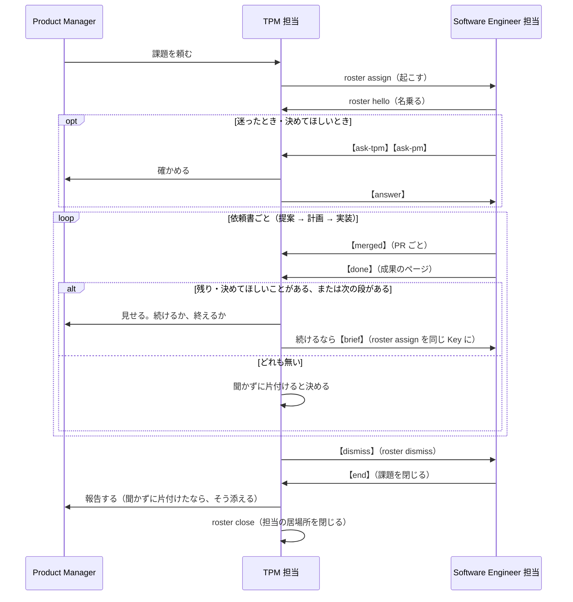
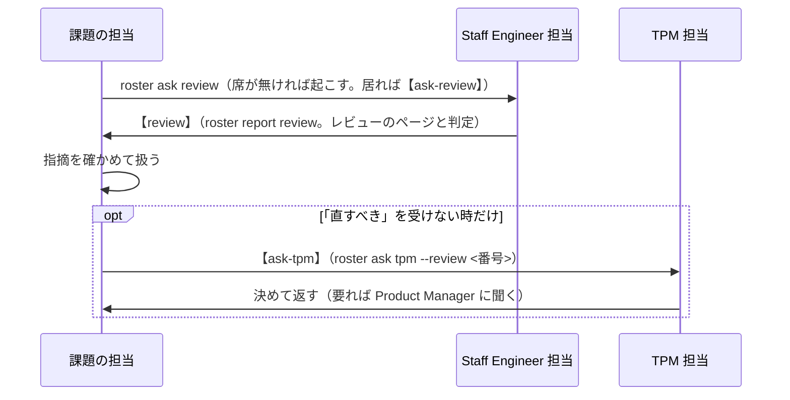

担当どうしのやりとりは、文とコードに分けてある。

- **文**（`skill-sets/core/.claude/skills/_shared/protocol.md`）: いつ・なぜ知らせるか、どの命令を打つか。どの担当もこれを読む。
- **コード**（`cli/src/`）: 見出しの表・メッセージの書式・課題への記録・状態の字・名簿。担当は `roster` の命令を打ち、命令が道具（cmux・acli・gh）を動かす。

TPM 担当が書く依頼書には、その課題だけのことを書く（ひな形は `skill-sets/core/.claude/skills/tpm/brief-template.md`）。TPM 担当は振る前に課題を読み（`roster issue view`）、新しい担当を起こす依頼書には課題の概要の節を書く。repo や資料を調べて案を出すのは担当。

## 層

上の層は下の層の道具を知らない。道具は使う側の project の設定で選ぶ（[設定](/configuration/)）。

| 層 | 中身 | 置き場所 |
|---|---|---|
| 役割 | 誰が何を受け持つか | `skill-sets/` の `SKILL.md` |
| 決まり | 見出し・順番・記録・名簿 | `protocol.md` の文と、`cli/src/protocol.ts`・`cli/src/roster.ts`・`cli/src/commands/` |
| 連携の道具 | メッセージを送る・担当を起こす・状態を出す | `cli/src/transport/`（`cmux`・試験用の `file`） |
| 課題管理の道具 | 課題を読む・課題に記録を書く・課題を閉じる | `cli/src/tracker/`（`jira`・`github`・`none`） |
| guard | 共有の環境と、道具の直打ちと、担当が置き場のページを消す要求と、読むだけの担当（Auditor・Staff Engineer 担当）が repo・設定・記録を変えることと、Audit の席を起こす命令と、pattern で process に合図を送る命令を止める | `cli/src/guard.ts`（Claude Code の hook から呼ばれる） |
| バナー | 通知のバナーを、居場所の役割 × きっかけで出すか消すか（[設定](/configuration/#通知のバナー任意)） | `cli/src/banner.ts`・`cli/src/commands/banner.ts`（cmux の通知の hook から呼ばれる） |

## 名簿と状態の置き場

`roster` は、TPM 担当を起こした folder（project）ごとに状態を持つ。置き場所は `~/.local/state/roster/<project の path から作った名>/`（`$XDG_STATE_HOME` があればその下）。

| ファイル | 中身 |
|---|---|
| `tpm.jsonc` | TPM 担当の宛先。担当はメッセージを送るたびに読むので、TPM 担当を起こし直しても担当に知らせ直さなくてよい |
| `roles/<Key>.jsonc` | 名簿。課題の Key → 役割・居場所の宛先・依頼書・課題管理の課題。Staff Engineer 担当の席は、課題の担当と並べるために名簿の Key を `<課題の Key>.staff` にし、見ている課題の Key を `subject` に持つ |
| `reviews/<番号>.jsonc` | レビューの頼み 1 件（下の「Staff Engineer 担当の席」）。課題の Key・見る物・頼んだ担当と時刻・渡した依頼書・判定・レビューのページ・返った時刻・TPM 担当に上げた時刻。レビューを 1 度も頼んでいない project には無い |
| `approvals/<環境>.jsonc` | Product Manager の承認と期限 |
| `log.jsonl`・`infra.jsonl` | 送ったメッセージ（時刻・Key・見出し・本文・返事の先・送り手と届く担当。前の版の行には、送った後 2 秒の内に届いたかの `delivered` もある。今の版は書かず、見た時刻は `cli/src/seen.ts` の口が `deliveries.jsonl`・`shown/`・`returned.jsonl` から引く）と、`roster infra run` で打った命令の記録 |
| `message-records.jsonl` | 送った記録を置き場に写せなかった回と、送り手を付けずに置いた回（時刻・メッセージの id・訳の短い字。後の回には `placed` の欄が付く。下の「[ページの置き場](#ページの置き場)」の「送った記録の写し」）。写せた時は書かない。1 度も写しそこねていない project には無い |
| `deliveries.jsonl` | メッセージの送った・届いた・読んだ時刻（連携の道具が覚えている物の写し）。cmux は新しい 1,000 件より古い物を捨てるので、`roster close` で居場所を閉じる前と、TPM 担当が `roster hello` を打った時に写す。変わった時だけ 1 行足すので、同じ id の行は後ろが新しい |
| `tracker.jsonl` | `roster` が課題管理に書いた物（コメント・済み）。時刻・打った担当・課題・記録の種類・通ったか。課題管理の履歴は人も担当も同じ account なので、`roster` の手かどうかはここで見分ける |
| `guard.jsonl`・`gate.jsonl` | guard が止めた命令（頭の 300 字と訳）と、入口の検査が送る・置くのを止めた回（読んでいないメッセージ・merge していない PR・読めない PR・同じメッセージの 2 度送り・TPM 担当が送って済んでいない物・前の監査の文脈が残ったまま始めようとした監査） |
| `audits.jsonl` | 監査線の記録（下の「Auditor の席」）。Auditor の席を起こした・新しい文脈になった（席を起こした時と `/clear` の時）・監査を始めた・報告した・決定を渡した・Auditor の置いたページを消した、を 1 行ずつ。Auditor の席を 1 度も起こしていない project には無い |
| `waits.jsonl` | 状態 `wait` の移り変わり（`waits/<宛先>.jsonc` は最後の 1 つだけ） |
| `shown/<宛先>.jsonc` | 居場所に見せたメッセージの id と、初めて見せた時刻（`roster inbox` と、送る前の検査が見せた物。`roster hello` は未読を出さないので、入らない。新しい 200 件）。送る前の検査は、ここに無いメッセージがあれば 1 度止まる。TPM 担当が送って済んでいない物の検査と時系列のページは、この時刻を「担当がメッセージを見た時」に使う（見た時刻の口 `cli/src/seen.ts`） |
| `incidents/<番号>.jsonc` | 台帳。思わぬ出来事（信頼性・安全性・効率性が落ちた時）の 1 件 1 ファイル。書いた担当・種類・起きた事実・tag・扱い（未決・振った・調べない・済み）と、結んだ振り先・PR |
| `waits/<宛先>.jsonc` | 居場所が最後に打った `roster wait` の種類と時刻。バナーの hook が「この回に `roster wait pm` を打ったか」を見る |
| `sessions/<session の id>.jsonc`・`launches/<起こしの id>.jsonc` | castlist に登録した session の本当の id と名・稼働中か・送った出来事の番号・最後に送った見た model と effort（[アクターの台帳](#アクターの台帳castlist)）と、起こし 1 回の session の並び。castlist を設定した project にだけある |
| `banner/last-turn/<宛先>.jsonc`・`banner.jsonl` | バナーの hook が覚える、居場所の前の「答え終わった」の時刻と、決めたことの記録 |

1 件 1 ファイルの物は、`config.jsonc` と同じく JSONC（コメントと末尾のカンマを許す JSON）として読む。`roster` は読んだ値を書き直すので、手で足したコメントは書き直しで消える。足していく記録は 1 行 1 件の JSON（JSON Lines）のまま。記録（`*.jsonl`）は、後から「何が・いつ・誰の手で起きたか」を言うための証拠で、`roster` は消さない（`banner.jsonl` だけは 7 日）。メッセージや命令の字が入るので、roster を動かす機械の外（課題のコメント・PR の本文）には写さない。古い名の `*.json` が残っていれば、`roster` が最初に動いたときに `*.jsonc` に名前を替えて移す。

名簿は「Key → 宛先」を覚えるだけで、動いているかは毎回、連携の道具に聞く。`roster roles` は、名簿にあって居場所が無い担当を「消えた」と出す。

## ページの置き場

依頼書・確認・提案・計画・結果の HTML を置く、roster を動かす機械の中だけの置き場。ページを DB に持つサーバー（別の repo の pagetray）の container が、`127.0.0.1` だけで待ち受ける（起こし方は [運用](/operations/#ページの置き場pagetray)。起こす・止めるのは DevOps Engineer 担当）。`http://127.0.0.1:8801/` が一覧の UI で、Product Manager は、置いた担当の役割・居場所（workspace の ID）・Key・種類で絞り、時刻で並べ、題と本文を探して、選んだ 1 枚を同じ画面で読む。

- `roster page put <file> --kind <種類>` が、file を置き場に送り、URL（`<置き場の URL>/<状態の folder の名>/<Key>/<種類>-<番号>.html`）を出す。置いた担当の役割（`$ROSTER_ROLE`。TPM 担当は `tpm`）と居場所の宛先も、一緒に置き場に入る。同じ中身を、roster を動かす機械の控えの folder（`<控えの folder>/<状態の folder の名>/<Key>/<種類>-<番号>.html`）にも写す。種類は `brief`・`confirm`・`proposal`・`plan`・`result`・`review`（Staff Engineer 担当のレビュー）・`issue`（課題の写し。ふだんは `roster assign` が置く）・`timeline`（時系列。`roster incident timeline` が置く）・`audit`（監査。思わぬ出来事の原因と改善案）。Key は担当なら今の課題の Key（Staff Engineer 担当の席は、見ている課題の Key）、TPM 担当は `--key` で書く。番号は置き場が決める（同じ Key・同じ種類の次の番号。多くの担当が同時に置いても重ならない。消したページの番号も使わない）。置いたページの本文を書き換えるエンドポイントは無い（置き直すと次の番号。置いた後に変わるのは、下の返事の状態だけ）。
- project は `$ROSTER_PROJECT`、無ければ今いる folder。`.claude/roles/config.jsonc` も TPM 担当が起きた印（状態の folder の `tpm.jsonc`）も無い folder（scratchpad など）から `roster page put` を打つと、置き場に頼む前に止まる（その folder の名が別の project として置かれるのを防ぐ）。project の folder で打つか、`$ROSTER_PROJECT` を付ける。
- 置き場が応えなければ、ページは置けない。控えにあるページは読める。`roster ask devops` で起こすよう頼む。
- **送り手**: castlist の設定（[下](#アクターの台帳castlist)）があり、`$CLAUDE_CODE_SESSION_ID` がある時、`roster page put`・`roster file put`（と、`roster assign` の課題の写し・`roster incident timeline` の時系列）は、置く要求の引数に送り手の付随する id（`actor_issuer` は session を登録する時と同じ issuer、`actor_ref` は `claude.session:<session の id>`）を付ける。置き場は、受けたその時に castlist に送り手を聞き、記録の `sender` に残す（一覧の UI に送り手の名が出る）。どちらかが無ければ付けず、今までどおり置く。`roster page import` も付けない（置いた担当はわからない）。置き場が断った時は、ページも file も置かれておらず、`roster` は送り直さない。
  - `503`（置き場が castlist に聞けない）: 「castlist に送り手を聞けませんでした」と出て止まる。castlist が起きてから打ち直す。castlist が起きているのに続く時は、`roster report incident` で台帳に挙げる（置き場から castlist に届いていない。[運用](/operations/#起こす)）。
  - `400`（欄 `/actorRef`。castlist に、この session の登録が無い）: 「castlist に登録が無いと、置き場が答えました（400）」と出て止まる。`/actorRef` の形の誤り（打ち直しても通らない）は、置き場が断った訳をそのまま出す。session は Bash の前に guard が登録するので、打ち直す。続く時は `roster report incident` で台帳に挙げる。
- `roster page path <URL>` が、置き場の URL を控えの file の path にする（Read tool で読むため）。控えに無ければ、置き場から取って控えに写す。前の置き場の `http://127.0.0.1:8800` の URL も、同じ控えの path になる（browser では、置き場が 8800 でも同じ path で返す）。ページの `src`・`href` が相対で参照する file（下）のうち控えに無い物も取り、ページから同じ相対の所に写して、`参照の file:` の行に path を出す（取れなければ `注意:` の行を出し、ページの path は返す）。
- `roster page list` が、置き場のページを絞って探す（`--key`・`--role`・`--workspace`・`--kind`・`--q`・`--reply`。`--json` は記録の配列）。既定は今の project の新しい順 50 件で、`--all-projects` でほかの project も出す。
- **返事の状態**: 置き場は、Product Manager の返事が要るページに「返事待ち」「答えた」の状態を持ち、一覧の UI は、操作の帯の「返事待ち N 件」・行の印・絞り込みの「返事」で出す。書くのは `roster` の命令で、担当は手で書かない。
  - `roster ask pm --url <確認の URL>` が、【ask-pm】を送った後に、そのページを返事待ちにする（置いただけの確認には印が付かない）。
  - `roster ask pm --supersede <古い確認の URL>`（何度でも）が、この確認で置き換える古い確認の返事待ちを外す。受けるのは同じ Key の返事待ちの確認だけで、別の project・Key・答え済み・送っていない確認・送る確認そのものは、送る前に断る。【ask-pm】の本文に「置き換える確認:」と URL が載る（log に残る）。置き場が応えない時は確かめずに送り、外せなかったことと `roster page reply <URL> --answered` の直し方を出す。
  - `roster answer <Key> "<答え>"` が、【answer】を返した後に、その Key の返事待ちのページを答えたにする。返事待ちが 2 枚以上ある時は、送る前に止まって URL を並べる（別の確認まで答えたにしないため）。どのページへの答えかを `--url <確認の URL>`（何度でも）で書くか、みなへの答えなら `--all` を付ける。
  - `roster page reply <URL>… --waiting|--answered` が、状態を手で直す（TPM 担当だけ）。`roster answer` を通らずに済んだ確認と、置き場が応えない間に送った確認に使う。`roster page list --reply waiting` が、今の返事待ちを並べる。`roster dismiss` は、その Key に返事待ちのページが残っていれば URL を出す（止めない）。
  - 置き場が応えない時も、`roster ask pm`・`roster answer`・`roster dismiss` はメッセージを送り、`置き場の印: 付けていない` と訳を出す。`roster page reply` だけは誤りで止まる。
  - 置き場が `.pagetray-version` より古い版で、呼ぶ操作を持たない時は、置き場に頼む命令はどれも「置き場が、この roster の呼ぶ操作を持たない」で止まる（[運用](/operations/#版を上げる)の 4）。
  - `roster ask pm` で送っていないページは、状態を持たない（印は付かない）。
- **送った記録の写し**: `roster` は、メッセージを送るたびに、送った記録（`log.jsonl` の 1 行）を置き場にも 1 件置く（pagetray 1.1.0 から）。Product Manager は、一覧の画面 `http://127.0.0.1:8801/messages` で、誰が誰に何を送ったかを見る。写すのは、Key・見出し・送り手の名と受け手の名（下）・本文（8,000 字を超える時は、頭の 7,990 字に「…（長いので切った）」を付ける）・送った時刻・返事の先の id。castlist の設定と session の id があれば、ページを置く時と同じ送り手の付随する id も付ける。
  - 置き場の記録の送り手・受け手の名（`from`・`to`）は、担当の Key（人が読む名。TPM 担当は `tpm`）。配りの受け手の名（Key と起こした回の組。NATS に替える段で使う）とは別。置き場は初めの値から替えないので、替わる居場所の題では書かない（送り手の組の無い前の版の行だけ居場所の題、届く担当の分からない行は宛先の字。200 字を超える名は切る）。
  - 状態は、今は `carried`（ほかの道具で運んだ）だけ。メッセージを運ぶのが cmux の間は、届いたかを置き場に書かない（届いた時刻は、今までどおり `deliveries.jsonl`）。
  - **写せなくても、送りは止めない**。置き場が応えない・古い版・形の誤りのどれでも、送った事と `log.jsonl` は変わらず、命令の出力にも何も出ない。写せなかった事だけが、状態の folder の `message-records.jsonl` に 1 行残る。後から写し直す命令は無い。
  - 置き場が送り手を castlist に聞けない（503）・castlist に登録が無いと断った時は、送り手の付随する id を外して 1 度だけ置き直す（送り手が空の記録になる）。置けたら、その事を `message-records.jsonl` に `placed` の欄を付けて残す。
  - 置き場が答えない時は、送る命令の終わりが 2 秒（置き直しが入ると長くて 4 秒）遅れる。session の始めの hook の命令（`roster returned check`）も、届け違いを返した時だけ、同じだけ遅れる。
- **レビューの印**: 置き場は、返事待ちの相手（Product Manager・レビューの席・TPM 担当）と、レビューの判定・見た物も持つ。TPM 担当を通らないレビューのやりとりを、Product Manager と TPM 担当が一覧の UI で追うための物。書くのは `roster` の命令で、担当は手で書かない。置き場に写すのは、判定の語・見た物の URL・時刻だけ。
  - `roster ask review` と、Staff Engineer 担当の席の起こし直し（`roster ask review`・`roster assign --role staff-engineer`）が、依頼書に見る物（置き場のページは path、PR は URL）を書いて「レビュー待ち」にする。起こし直しで置き換えた前の依頼書は、返っていない頼みがほかに無ければ待ちを外す。
  - `roster report review` が、レビューのページに判定と、済ませた頼みの見る物をみな書き、依頼書を「レビュー済み」にする。一覧の UI は、レビューの行に判定の印と「見た物:」の link、見られたページの行に「レビュー: review-N 判定」を出す。
  - `roster ask tpm --review <番号>` が、レビューのページを「上げた」（TPM 担当の返事待ち）にする。TPM 担当は、決めたら `roster page reply <URL> --answered --on tpm` で「決まった」にする。一覧の UI の操作の帯に「レビュー待ち N 件」「上げた N 件」が出る。
  - 「返事待ち N 件」・`roster answer` の数・`roster ask pm --supersede` の確かめは、Product Manager の待ちだけを見る。`roster page list --reply waiting --on review|tpm` で、ほかの相手の待ちを並べる。`roster dismiss` は、残ったレビュー待ち・上げた件も、相手ごとに並べる。
- `roster page import` が、控えの folder にあって置き場に無いページを、同じ番号・file の時刻で置き場に入れる（DB を失った後。何度打っても同じ結果）。置いた担当はわからないので、役割は依頼書と課題の写しだけ `roster`、ほかは `unknown` で入る。控えの `<Key>/files/` の file も同じ決まりで入れる（役割は `unknown`）。
- `roster page delete` が、ページを置き場と控えの folder から消す（戻せない）。**消してよいのは TPM 担当だけ**で、担当の居場所から打つと止まる。Auditor が置いたページ（置いた担当の役割が `auditor`）は、Product Manager の言葉を `--pm "<言葉>"` に添えなければ消せず、消した事は `audits.jsonl` に残る（担当は `roster ask tpm` で、消すページの URL と訳を送って頼む。置き場に消す要求を直に送る `curl` と、置き場の CLI の `pagetray page delete` も guard が止める）。URL を名指すと 1 枚、`--key <Key>` でその Key のページみな、`--project <名>` だけで、その project（状態の folder の名）のページみなを消す（`--key`・`--project` は、合う file も一緒に消す）。まず消す物を一覧で出し、`--yes` を付けたときだけ消す。消したページの URL は `410` を返し、その番号は 2 度使われず、`roster page import` でも入らない。
- ページに付ける画像・PDF・字の file（png・jpg・jpeg・gif・webp・pdf・txt・log・md・csv・json。1 つ 16 MiB まで）は、`roster file` で置き場に上げる。URL は `<置き場の URL>/<状態の folder の名>/<Key>/files/<語>-<番号>.<拡張子>` で、ページからは相対で参照する（同じ Key なら `files/<語>-<番号>.<拡張子>`、別の Key なら `../<Key>/files/…`）。控えも同じ形（`<控えの folder>/<状態の folder の名>/<Key>/files/`）に写すので、置き場でも控えでも図が出る。
  - `roster file put <file>` が上げて、控えに写し、URL と `ページからの参照:` を出す。名は元の file の名から作る（小文字にし、英小文字・数字・`-`・`_` でない字を `-` にする。`--name <語>.<拡張子>` で替えられる）。番号は置き場が決め、同じ名で上げ直すと次の番号。
  - 上げた物は model にも人にも見えるので、画像と PDF は `--reviewed` が無いと止まる（Read tool で見て、token・鍵・個人の情報・ほかの人の画面・roster を動かす機械の path が写っていないか確かめてから付ける）。字の file は秘密の形（GitHub・AWS・Slack・Atlassian の token、`sk-` の鍵、秘密の鍵の頭など）を走査し、当たれば行の番号を出して止まる。わざと上げるなら `--allow-secret`（状態の folder の `file-secret.jsonl` に残る）。EXIF のある JPEG は、上げた上で位置情報の注意を出す。
  - `roster file path <URL>` が控えの path を返す（控えに無ければ取る）。`roster file list` が探す（`--key`・`--role`・`--q`・`--json`・`--all-projects`）。
  - `roster file delete <URL>…` が消す（**TPM 担当だけ**。戻せない）。まず消す物と、それを参照している同じ project のページを出し、`--yes` を付けたときだけ消す。消した URL は `410` を返す。
- Product Manager が読むページ（確認・提案・計画・結果・監査）には、図をページの中の inline の SVG で入れる。どのページにどの図を入れるかは `skill-sets/core/.claude/skills/_shared/protocol.md` の「ページ」の図の項、ひな形（選ぶ問いの木・流れ・前と後・数の棒・並べと、明るい画面と暗い画面の色の変数）は `skill-sets/core/.claude/skills/_shared/figures.md`。依頼書は、読むのが担当なので要る所だけ。図を入れないページには、入れない訳を頭に 1 行書く。
- project の名に状態の folder の名を使うので、TPM 担当と、起こされた担当とで URL がずれない。課題の folder の URL（`…/<Key>/`）は、その課題で絞った一覧を出す。
- 控えの folder と置き場の URL は、環境変数 `ROSTER_PAGES_DIR`・`ROSTER_PAGES_URL` で替えられる（[設定](/configuration/)）。

## アクターの台帳（castlist）

設定に `castlist` の URL（[設定](/configuration/#アクターの台帳castlist任意)）があれば、`roster` は、Claude Code の session 1 つ（TPM 担当・担当・Auditor）を castlist のアクター 1 つとして登録し、登場から退場までを送る（API は castlist の docs の [API](https://uraitakahito.github.io/castlist/api.html)。コードは `cli/src/castlist.ts`・`cli/src/commands/castlist.ts`）。設定が無ければ、何も送らず、`roster start`（stderr。terminal なら赤の太字）と `roster hello`（出力の頭）が、枠で囲んだ警告を出す（止めない。足す 1 行と、直下の folder の設定にだけ castlist があれば読まないことを書く）。

| いつ | 送る物 |
|---|---|
| `roster start` | `/healthz` を見て、Product Manager を人のアクター（鍵 `tpm.person:product-manager`・名の接頭辞 `product-manager`）として登録する（何度打っても同じアクター）。1 行の頭に、起こしの印（下）を付ける |
| session の始まり（SessionStart の hook の `roster castlist session-start`） | session を登録する（鍵は `claude.session:<session の id>`。cmux の連携なら `cmux.workspace.ref`、`$CMUX_WORKSPACE_ID` があれば `cmux.workspace.uuid` も付ける）。ラベルは `tpm.project`・`tpm.launch`・`tpm.key`（担当だけ。名簿の Key）・`tpm.role`（TPM 担当は `tpm`）・`tpm.subject`（Staff Engineer 担当の席だけ。見ている課題の Key。`tpm.key` は `<課題の Key>.staff` で、名の接頭辞は `<課題の Key>-staff`）。続けて、source ごとに: 起こした（startup）→ 登場（`entered`）と、起こした者からの線（`launched`）／続きから開いた（resume）→ 再登場（`reentered`）／要約した（compact）→ 要約（`compacted`）／`/clear` → 新しい session の登場（`entered`・`detail.source` が `clear`）と、同じ起こしの前の session からの継ぐ線（`continued`）／fork → 分身（`forked`）と継ぐ線 |
| session の終わり（SessionEnd の hook の `roster castlist session-end`） | `/clear` なら交代（`cleared`）、ほかは退場（`exited`）。訳は `detail.reason` |
| Bash の前（`roster guard`） | まだ登録していない session を登録する。推しの幕引き（下）で居ないにした session が打てば、生きていたので、今の居場所で登録し直して番号つきの再登場（`reentered`・`detail.source` が `guard`）を送る（退場・交代・`roster close` の後は送らない）。hook の入力の effort と、写し（transcript）の最後の model（`<synthetic>` は飛ばす）が、前に送った物と違えば「見た」model と effort（`source: observed`）を送る。写しから model を読めなければ（写しの形が変わった）、session に 1 度だけ model 不明（`model_unreadable`）を送る（止めない） |
| `roster hello` | 名乗り（`reported_in`）。出力の頭に `アクター: <名>`（`t-23zs-swe.1` など）。推しの幕引きで居ないにした session なら、名乗りの前に、guard と同じく登録し直して再登場（`detail.source` が `hello`）を送る |
| `roster close` | その担当の起こしのアクターのうち、まだ居る物に幕引き（`closed`） |
| `roster hello`（Auditor を除く）・`roster roles`・`roster assign` | 落ちた session の突き合わせ（下の「推しの幕引き」） |

- **名**: castlist が `<接頭辞>.<番号>` で出す（番号は issuer と接頭辞ごと）。接頭辞は、担当が `<Key>-<役割の略>`（`swe`・`devops`・`sus`・`staff`。Staff Engineer 担当の席は、名簿の Key でなく、見ている課題の Key から作る: `ai-33-staff`）、TPM 担当が `<project の folder の名>-tpm`、Auditor が `<project の folder の名>-audit`。castlist の接頭辞は英小文字・数字・`-` だけなので、`.` でなく `-` でつなぎ、Key の大文字は小文字に、ほかの字は `-` に替える。issuer は `tpm.` と状態の folder の名（英小文字に替える。64 字を超える名は、頭を残して hash を足す）。
- **起こしの印**（環境変数）: 起こす側が付け、hook が読む。`ROSTER_LAUNCH`（起こしの id。`roster start` の 1 行は打つたびに `uuidgen` で作り、`roster assign`・`roster audit start` は名簿の `launch` に書く）・`ROSTER_LAUNCHED_BY`（起こした者。`roster assign` は打った TPM 担当の `claude.session:<$CLAUDE_CODE_SESSION_ID>`、`roster start` と `roster audit start` は Product Manager）・`ROSTER_LAUNCH_MODEL`・`ROSTER_LAUNCH_EFFORT`（claude の `--model`・`--effort` と同じ値）・`ROSTER_LAUNCH_FRESH=1`（起こしたばかりの印）。担当には `roster run-role` が名簿から付ける。
- **頼んだ model と effort**（`requested`）は、起こしたばかりの process の初めの登録（startup か resume）でだけ送る。`/clear` の後の session は同じ環境変数を持つが、その間に `/model` で替えたかもしれないので送らない。どの起こしで送ったかは状態の folder の `launches/<起こしの id>.jsonc` に残す。
- **id**: 出来事・線・model と effort の id は、issuer・session・種類（と、何度も起きる物は番号）で決める。送り直しても同じ id なので、castlist は 2 度足さない。番号は送れた時だけ進める。登録の答え（本当の id と名）は `sessions/<session の id>.jsonc` に控える。
- **castlist が止まっている時**: `roster start`・`roster assign`・`roster audit start`・`roster hello` は、起こさず・名乗らずに止まり、Product Manager が自分の terminal で打つ 1 行を出す（container `castlist.box` が在れば `container start castlist.box`、0.1.0 の名 `castlist` の container だけが在ればその名で起こし直す 1 行と名を替える docs、どちらも無ければ `container run …`。castlist を起こすのは Product Manager だけ）。`roster assign` は、TPM 担当が `roster wait pm "castlist を起こす" --hand` で Product Manager に頼むよう添える。hook は何も送らずに終わり（Claude Code を止めない）、登録までは `roster guard` が Bash を同じ 1 行を添えて止める。登録した後も、送る物（見た model と effort など）があるのに止まっていれば止める。`roster close` は止めず、送れなかったと 1 行出す。
- **推しの幕引き**: kill・クラッシュ・roster を動かす機械の止まりで落ちた session は、終わりを送れない。そこで roster は、上の 3 つの命令のたびに cmux の居場所の一覧（`cmux --json workspace list --id-format both`。uuid と ref）と、控えで「居る」ままの session を突き合わせ、次のどちらかなら幕引き（`closed`。`detail` は `{"inferred": true, "reason": …}`。id は番号つきで、`roster close` の幕引きと別）を送って、控えを居ないにする（出力に 1 行）。castlist はこれを点線の帯と「停止（推し）」で描く。
  - `workspace_gone`: その session の居場所の uuid が、一覧に無い。
  - `superseded`: uuid は残り ref が替わった（cmux が起こし直され、居場所を同じ uuid で復元した）うえ、今の組（uuid と今の ref）に別の session が登録した。ref が替わっただけでは送らない（cmux は起こし直しの後に Claude の session を続けることがある）。ref も同じ組に 2 つ居ても、後先を決められないので送らない。
  - 居場所は、登録の時に控え（`sessions/<session の id>.jsonc` の `workspace`）に書く。控えに無い session（前の版で登録した物）は、castlist のアクターの付随する id（種類ごとに最新）から引く。
  - 自分の session は見ない。自分の session の id（`$CLAUDE_CODE_SESSION_ID`）が無い（roster の起こした session の外で打った）・一覧が引けない・一覧に自分の組が無い（一覧を信じられない）時は何もしない。cmux でない連携（file）でもしない。castlist が応えなければ、そこでやめて 1 行出す。送れなくても命令は止めず、送れなかった session を 1 行で出す。
  - 控えに居場所を書く時は、読み直した控えに居場所だけを足す（その間に session の hook が書いた物を消さない）。
  - 気づけないのは、Claude Code だけが落ちて居場所が残った時。castlist では稼働中のまま残る。
  - 誤って閉じうるのは、生きている session の復元された居場所で、別の pane から roster の起こした session が始まった時（その session を `superseded` で閉じる）。生きていれば、次の Bash か `roster hello` で再登場して戻る。
- **ページと file の送り手**: castlist の設定があれば、`roster page put`・`roster file put` が、置き場に送り手（session の付随する id）を付けて置き、置き場が castlist に聞いて記録に残す（[ページの置き場](#ページの置き場)の「送り手」。置き場の側の設定は [運用](/operations/#起こす) の `PAGETRAY_CASTLIST_URL`）。roster は castlist に何も送らない。
- **時計**: 起こす前に見る `/healthz` の時刻と roster を動かす機械の時計が 2 秒より離れていれば、`roster report incident` で台帳に挙げるよう 1 行出す（止めない。`roster start` は stderr に出す）。

### 監査の検索を読む

Auditor が、件の記録に残っている物（Key・役割・時刻）で castlist を引くための、読むだけの命令（コードは `cli/src/commands/castlist-read.ts`。castlist の側は API の「監査の検索」）。どれも GET だけを送り、castlist にも状態の folder にも書かない（Auditor の guard も止めない）。旗は `cli/src/castlist-query.ts` が castlist の操作の引数に直す（`--active-from`・`--active-to`・`--launched-by` は `activeFrom`・`activeTo`・`launchedBy`、`--limit` は `maxResults`、`--after` は `nextToken`、`settings --actor` の `--at` は `time`）。

| 命令 | 聞く所 | 出す物 |
|---|---|---|
| `roster castlist find` | `ListActors`（`GET /api/actors`）。`--label <鍵:値>`（何度でも）・`--binding <種類:値>`・`--at`・`--active-from`・`--active-to`・`--active <true\|false>`・`--model`・`--effort`・`--launched-by`・`--skewed`・`--kind`・`--sort`・`--order`・`--limit`・`--after` | アクター 1 つを 1 行（名・種類・状態（稼働中・停止）・最初の登場と最後の退場・最新の model と effort・ラベル・プロフィールの画面の URL `<castlist>/actors/<id>`）。続きがあれば、`--after` に渡す `next` |
| `roster castlist show <名か id>` | `GetActor`（`GET /api/actors/<id>`）と `GetLineage`（`GET /api/actors/<id>/lineage`） | ラベル・付随する id（種類ごとの最新）・今の状態・最新の model と effort・線の要約（上は人まで、下は 1 段）・プロフィールの画面の URL |
| `roster castlist lineage <名か id>` | `GetLineage`（`GET /api/actors/<id>/lineage`）。`--direction`・`--depth`・`--type` | 点（名と URL）と線 |
| `roster castlist events` | `ListEvents`（`GET /api/events`）。`--type`（何度でも）・`--actor`・`--from`・`--to`・`--reason`・`--source`・`--skewed`・`--limit`・`--after` | 出来事 1 つを 1 行（受けた時刻・アクターの名・種類・detail・URL） |
| `roster castlist settings` | `--actor` が無ければ `ListSettings`（`GET /api/settings`。`--model`・`--effort`・`--source`・`--from`・`--to`・`--mismatch`・`--skewed`・`--limit`・`--after`）、あれば `GetActor`（行に付けるアクターの名）の後に `ListActorSettings`（`GET /api/actors/<id>/settings`）か、`--at` でその時に効いていた 1 行の `GetActorSettingAt`（`GET /api/actors/<id>/settings/at`） | model と effort の行（受けた時刻・アクターの名・model と effort と source・URL） |

- **名**: castlist には名で引く道が無い。`show`・`lineage` の引数と `--actor`・`--launched-by` の名（`t-23zs-swe.1` など）は、この project の roster が登録して控えた物（状態の folder の `sessions/`）で id にする。控えに無い字は id とみなす（castlist に無ければ、404 の訳に `roster castlist find` で探すよう添える）。Product Manager のアクターは控えないので、`find --kind human` などで id を探す。
- **時刻**: 時刻の条件は RFC 3339（`2026-11-22T11:00:00+09:00` など）。`roster` が UTC に直して送る。castlist が受けた時刻（`received_at`）と比べる。
- **頁**: 1 度に読むのは 1 頁（`--limit`。castlist の既定は 100）。続きがあれば「続きがある: --after …」の 1 行に、`--after` に渡す字（castlist の `nextToken`）を出す。
- **断る値**: castlist は知らない引数を読み飛ばすので、読めない時刻・`true` か `false` でない `--active`・範囲の外の `--limit`（1〜1000）と `--depth`（1〜20）・`--actor` と一緒の `--at` のほかの旗は、`roster` が送らずに断る。ほかの値（決まりの外の `--sort` など）は castlist が断り、訳は castlist の物（引数の名も castlist の名）。
- `--json` は castlist の答えを、欄の名を `snake_case` にした形で出す（無い値は `null`・頁の印は `next`・時刻は UTC のミリ秒まで。`show --json` は `GetActor` の答え）。
- castlist が断ったら（400・404）訳をそのまま出し、止まっていれば `castlist に聞けない（<URL> が応えない）` の 1 行、設定が無ければ設定していないと言う 1 行で、どれも exit 1 で止まる。

## 状態

各担当は、連携の道具の表示（cmux ならサイドバー）に `model` と `wait` の 2 つだけを出す。`wait` は「今、誰が何を待っているか」を 1 つだけ出し、状況が変わるたびに上書きする（`roster wait` などのやりとりの命令が出す。字の形は `protocol.md` の「状態」）。

`roster wait` は、打った種類と時刻を状態の folder の `waits/<宛先>.jsonc` にも書く。通知のバナーの hook は、TPM 担当が前に答え終わった時より後に `roster wait pm` を打っていれば、その回の「答え終わった」のバナーを出す（[設定](/configuration/#通知のバナー任意)）。TPM 担当は手が空くと `回答待ち(PM): 指示` のまま待つので、状態の字だけでは、担当のメッセージをひとりで片付けた回と見分けられないため。だから TPM 担当は、Product Manager に返して手を止める回は毎回 `roster wait pm` を打つ（`/tpm` の skill）。

### 居場所の色

どの居場所も、役割ごとの色を 1 つ持つ（cmux ではサイドバーの左の端の帯）。帯の色で、題を読まずに役割が分かる。色は役割の表（`cli/src/protocol.ts` の `ROLES` の `color`。TPM 担当は `TPM_COLOR`）にある。

| 役割 | 色（cmux の色の名） |
|---|---|
| TPM 担当 | Amber（#7D6608） |
| Software Engineer 担当 | Green（#196F3D） |
| DevOps Engineer 担当 | Orange（#A04000） |
| Sustaining Engineer 担当 | Magenta（#AD1457） |
| Staff Engineer 担当 | Purple（#6A1B9A） |
| Auditor | Olive（#4A5C18） |

- 色は、選んだ居場所の地の青と紛れない物から選ぶ（Blue・Navy・Indigo・Aqua・Teal・Charcoal は使わない）。どれも暗い画面の地より明るく、互いの色相も離す。課題ごとに色を替えない（同じ課題の席は、題の Key で分かる）。
- 色相のいちばん近い組は Orange と Amber（24°）、Amber と Olive（28°）。どれも 1 席だけの役割（DevOps・TPM 担当・Audit）で、題も短く違うので、そのままにしている。
- どの席も、`roster hello` で名乗る時に自分の居場所に付ける（TPM 担当の居場所は利用者が作り、Auditor の席は Product Manager が手で起こすこともあるため）。起こされる席（`roster assign`・`roster ask review`・`roster audit start`）は、名乗る前から帯が出るように、宛先を名簿に書いた後に起こす命令も連携の口の `setColor` で付ける。TPM 担当の居場所に利用者が手で付けた色は、名乗るたびに Amber に戻る。
- 色は飾りなので、付けられなくても止めずに 1 行で知らせる。
- 色は起こす時・名乗る時に付くので、前から居る席には、次に `roster hello` を打つ（起こし直す）まで付かない。

## 見出しの流れ

担当どうしは、`roster` の命令で見出しの付いたメッセージを送り合う。Software Engineer 担当の 1 つの課題では、おおよそ次の順に流れる（見出しと命令の一覧は `protocol.md`）。

## 入口の検査

メッセージを送る命令は、送る前に次を見る（`cli/src/commands/messages.ts` の `assertRead`・`assertMerged`・`assertNotRepeat`・`assertSettled`）。どれも、課題への記録や課題の写しを書く前に見るので、止まった回は何も残さない。

- **読んでいないメッセージ**: 自分宛てでまだ届いていないメッセージ（相手が送った時、こちらが手を動かしていた物）のうち、まだ見せていない物があれば、それを出して 1 度止まる。同じ命令を打ち直すと送る。相手のメッセージを読む前に次を送る行き違い（同じ問いを 2 度送る・答えを待たずに【done】を送る）を減らすため。自分が送ってまだ相手に届いていない物は数えない（cmux は、自分の受信箱の「まだ届いていない物」に、それも返す。送った記録の送り手で見分ける）。TPM 担当は、送る相手の担当から来た物だけを見る（ほかの担当のメッセージでは止まらない）。`roster inbox` で見た物では止まらない。送った後で相手が動いた行き違いは防げない。`roster page put` も、確認・提案・計画・結果・レビューのページ（`--kind confirm|proposal|plan|result|review`）を置く前に同じ検査をする（相手の答えを読む前に、古い前提のページを置かないため。`cli/src/commands/page.ts` の `assertReadBeforePut`）。担当は TPM 担当から来た物を、TPM 担当は `--key` の担当から来た物を見る。依頼書・課題の写し・時系列・監査のページは止めない。
- **PR が merge 済みか**: `roster report merged`・`roster report doc-fix`・`roster report end --pr` は、`gh pr view <URL> --json state` が `MERGED` を返さなければ送らない（merge が断られたのに【merged】を送らないため）。`gh` で読めない PR は、`--unchecked "<訳>"` で確かめずに送れる（訳はメッセージに載る）。
- **同じメッセージの 2 度送り**: 同じ差出人が、同じ宛先に、同じ見出し・本文・返事の先のメッセージを 30 秒の内に送っていたら、2 度目を送らない。止まった命令の打ち直しを `;` や `||` で 1 行に続けて書くと、止まらなかった時にも 2 度目が動き、課題の記録も 2 件になるため（実際に起きた）。
- **TPM 担当が送って済んでいない物**: `roster dismiss` と続きの `roster assign` は、その担当に送って、担当がまだ見ていないメッセージ（届いておらず、`roster inbox`・送る前の検査でも見せていない物。assign は【brief】だけ）か、【done】が返っていない依頼書があれば、出して止まる（自分の送った物どうしの行き違いを減らすため）。依頼書は、起こしたときに渡した物と【brief】で送った物を積み（`--after` で送った物も）、【done】（Staff Engineer 担当の席は【review】）が 1 つ返るごとに、そのとき担当が見ていた依頼書のうちいちばん古い物を 1 つ済ませる（担当が `roster report done --briefs` で名指した【done】は、名指した依頼書をみな済ませる。名指しは、渡されていて済んでいない依頼書に、URL か、当たるのが 1 つの名で当たらなければ送らずに止まる）。担当が見た時は、見た時刻の口（`cli/src/seen.ts`）が決める: 画面に届いた時刻と、`roster inbox`・送る前の検査が見せた時刻の早い方（時系列のページも同じ口を使う。まだ見ていない依頼書の分に、行き違いの【done】を数えない）。`--supersede` で送った【brief】と【dismiss】は前の依頼書を取り消し、【end】は全部を済ませる。`--supersede`（取り消す）か `--after`（済ませてから。assign だけ）を付けると送り、本文に一言が載る。`roster answer`・`roster notify` は止めない。
- **TPM 担当だけの命令**: `roster assign`・`roster close`・`roster notify`・`roster answer`・`roster dismiss` は、担当の session（`$ROSTER_KEY` がある）から打つと、何も送らず・書かずに止まる（`cli/src/roster.ts` の `requireTpmSide`。`gate.jsonl` に `tpm-only`。`roster infra approve`・`roster infra revoke`・`roster incident add` も、同じ検査で断って残す）。送り手の名は命令が付けるので、担当が打つと TPM 担当の名で相手に届いてしまうため。
- **前の監査の文脈**: `roster audit begin` は、前の報告の後に新しい文脈（席を起こした・`/clear` した）になっていなければ、監査を始めずに止まる（下の「Auditor の席」）。

## 届け違い

待っているメッセージは連携の道具（cmux）が持ち、居場所の中の面で次に起きた Claude に、Claude の hook から配る。cmux は宛先を面の id で覚え、居場所を復元してもその id は残るので、前の session 宛てで待っていた物が、同じ居場所で起きた別の担当の session に配られることがある（2026-11-23、台帳 #84）。`roster` は配る道に入っていないので、届いた所で見分ける（`cli/src/commands/returned.ts`）。

- **送る時**: 送った記録（`log.jsonl`）の行に、送り手（`sender`）と届く担当（`recipient`）を書く。担当は名簿の Key（TPM 担当は `tpm`）と起こしの id（`$ROSTER_LAUNCH`・名簿の `launch`。castlist を設定した時だけある）。返事の形（`--reply-to`）では、cmux が元のメッセージの送り手の居場所へ届けるので、届く担当は元の行の送り手にする（元の行が無ければ書かない）。
- **始まりに比べる**: どの席の SessionStart にも `roster returned check` の hook が付く（castlist の設定に依らない）。自分の居場所宛ての物（cmux の `--surface` の一覧は、その居場所が送ってまだ相手に届いていない物も並べるので、`recipient_workspace_id` で宛先が自分の物に絞る）のうち、まだ待ちの物と、Claude の hook で配られた物（`delivered_via` が `claude.wake`。Claude が起きた時と、手が空いた時の Stop の両方で付く）で配った時刻が hook の始まりの前後 10 秒の内の物（この session の始まりの物とみなす）を、記録の届く担当と比べる。それより前に前の session に配られた物は拾わない（前の session の Stop で、落ちる 10 秒の内に配られた物は拾う）。記録の無い物・届く担当の無い前の版の行は比べない。
- **違うとみなす**: Key が違う。または Key が同じ担当で、起こしの id が両方あって違う（同じ Key で起こし直した）。TPM 担当は役割で比べる（起こし直した TPM 担当が前の TPM 担当宛てを受けるのは決まりどおり）。/clear の後は同じ起こしなので違わない。
- **違う物があれば**、順に:
  1. 待ちの物がみな違う宛てなら、`cmux agent inbox --mark-read` で既読にして配らせない。`--mark-read` は並べた物をみな既読にし、1 通ずつはできないので、正しい宛ての物が混じる時と、その居場所が送ってまだ相手に届いていない物（自分や前の session が送った【brief】【done】など）がある時は既読にしない（相手に届かなくなるため）。既読にした物に、確かめた組の外の物（間に届いた物）があれば、その中身を「あなた宛てかもしれない」として示す。
  2. 台帳に 1 件書く（reliability、tag「届け違い」）。【incident】は送らない。
  3. TPM 担当へ【returned】を送る（宛先の担当ごとの数と、1 通ずつの id・見出し・送った時刻・宛先・本文の先頭 80 字。全文は TPM 担当が `roster returned show <id>` で読む）。自分が TPM 担当なら送らない。TPM 担当の居場所が無ければ送らず、そう示す。
  4. 返した id を `returned.jsonl` に控える（resume・compact で hook がもう 1 度走っても 2 度返さない。返せなかった物は控えず、次の始まりでもう 1 度試す）。見た時刻の口（`cli/src/seen.ts`）も読み、返した物を、cmux の上で既読でも「宛先の担当はまだ見ていない」とする（`roster dismiss`・続きの `roster assign` の検査が止まり、時系列のページは「届け違いで返した」と出す）。
  5. 画面（`systemMessage`）と Claude の文脈（`additionalContext`）に「前の session 宛て。扱わない」と一覧を出す。
- **見ない物**: session が起きた後に届く届け違い（次の始まりまで見ない）。roster の hook を付けずに起きた Claude（比べる自分が分からない）。

## Staff Engineer 担当の席

Staff Engineer 担当（役割 `staff-engineer`。題は `レビュー <課題の Key>: <見る物>`、名簿の Key は `<課題の Key>.staff`。skill は `/staff-engineer`）は、課題の担当が頼んだ計画・提案・PR を見て助言する担当。席は課題ごとに、課題の担当の隣に立つ。**頼み（【ask-review】）と判定（【review】）は、TPM 担当を通らず、課題の担当と席の間をじかに届く**（担当から担当への道は、この 2 通だけ。見出しの表（`cli/src/protocol.ts` の `HEADINGS`）の `peer` の印）。席は、頼みの命令が起こす。課題の担当が判定を受けない時だけ、`roster ask tpm --review <番号>` で TPM 担当に上がる。いつ頼むか・判定の意味・助言で縛らないことは、決まり（`skill-sets/core/.claude/skills/_shared/protocol.md` の「レビュー」と「連携の 3 つの形」）。コードは `cli/src/reviews.ts`・`cli/src/commands/review.ts` と、`cli/src/commands/staff.ts` の `askReview`・`reportReview`・`launchStaff`、`cli/src/commands/messages.ts` の `toPeer`。

席の題・説明・色は、席を起こす命令（`roster ask review`。起こし直しは `roster assign`）が頼みから作る（`cli/src/reviews.ts` の `reviewLabel`）。見る物は、PR なら `PR #<番号>`、置き場のページなら種類の名と file の名（`計画 plan-2`・`提案 proposal-1`・`結果 result-3`、ほかの種類は file の名だけ）。依頼書の頼みが 2 つ以上なら、番号の新しい頼みに `+<残りの数>` を付ける。説明は新しい頼みの見てほしい所（24 字で切る。無ければ付けない）。色は Purple（上の「居場所の色」）。居る席に頼み（【ask-review】。TPM 担当の起こし直しでは【brief】）を送る時は、連携の口の `relabel` で題と説明を替え、名簿の題も同じ字にする（通知のバナーの hook は、居場所の題と名簿の題が同じかで席を探す）。替えられなければ名簿は替えず、命令が 1 行で知らせる。Staff の席に `--title` を書くと、`roster assign` は止まる。

| 命令 | 打つ人 | すること |
|---|---|---|
| `roster ask review --url <見る物> [--focus <見てほしい所>]` | 課題の担当 | 頼みを書き（番号は「在れば失敗」で取る）、頼みから依頼書のページ（見る物・見てほしい所・課題の担当の依頼書）を作って置く。席が無ければ（落ちていても）起こして依頼書を名簿の行で渡し（返っていない前の頼みも渡し直す。名乗りを 90 秒まで待つ）、居れば【ask-review】（頭が依頼書の URL）を席へじかに送る。前の頼みが返っていなければ、後ろに積む（席の題は、新しい頼みと `+<返っていない残りの数>`）。まだ席に渡していない前の頼み（前の流れで TPM 担当に送られたままの物）があれば、同じ依頼書で一緒に渡す。状態を `回答待ち(レビュー): <見る物>` にする。見る物は、置き場のページか PR の URL。同じ物の頼みがまだ返っていなければ、2 度目は断る。送る前・居場所を作る前に止まった回は、頼みを残さない（送った後・居場所を作った後の失敗では、席に渡してあるので残す）。席の model などは設定の `staff-engineer` の欄で決まる（旗は無い） |
| `roster report review --url <レビューのページ> --verdict <判定> --summary <一言>` | Staff Engineer 担当 | いちばん古い依頼書の頼みに判定を書き、課題に「レビュー」の記録を書き、頼んだ課題の担当へじかに【review】を送り、状態を `回答待ち(レビュー): 次の頼み` にする。判定は `approve`・`concerns`・`reject`・`not-assessed`。ページは、その課題の `review` のページだけを受ける。課題の担当の居場所が無ければ、送らず・記録も書かずに止まる |
| `roster ask tpm "<訳と案>" --waiting-for <何を> --review <番号>` | 課題の担当 | 判定を受けずに TPM 担当に上げる。本文の頭にレビューの番号・判定・レビューのページの URL を足し、頼みの記録に上げた時刻を書く。自分の課題の、判定が「直すべき」の頼みだけを受ける。2 度上げても、最初に上げた時刻を残す |
| `roster assign <課題の Key> --role staff-engineer` | TPM 担当 | 席の起こし直し（返っていない頼みがあるのに席が落ちた・名乗らない時。居場所が残っていれば、先に `roster close <課題の Key>.staff` で閉じる）。返っていない頼みから依頼書を作って置き、席を起こす。席が居て、まだ依頼書にしていない頼みがあれば【brief】で送る。`--brief`・`--title` は受けない。頼みが無い・課題の担当が名簿に居ない・skill が無ければ止まる。`--supersede` は、じかに届いた頼みも含めて取り消し、新しい依頼書に入れ直す |
| `roster review list [--key <Key>]` | 誰でも（読むだけ） | 頼みごとの行と、判定ごとの数・TPM 担当に上げた数。初めての頼みより後に結果の【done】を出した課題のうち、レビューを頼んでいない課題の数 |

- **守り**: じかの 2 通も、送る前の検査（読んでいないメッセージ・同じメッセージの 2 度送り）を通る（2 度送りは、相手の宛先で数える）。届いた時刻は、`roster ask review` と `roster report review` が `deliveries.jsonl` に写す（TPM 担当の命令を通らないため）。じかに送った行は、送った記録（`log.jsonl`）に `peer` の印が付く。時系列のページの行き違いの印は、この印のある行では、課題の担当と席の間の逆向きのじかの物だけを相手に数える（`cli/src/commands/timeline.ts`。印の無い、前の流れの【ask-review】【review】は、今までどおり「同じ Key で向きが逆」で数える）。席の「済んでいない依頼書」には、じかに届いた【ask-review】も数える（`openBriefs`）。
- **見え方**: TPM 担当は【ask-review】【review】を受け取らない。課題の「レビュー」の記録・置き場のレビューのページ・`roster review list`・名簿（`roster roles`）・成果のページの「レビュー」の行で見える。席を起こした者（castlist の起こした線）は、課題の担当の session になる。
- 席に掛かる守りは Auditor と同じ（下の「guard」）: project・状態・ページの控えの folder への書き込みと、`git`・`gh` の変える命令（`gh pr review`・`gh pr comment` も）を止める。レビューは、PR のコメントでなく、置き場のページで返す。
- Staff Engineer 担当からの `roster report done`・`end`・`merged`・`doc-fix`・`roster ask pm`・`roster ask review` は断る（【end】を打てると、レビューが済んだだけで課題が済みになる）。`roster ask tpm`・`roster report incident` は打てる。
- TPM 担当は、席を名簿の Key（`<課題の Key>.staff`）で名指す（`roster notify`・`roster close`。どちらも、担当の session からは断る）。`roster dismiss` は断る（片付ける worktree が無い）。課題の担当の席を `roster close` で閉じると、Staff の席も一緒に閉じる。
- `roster hello` は、課題の Key と名簿の Key の両方を返す。`roster page put` は、課題の Key の folder に置く。`roster incident timeline <課題の Key>` は、Staff の席の行も集める。
- 考えは、[Claude-Code-Game-Studios](https://github.com/Donchitos/Claude-Code-Game-Studios) の連携の決まり（横の相談は相手を縛らない・食い違いは上に上げる）と、レビューの形（書いた文脈から切り離す・判定を決まった語で返す・見られなかった時を「よい」と分ける）から借りた。字は写していない。

## Auditor の席

Auditor（役割 `auditor`。題は `Audit`、課題の Key は `audit`。skill は `/audit`）は、担当の仕組みを見て勧める担当で、TPM 担当の回し方も見る。だから席は TPM 担当の手を通さない。何のために・どこまで・誰に、は監査の規程（`skill-sets/core/.claude/skills/_shared/audit-charter.md`。Product Manager が承認した物）、どう調べて書くかは監査の手順（`skill-sets/core/.claude/skills/_shared/audit.md`）、Product Manager の手は [運用](/operations/#監査auditor-の席)。コードは `cli/src/commands/audit.ts`・`cli/src/audits.ts` と、`cli/src/commands/messages.ts` の報告の命令。

| 命令 | 打つ人 | すること |
|---|---|---|
| `roster audit start` | Product Manager | 名簿に Auditor の行を書き、居場所を作って、名乗るまで待つ（`--model`・`--effort`・`--permission-mode`・`--wait`）。席は project に 1 つで、もうあれば断る。居場所が消えていれば起こし直す。skill `/audit` が無ければ断る |
| `roster hello` | Auditor | 居場所の題を `Audit` にし、色（Olive）を付け直し、状態を出し、監査の規程・手順の path と、前の監査・答えの出ていない報告を返す。TPM 担当が起きていなくても名乗れる |
| `roster audit begin [番号…]` | Auditor | 監査を始める（番号があれば、その件の臨時の監査）。**前の報告の後に新しい文脈になっていなければ、始めずに止まる**（`gate.jsonl` に `stale-context`）。通れば、監査の材料（規程・手順・前の監査・答えの出ていない報告・台帳の件数）を返す |
| `roster audit fresh` | Auditor の席の hook | 席を起こした時（`startup`）と `/clear` の時（`clear`）に、新しい文脈の印を書く。続きから開いた時（`resume`）と文脈を要約した時（`compact`）は書かない |
| `roster report audit` | Auditor | 監査のページを Product Manager へじかに報告した、と記録する。TPM 担当に写し（【audit】）を送り、状態を `回答待ち(PM): 監査の報告` にする（その回の終わりに通知のバナーが出る）。TPM 担当が起きていなければ、写しは送らずに記録だけ書く |
| `roster report decided` | Auditor | Product Manager の決定（する・受け入れる・見送る）を TPM 担当に渡す（【decided】）。TPM 担当が起きていなければ、送らず・記録せずに止まる |

- `roster audit start` は、担当の居場所（`$ROSTER_KEY` がある）からは打てない。TPM 担当と担当が道具として打つのは guard が止める（下の「guard」）。Product Manager は、cmux の中の shell で打つ。
- TPM 担当の `roster assign`（役割 `auditor`・Key `audit`）・`roster dismiss`・`roster close` は、Auditor の席を断る。`roster notify`・`roster answer` は通る（Auditor の【ask-tpm】への答え）。居場所が消えた Auditor は、`roster roles` に「起こし直すのは Product Manager」と出る。
- Auditor からの `roster report done`・`end`・`merged`・`doc-fix`・`roster ask pm`・`roster ask review` は断る（成果は PR や【done】でなく、Product Manager へじかに出す）。`roster ask tpm`・`roster report incident` は打てる。
- 新しい文脈の印は、Auditor の席の `--settings` に付けた SessionStart の hook が書く。前の監査の文脈が残ったまま次の監査を始めると、同じ Auditor が自分の前の勧告を自分で追いかけることになるので、`/clear` してから `/audit` を呼ぶ決まりを、この検査で守る。
- TPM 担当の `roster hello`・`roster roles` は、Auditor の席を 1 度でも起こした project では、終わりに「前の監査: 2026-11-22（8 日前。目安は週 1）」の 1 行を出す（7 日を過ぎたら「Product Manager に一言伝える」と添える）。出すだけで、何も起こさない。

## 台帳

思わぬ出来事を、気づいた担当がその場で 1 行書く置き場（いつ・何を書くかは `protocol.md` の「思わぬ出来事」「監査」と `/tpm` の「監査」）。コードは `cli/src/incidents.ts` と `cli/src/commands/incident.ts`。

| 入り口 | 命令 | 打つ担当 |
|---|---|---|
| 気づいた出来事 | `roster incident add`・`roster report incident`（【incident】） | TPM 担当・担当 |
| 【done】の「残り」・【end】の「残っている物」 | `roster report done`・`roster report end`（「なし」で始まらなければ入る。【end】は、同じ Key の未決の【done】の「残り」があれば、そのいちばん新しい件に寄せる） | 担当 |
| Product Manager に頼んだ手の操作 | `roster wait pm "<何を>" --hand`（前の wait がその頼みのまま打ち直したら、前の件に寄せる） | TPM 担当 |

- 番号は、今の最大＋1 から、無い番号の file を「在れば失敗」で作って決める（担当が同時に書いても同じ番号にならない）。
- 種類（`--type`）は `reliability`・`safety`・`efficiency`。tag は任意で、書いた時に同じ tag の前の件数を返す（「権限: これで 4 件目」）。
- 見直す（`roster incident review`）・tag を足す（`roster incident tag`）・扱いを決める（`roster incident assign`・`roster incident drop`・`roster incident close`）のは、TPM 担当と Auditor（役割 `auditor`）。ほかの担当の居場所からは止まる。扱いを決めると、件に誰が決めたか（`decidedBy`。課題の Key と役割）が残る。
- **種類のある件（出来事）を「調べない」「済み」にできるのは Auditor だけ**（`roster incident drop`・`roster incident close`。TPM 担当の誤りの件を、TPM 担当が自分で決めないため。tag で分けると、付けなければすり抜けるので、役割で分ける）。種類の無い件（「残り」と「PM の手」）は TPM 担当も決められる。名指した件に出来事が 1 つでも混じっていれば、どれも書き替えない。tag を足す・振り先を結ぶのは、TPM 担当もできる。
- `roster incident follow` は、追いかけの一覧を出す（読むだけ。TPM 担当と Auditor）。振ったまま（振った件と、振り先が名簿に居るか・最後に返した【done】【end】【merged】）、済みの後の再発（tag ごとに、いちばん新しい済みの後に起きた件）、古い残り（未決の「残り」と「PM の手」を古い順に）、TPM 担当の決め（TPM 担当が調べない・済みにした件。`--since <日付>` で、前の監査より後に絞る）。`--json` もある。
- `roster incident timeline <番号|Key>` が、時系列のページ（種類は `timeline`）を置く（`cli/src/commands/timeline.ts`）。番号なら、引き金のメッセージ（`--msg`）の前後 30 分（`--minutes`）の、その Key の記録を拾い、件に URL を結ぶ。引き金の無い件は、出来事がいつかが分からない（件は出来事のしばらく後に書かれる）ので、その Key の初めから、件を書いた 30 分後までを拾う。Key なら、その Key の記録をみな拾う。並べるのは `log.jsonl`（`deliveries.jsonl` の届いた時刻を添える）・`tracker.jsonl`・`guard.jsonl`・`gate.jsonl`・`waits.jsonl`・`infra.jsonl`・台帳。あるメッセージが届く前に、相手（向きが逆）が送ったメッセージがあれば「行き違い」の印を付ける。作る前に、届いた時刻を連携の道具から写す。castlist を設定した project では「アクター」の欄を足し、行ごとに、その時刻にその席（担当は課題の Key、TPM 担当は `tpm`）に居たアクターを castlist に聞いて（`ListActors`。`GET /api/actors?label=tpm.project:<project>&label=tpm.key:<Key>&activeFrom=<時刻>&activeTo=<時刻>`。TPM 担当の席は `tpm.key` の代わりに `tpm.role:tpm`）、プロフィールの画面への link で出す。castlist が止まっていれば欄に「castlist に聞けない」と書き、ページは置く。
- 原因の調べは、Auditor がする（上の「Auditor の席」。Product Manager が `Audit` の席で `/audit` を呼ぶ）。Auditor は監査のページ（種類は `audit`）を置き、`roster report audit` で報告する。Product Manager が「する」とした改善は、TPM 担当が課題にして振り、`roster incident assign` で件に振り先を結ぶ。入ったと確かめて `roster incident close` で済みにするのは、次の監査の Auditor。
- 【incident】は課題管理に記録を書かない。台帳の中身と時系列のページは、roster を動かす機械の外に写さない。

## guard

`roster start` の 1 行と `roster assign` は、起こす claude に `--settings` で hook を付ける。担当が shell の命令を打つと、実行の前に `roster guard` が見て、通すか止めるかを決める（hook の拒否は `bypassPermissions` でも効く）。

同じ `--settings` で、session の始まりと終わりに `roster castlist session-start`・`roster castlist session-end` を呼ぶ hook も付ける（[アクターの台帳](#アクターの台帳castlist)。castlist を設定していなければ何もしない）。

止めるのは 6 つ（castlist を設定した project では、castlist に送れない時の Bash も止める。[アクターの台帳](#アクターの台帳castlist)）。

- **共有の環境に触る命令**: 設定の `infra` の `match` に当たる命令を、環境の手続きで見る（[設定](/configuration/)）。「PM だけ」はどの担当も通らない（Product Manager が自分の terminal で直に打つ）。「TPM に相談」と「PM の承認」は DevOps Engineer 担当だけが通り、「PM の承認」は `roster infra approve` で書いた承認の期限の中だけ通る。
- **道具の直打ち**: `cmux agent message`・`cmux set-status`・`cmux workspace create`・`cmux workspace close`、`acli` の記録と状態、（課題管理が GitHub の Issue の project では）`gh issue comment`・`gh issue close`。`roster` を通さないと記録と状態が抜けるため。課題を読む命令（`acli jira workitem view` など）は止めない。
- **担当が置き場のページと file を消す命令**: 消す要求を直に送る `curl` と、置き場の CLI（`pagetray`）の消す命令。消してよいのは TPM 担当だけ。
- **読むだけの担当が repo・設定・記録を変えること**: Auditor（役割 `auditor`）と Staff Engineer 担当（役割 `staff-engineer`）は見て勧めるだけで、直さない。この 2 つの席だけ、hook を file を書き替える道具（Edit・Write・NotebookEdit）にも付け、project の folder・状態の folder・ページの控えの folder の下への書き込みを止める（書く先を読めない呼び出しも止める）。shell では、`git` の変える命令（`commit`・`push`・`pull`・`checkout`・`stash` など。`git -C <folder> …` の形も）と、`gh` の変える命令（`pr create`・`pr merge`・`pr review`・`pr comment`・`release`・書き込みの `api` など）を止める。読む命令（`git log`・`git diff`・`git fetch`・`gh pr view`）は通す。`ROSTER_RAW=1` は効かない。
- **Audit の席を起こす命令**: `roster audit start` を、TPM 担当と担当が道具として打つこと（Auditor の席を起こすのは Product Manager。`ROSTER_RAW=1` は効かない）。
- **pattern で process に合図を送る命令**: `pkill`・`killall`（引数に依らず）と、pid を名指さない `kill`（的が無い `pgrep … | xargs kill`・的が `$(…)` の `kill $(pgrep …)`・`kill 0`（自分の process group）・`kill -9 -1`（送れる process みな））。pattern で選ぶと思わぬ process に届くため（macOS の `pkill` は pattern の後ろの旗も 2 つ目の pattern に読み、2026-11-23 の朝（05:33 JST）に担当の session ごと 29 個の process を止めた。台帳 #89・#92）。`pgrep -fl '<型>'` で pid と command line を見て、当たった数を確かめてから、その数字を `kill <pid>` に書く。`kill` は、的がみな pid・job（`%1`）・変数（`$pid`・`$!`・`$$`）の時だけ通す（通す形を数える。的が `{}`・負の数（process group）でも止める）。`kill -l` も通す。TPM 担当にも効き、`ROSTER_RAW=1` は効かない。すり抜ける物: pgrep の出力を変数に入れて渡す形（`pid=$(pgrep -f x -n); kill $pid` は、pkill と同じく後ろの `-n` を pattern に読み、当たった pid をみな送る）、`timeout 5 pkill …` のように前に付く語の表に無い命令の後ろ、前に付く語の旗の値の後ろ（`sudo -u root pkill …`・`nice -n 10 pkill …`・`xargs -n 1 kill`・`xargs -I {} kill {}`。旗の値を命令の名と読む）。誤って止まる物: `command -v pkill`（`which pkill` で代える）、pid の file を読む `kill $(cat x.pid)`（file を読んで数字を書く）。

hook は shell の命令（Bash）と、読むだけの担当の席では file を書き替える道具にだけ付くので、claude.ai の Atlassian の connector の道具は見ない。担当は、`acli` に命令の無い課題の欄（コンポーネントなど）だけを connector で書き、コメントと状態は connector で書かない（決まりの「Jira の課題の欄を書く」）。

見方は 2 つで違う。

- 共有の環境は、命令の字全体に `match` の字が含まれるかで見る。疑わしければ止める方に倒すため、commit の文に書いただけでも止まる。
- 道具の直打ちは、命令を `;`・`&&`・`|`・改行などで単純な命令に分け、その頭（実際に打つ道具の命令）だけを見る（`cli/src/shell.ts` の `splitCommands`）。頭の代入（`FOO=1`）・前に付く語（`sudo`・`env`・`if` など）・path は外して見て、`$(…)`・`` `…` ``・`sh -c '…'` の中の命令も見る。引用の中の字・here-document の中身・注釈は命令でないので、commit の文や `grep` の型に道具の名が入っても止めない。

guard は字で見るので、防げるのは「うっかり」まで。script に包んだ命令や別名、shell の redirect での書き込みはすり抜ける。ほかの人と共有の環境を確実に守るには、担当に渡す権限を読むだけにする。
